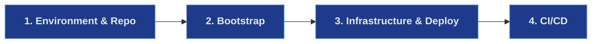

# Bootstrap Plan

The path from an empty clone of this starter kit to a live, deployed client instance, grouped into 4 stages.



---

## Stage 1 — Environment & Repo

Entirely manual, done by the developer **before** invoking `/bootstrap-client` — this skill starts from Stage 2. Covers prerequisites, environment, creating the new repo, and detaching it from this starter kit's own history.

### Prerequisites

Install Node `>=24`, Yarn 4, and the GitHub CLI — later stages (repo creation, Discussions, giscus IDs, CI/CD variables) all run through `gh`.

```bash
nvm install 24       # installs and switches to Node 24
corepack enable       # activates Yarn 4 via the packageManager field
yarn install          # installs all workspace deps
brew install gh       # GitHub CLI
gh auth login         # authenticate gh — required before any gh command below
```

→ See `docs/Engineering Guide/05 Getting Started.md`

### Environment

```bash
cp .env.example .env   # scaffold your local env file
# edit .env with your credentials
source .env && claude  # load credentials into the shell, then launch Claude Code
```

→ See `docs/Engineering Guide/06 MCP Setup.md`

### Empty git repo

```bash
gh repo create {org}/{repo} --private   # creates the empty client repo on GitHub
```

### Initial commit — detach from this starter kit

Reset to a single fresh commit — don't carry this starter kit's own development history (bootstrap tooling commits, etc.) into the client's repo — then repoint `origin` and push.

```bash
git clone https://github.com/DataArt/adlc-discovery-tool.git   # clone the starter kit itself
cd adlc-discovery-tool
git checkout --orphan client-init                          # new branch with no commit history
git add -A
git commit -m "chore: initial commit — starter kit"        # single commit holding the whole starter kit
git branch -D main                                          # drop old main (still had this tool's own history)
git branch -m main                                           # rename client-init to main
git remote remove origin                                    # detach from this tool's own repo
git remote add origin git@github.com:{org}/{repo}.git       # point at the new client repo
git push -u origin main                                     # push the fresh single-commit history
```

**Alternative — via GitHub UI (covers repo creation + initial commit in one action):** if `adlc-discovery-tool` is marked as a template repository (https://github.com/DataArt/adlc-discovery-tool), GitHub can do the empty-repo creation and the fresh-history reset for you:

1. Go to `https://github.com/DataArt/adlc-discovery-tool`
2. Click **Use this template → Create a new repository**
3. Set the owner and repo name, choose **Private**, click **Create repository**

GitHub creates the new repo with a single fresh commit — no CLI, no orphan-branch steps needed. Then just clone it locally:

```bash
git clone git@github.com:{org}/{repo}.git
cd {repo}
```

**How the skill verifies this stage is done:** `git remote -v` no longer points to `DataArt/adlc-discovery-tool` — see `pattern-run-and-validate.md` for why this specific check is safe for Claude to run directly rather than asking the developer to paste it (local, read-only).

---

## Stage 2 — Bootstrap

Run inside Claude Code:

```
/bootstrap-client
```

Collects client identity (name, org prefix, AWS region/location code, GitHub org/repo), applies everything deterministically via `scripts/bootstrap/bootstrap-client.mts`, optionally drafts the narrative "story" sections, and wires up GitHub Discussions/giscus comments.

→ See `SKILL.md` for the full Q&A flow (this _is_ that flow — Stage 2 of the orchestrator delegates straight into it)

### Repo Discussions (part of Stage 2)

```bash
gh api repos/{org}/{repo} -X PATCH -f has_discussions=true   # turns on the Discussions tab
```

**Alternative — via GitHub UI:** repo → **Settings → General → Features** → check **Discussions**.

Then, via the browser regardless of which path above you took (no CLI equivalent for either):

1. Install the giscus GitHub App (https://github.com/apps/giscus), scoped to `{org}/{repo}`.
2. Create a Discussions category for comments — Announcements format, so only maintainers/giscus start new top-level discussions (repo → Discussions tab → "New category"). Note the category name — you'll need it below.

**Private repos — no UI path for the giscus IDs.** giscus.app's own configuration wizard needs public visibility to auto-detect a repo, and GitHub's embedded GraphQL Explorer no longer exists. Capture both IDs via the authenticated GraphQL API instead:

```bash
gh api graphql -f query='
  query {
    repository(owner: "{org}", name: "{repo}") {
      id
      discussionCategories(first: 10) {
        nodes { id name }
      }
    }
  }
'
```

`repository.id` → `GISCUS_REPO_ID`. Match the category name you created above against `discussionCategories.nodes` → that node's `id` → `GISCUS_CATEGORY_ID`.

→ See `docs/Engineering Guide/Infrastructure/04 Giscus Setup.md` if this was skipped and needs doing later, outside the bootstrap flow.

---

## Stage 3 — Infrastructure & Deploy

Prerequisite — this stage's commands run in your own terminal (not the one that launched Claude Code), so `AWS_PROFILE` isn't set here yet even if you already ran Stage 1's `source .env` elsewhere.

```bash
ls .env || cp .env.example .env   # create it if Stage 1 never did — then fill in AWS_PROFILE (and friends) before continuing
source .env                        # loads AWS_PROFILE into this terminal
aws sso login --profile "$AWS_PROFILE"                 # opens a browser, refreshes SSO credentials
aws sts get-caller-identity --profile "$AWS_PROFILE"   # confirms the session is valid — should print an Account/Arn, not an error
```

If `cdk bootstrap`/`cdk provision` fail with "Unable to resolve AWS account to use," this is almost always why — either `.env` was never created, or `$AWS_PROFILE` is unset in whatever terminal ran the command.

→ See `docs/Engineering Guide/06 MCP Setup.md` (AWS section)

### OIDC provider check (before provisioning)

The GitHub Actions OIDC provider (`token.actions.githubusercontent.com`) is an AWS-account-wide singleton — `infra:provision:dev` deploys `CiStack`, which fails with `EntityAlreadyExistsException` if the provider already exists in this account and `CREATE_OIDC_PROVIDER` is left at its default `true`.

```bash
aws iam list-open-id-connect-providers --profile "$AWS_PROFILE"   # confirms whether the provider already exists in this account
```

- No `token.actions.githubusercontent.com` ARN in the output → fresh account, leave `CREATE_OIDC_PROVIDER` unset in `apps/infra/.env.dev` (defaults to `true`).
- ARN present → another client/org sharing this account already provisioned it. Set `CREATE_OIDC_PROVIDER=false` in `apps/infra/.env.dev` before provisioning.

```bash
yarn nx run infra:bootstrap:dev        # one-time per AWS account/region — provisions the CDK toolkit stack
yarn nx run infra:provision:dev        # creates CloudFront, S3, Lambda@Edge IAM roles, Secrets Manager secret
yarn nx run infra:output:dev           # prints stack outputs (distribution ID, bucket name, etc.)
# copy printed outputs into apps/lambda-auth/.env.dev and apps/docs-web/.env.dev
# CF_DISTRIBUTION_ID specifically must be set in BOTH files — it's the one value
# left blank when Stage 2's bootstrap script scaffolded them, since it's only
# known once CloudFront actually exists. lambda-auth needs it to restore the
# CloudFront association on deploy; docs-web needs it for cache invalidation.
yarn nx run infra:env-push:dev         # writes infra's .env.dev to SSM Parameter Store
yarn nx run lambda-auth:env-push:dev   # writes lambda-auth's .env.dev to SSM Parameter Store
yarn nx run site:env-push:dev          # writes docs-web's .env.dev to SSM Parameter Store

# sm-push reads apps/lambda-auth/.secrets.dev, not .env.dev — generate the password hash first
cp apps/lambda-auth/.secrets.example apps/lambda-auth/.secrets.dev   # if it doesn't already exist
node -e "const{createHash}=require('crypto');console.log(createHash('sha256').update('your-password').digest('hex'))"
# paste the printed hash into DOCS_BASIC_AUTH_HASH= in apps/lambda-auth/.secrets.dev

yarn nx run lambda-auth:sm-push:dev    # writes the basic-auth password hash to Secrets Manager
```

`infra:bootstrap` and `infra:provision` are guarded commands — always run manually by the developer, never by Claude.

→ See `docs/Engineering Guide/Infrastructure/01 Local Provisioning Runbook.md`

### Deployment

```bash
yarn nx run lambda-auth:deploy:dev   # builds, zips, uploads the auth handler; restores the CloudFront association
yarn nx run site:deploy:dev          # builds the VitePress site and syncs it to S3
```

Auth handler deploys _before_ the site — restores the basic-auth gate before content becomes reachable. See `docs/Engineering Guide/Infrastructure/02 Deploy Lifecycle.md` for why the order matters. Subsequent deploys only need to re-run the target(s) for what actually changed.

---

## Stage 4 — CI/CD

The pipeline itself (`.github/workflows/ci.yml`, `cd.yml`, `.github/actions/aws-auth`) already ships with the starter kit — nothing to build here. This stage wires this instance's values into the repo's GitHub Actions `dev` environment so those workflows can authenticate via OIDC and find their config.

`IAM_ROLE_ARN` comes from `CiStack`'s own output:

```bash
yarn nx run infra:output-ci:dev   # prints CiStack's DeployRoleArn
```

Create the `dev` environment (if it doesn't already exist) and set its variables:

```bash
gh api repos/{org}/{repo}/environments/dev -X PUT   # creates the "dev" environment

gh variable set IAM_ROLE_ARN --env dev --repo {org}/{repo} --body "{value from infra:output-ci:dev}"
gh variable set AWS_REGION --env dev --repo {org}/{repo} --body "{value from apps/infra/.env.dev}"
gh variable set SITE_SSM_ENV_PARAM --env dev --repo {org}/{repo} --body "/{org_prefix}/dev/docs/site/env"
gh variable set LAMBDA_AUTH_SSM_ENV_PARAM --env dev --repo {org}/{repo} --body "/{org_prefix}/dev/docs/lambda-auth/env"
```

No bucket names, distribution IDs, or function names go here — those stay in SSM and are fetched at runtime by each deploy script.

→ See `docs/Engineering Guide/Infrastructure/03 CI-CD Pipeline.md`
