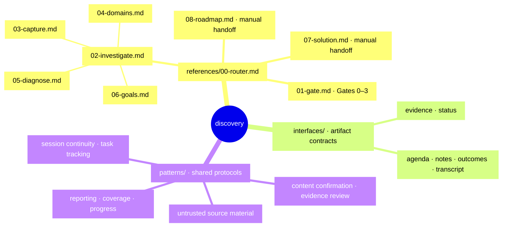

## Input

$ARGUMENTS

## Route

Parse an optional leading command; preserve the remaining input as the subject,
source material, or session instructions. Load only the selected reference from
[references/00-router.md](references/00-router.md).

- `gate {0-3} {input}` — one gate; pass the number and remaining input to the reference.
  A missing number is resolved from engagement state; reject numbers outside 0–3.
- `investigate {input}` — one Investigate session, selecting its work from coverage.
- `capture|domains|diagnose|goals {input}` — only that Investigate unit.
- `solution|roadmap {input}` — the corresponding documented manual handoff (still stubs).
- No command — run/resume the full engagement chain below. Free-form input is valid;
  ask only if an apparent command is ambiguous.

The former `/discovery-*` skills are retired. All discovery stages are references
inside this skill, selected through the routes above.

## Skill structure



This is the skill's file structure; all stages are references within this one skill.
The engagement sequence is Gate 0 → Investigate → Gate 1 → Solution → Gate 2 →
Roadmap → Gate 3. Load the selected branch, not every file in the diagram.

## Shared contracts

- This is one standing engagement, with no ticket, story folder, archive, or new
  `Report.md`. Durable state is `docs/AI SDLC/01 Engagement/04 Where We Are/`.
- Process authority: `docs/AI SDLC/01 Engagement/03 Process/01 Overview.md`,
  `02 Terminology.md`, `03 How the Engagement Runs.md`, and `04 Evidence Chain.md`.
  Consult the relevant document when its terminology or decision rule is needed;
  do not preload the whole process tree.
  Resolve abbreviated engagement artifact paths beneath `docs/AI SDLC/`.
- Preserve source citations, the Problem status ladder, immutable Claims, and
  stakeholder decision evidence. A prepared package or a file's existence never
  proves approval or phase completion.
- Apply [patterns/session-continuity.md](patterns/session-continuity.md) and
  [patterns/task-tracking.md](patterns/task-tracking.md) on every entry.
- References own artifact confirmation, review, and reporting through
  [patterns/write-confirm.md](patterns/write-confirm.md),
  [patterns/satellite-review.md](patterns/satellite-review.md), and
  [patterns/do-report-commit.md](patterns/do-report-commit.md).
  These patterns own their respective checkpoints; references identify where they apply.
- Direct entry returns after its requested unit. It may recommend the next command,
  but must not automatically start its parent phase or a gate. This return contract
  applies to all stage references.
- Use the artifact contracts in [interfaces/](interfaces/), loading only those
  relevant to the selected reference. They define required meaning and evidence;
  choose the composition to fit the artifact rather than copying a fixed layout.

## Resume detection

Read `01 Engagement.md` in the state directory and the relevant phase page:
`02 Investigate.md`, `03 Solution.md`, or `04 Roadmap.md`. Check the cited artifacts
and latest `05 Report Log.md` entries, including flagged items and unfinished work.

For direct entry, report the selected unit's state and check its prerequisites;
never silently change the requested stage. An explicitly requested correction can
reopen an item; a closed gate otherwise remains closed.

For full entry:

| State                      | Next unit                                                       |
| -------------------------- | --------------------------------------------------------------- |
| Gate 0 open                | Gate 0                                                          |
| Gate 0 closed; Gate 1 open | Investigate, or Gate 1 if coverage is clear                     |
| Gate 1 closed; Gate 2 open | Solution, or Gate 2 if substantive reviewed artifacts are ready |
| Gate 2 closed; Gate 3 open | Roadmap, or Gate 3 if the plan is ready for review              |
| All gates closed           | Verify Completion below                                         |

Present the evidence-backed status and resume point. If input already requests that
work, proceed. Ask when the recorded state conflicts with the requested work or a
session subject/source is missing. Do not restart completed work by default.

## Full chain

Track Gate 0 → Investigate → Gate 1 → Solution → Gate 2 → Roadmap → Gate 3.
At each transition show:

```
🚦 Gate 0 [status] · 🔍 Investigate [status] · 🚦 Gate 1 [status] · 🔧 Solution [status] · 🚦 Gate 2 [status] · 🗺️ Roadmap [status] · 🚦 Gate 3 [status]
```

Use `🔄` active, `✅` evidenced complete, `⏳` pending. Describe blockers alongside
this banner. Run the matching reference, persist its outcome, then announce progress
with [patterns/announce-progress.md](patterns/announce-progress.md).

Investigate loops per domain/session; apply
[patterns/coverage-check.md](patterns/coverage-check.md) before Gate 1. Completing
one workshop or diagnose pass is not completion of Investigate.

Gates prepare materials and record actual human outcomes. Pause while required
inputs or stakeholder decisions are pending. Never infer approval from silence.
Solution and Roadmap remain manual handoffs: report missing artifacts and the next
action, then end the session. Resume at their closing gate only when actual artifacts
and prerequisites support it; never skip a stub as if it completed successfully.

## Corrections

A flag at any gate returns to the unit that originated the item. Record the flag,
reopen that work, and mark affected downstream readiness for revalidation in the
standing status pages. Reprocess the affected evidence chain before rerunning the
flagging gate. Strategic Intent is validated, grounded, or re-scoped with recorded
reason; it is not recaptured as a new kickoff. Preserve historical decisions.

## Completion

Report engagement complete only when all four gates have recorded closure evidence,
no unresolved flags invalidate them, and the Roadmap's reviewed delivery plan exists.
Keep `01 Engagement/04 Where We Are/` and its append-only `05 Report Log.md` as the
historical record. Otherwise report the remaining work and precise resume command.
