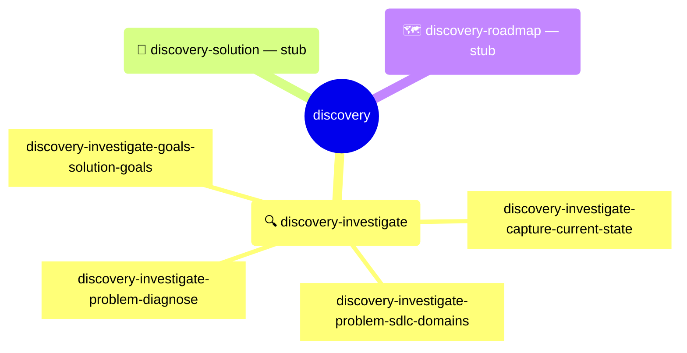

The engagement lead wants to progress the [[CLIENT_NAME]] discovery engagement. Here is their input:

---

## $ARGUMENTS

---

This command orchestrates the full engagement arc defined in `docs/AI SDLC/01 Process/01 Overview.md`: **Initiation (Gate 0) → Investigate → Gate Review (Gate 1) → Solution → Solution Approval (Gate 2) → Roadmap → Final Sign-off (Gate 3)**, per `03 How the Engagement Runs.md`.

> ⚠️ Follow every step in order. Do not skip, summarize, or improvise. If you are unsure, ask before deviating.

> 🗂 **No per-ticket folder.** This orchestrates one standing engagement, not a ticket that completes and archives. State lives in `docs/AI SDLC/01 Process/06 Where We Are/` — that tree _is_ the report; there is no separate `Report.md` to create.

> 🔁 **Session continuity** (`.claude/skills/discovery/pattern-session-continuity.md`): if resuming after context compaction, re-read this full SKILL.md before doing anything.

---

## Skill Hierarchy

This root delegates to a phase skill per phase; `discovery-investigate` further delegates to one stage skill per Investigate workflow doc. `discovery-solution`/`discovery-roadmap` are stubs today — no stage skills under them yet.



This is a tooling map, not a process diagram — for the Phase/Stage/Artifact process this executes, see `01 Process/01 Overview.md` and `02 Terminology.md`.

---

## Resume Detection (run first, every time)

**Step 1** — Read `docs/AI SDLC/01 Process/06 Where We Are/01 Engagement.md`'s gate table. The first gate not marked Closed is where the engagement stands.

**Step 2** — Read the phase-specific status page for more detail: `02 Investigate.md` if Gate 0 is closed and Gate 1 isn't, `03 Solution.md` if Gate 1 is closed and Gate 2 isn't, `04 Roadmap.md` if Gate 2 is closed and Gate 3 isn't.

**Step 3** — Present status and confirm:

> "[[CLIENT_NAME]] discovery is at **{gate/phase}**. `{phase tracker banner}`
>
> Continue from here? Type **yes**, or name a specific phase/gate to jump to."

**Stop and wait.**

---

## Phase tracker

```
🚦 Gate 0 [status] · 🔍 Investigate [status] · 🚦 Gate 1 [status] · 🔧 Solution [status] · 🚦 Gate 2 [status] · 🗺️ Roadmap [status] · 🚦 Gate 3 [status]
```

Where `[status]` is: `🔄` (active) · `✅` (closed/done) · `⏳` (pending)

> [!NOTE] Any gate can flag an item and fall back to where it originated
> Not just Gate 1. Per `03 How the Engagement Runs.md`, closing a gate is never final in the sense of being unreviewable — Gate 2 or Gate 3 can just as easily flag something that traces back to a Problem, an SDLC Domain, or even Strategic Intent as Gate 1 can. When that happens: re-open the flagged item at whichever stage or phase actually originated it (run the matching `discovery-investigate-*`/`discovery-solution-*`/`discovery-roadmap-*` skill again for that item), then reprocess forward through every layer downstream of it before re-running the gate that flagged it. This is the normal correction path, not an exception — each gate section below names it inline only where the concrete steps differ; the mechanism itself is this one.

---

## Gate 0 — Initiation

> Skip if `01 Engagement.md` shows Gate 0 Closed. Runs once, ever — Strategic Intent is never re-captured after this, only validated (by Investigate) or grounded and re-scoped (by Gate Review), per `04 Evidence Chain.md`.

Follow `01 Process/07 Workflows/01 Initiation.md` directly — the root owns gate mechanics, no phase skill sits under Gate 0:

1. **Capture** — draft Strategic Intent close to verbatim from `$ARGUMENTS` (sales notes, RFP, kickoff transcript) or ask the engagement lead for it. `04 Goals/02 Strategic Intent.md`'s Illustrative Patterns are a starting prompt, not a checklist.
2. **Review → publish** — present the draft to whoever's sponsoring the engagement for a light sanity check (not a workshop); publish by editing `04 Goals/02 Strategic Intent.md` directly and adding a `## Changelog` row.
3. **Derive Early Direction** — draft the likely pilot domain / known constraints / stated aspirations the same intake conversation signalled, into `05 Solution Space/index.md#early-direction` as an explicit, labelled hypothesis. Its Changelog row cites the Strategic Intent entries it derives from.

Apply `pattern-do-report-commit.md`. Apply `pattern-announce-progress.md`, then:

> "Ready to start Investigate? Type **yes** to continue, or **no** to stop here and resume later with `/discovery-investigate`."

---

## Phase 1 — Investigate

> Skip if `pattern-coverage-check.md` already reports coverage clear and Gate 1 is closed.

Follow the `/discovery-investigate` skill exactly — it loops its 3 stages (Capture, Problem, Goals) until `pattern-coverage-check.md` reports coverage clear.

On return: apply `pattern-announce-progress.md`, then:

> "Investigate coverage is clear. Ready to run Gate Review? Type **yes** to continue, or **no** to stop here and resume later with `/discovery` (it will re-detect this state)."

---

## Gate 1 — Gate Review

> Skip if `01 Engagement.md` shows Gate 1 Closed.

Follow `01 Process/07 Workflows/02 Gate Review.md`. This is a **manual session** — the root's job is to assemble the package and record the outcome, not conduct the session autonomously:

1. **Assemble** — consolidate confirmed Problems, Current State, and any Solution Goals drafted mid-Investigate into one package (not a scatter of page links).
2. **Satellite review** — apply `pattern-satellite-review.md` to the assembled package before it goes to stakeholders.
3. **Align + prioritise** — rank Problems by impact; drop any Solution Goal with no diagnosed Problem behind it.
4. **Score fit** — map each surviving Solution Goal back to the Strategic Intent entry it traces to.
5. **STOP** and present:

   > "Present this package to stakeholders (online or offline — not an async approval). Reply with the outcome: **approved** (findings hold, fit is acceptable) or **flagged: `<items>`** (re-evaluation needed)."

6. **On the reply** — exactly one of:
   - **Approved** → mark the surviving Problems and Solution Goals Confirmed + Changelog. Gate 1 closes.
   - **Flagged** → apply the loop-back note above for each flagged item, then re-run this gate once every flagged item is re-addressed.

Apply `pattern-do-report-commit.md`. Apply `pattern-announce-progress.md`, then:

> "Gate 1 closed. Ready to start Solution? Type **yes** to continue, or **no** to stop here."

---

## Phase 2 — Solution _(stub)_

> Not yet implemented. `/discovery-solution` currently points at `01 Process/07 Workflows/04 Solution/00 Overview.md` and hands the three flows (Target State, Pilot, Scale) to the engagement lead to run manually — Pilot's `/design` step already exists and works today.

---

## Gate 2 — Solution Approval _(stub)_

> Closing criteria are defined in `03 How the Engagement Runs.md` — Target State, Pilot, and (where run) Scale designs published and reviewed. Record the outcome manually in `01 Engagement.md` until `/discovery-solution` is built out. The loop-back note above still applies here — a flagged item can trace all the way back to Investigate, not just to Solution's own artifacts.

---

## Phase 3 — Roadmap _(stub)_

> Not yet implemented. `/discovery-roadmap` currently points at `01 Process/07 Workflows/05 Roadmap/00 Overview.md` and hands Milestones/WBS/Team Composition/Timeline to the engagement lead to run manually.

---

## Gate 3 — Final Sign-off _(stub)_

> Closing criteria are defined in `03 How the Engagement Runs.md` — Milestones, WBS, team composition, and Timeline sequenced. Record the outcome manually in `01 Engagement.md` until `/discovery-roadmap` is built out. The loop-back note above still applies — the same rule, one gate further down the chain.

---

## Completion

When Gate 3 closes:

> 🎉 **[[CLIENT_NAME]] discovery engagement complete.**
>
> 🚦 Gate 0 ✅ -> 🔍 Investigate ✅ -> 🚦 Gate 1 ✅ -> 🔧 Solution ✅ -> 🚦 Gate 2 ✅ -> 🗺️ Roadmap ✅ -> 🚦 Gate 3 ✅
>
> The delivery plan in `06 Roadmap/` is what [[CLIENT_NAME]] staffs and funds against. `01 Process/06 Where We Are/` remains the historical record — `05 Report Log.md` has the full session-by-session trail.
