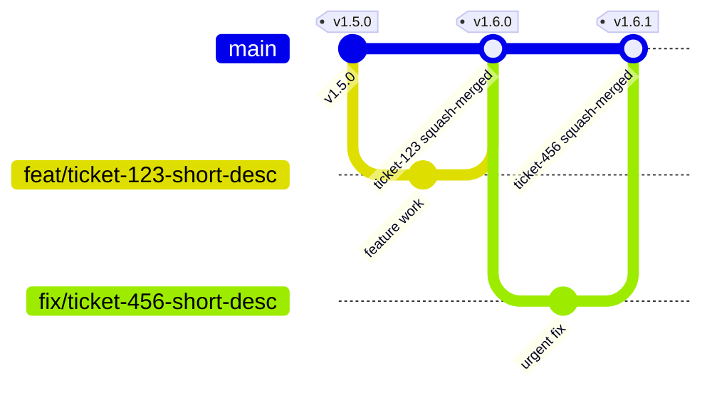

# Branching Strategy

The branching workflow is **trunk-based**, aligned with the project's actual CI/CD automation (a
pull-request-triggered CI workflow, a merge-to-`main`-triggered CD workflow). There is one
long-lived branch — `main` — and all work happens on short-lived branches cut from it and merged
straight back in. Nothing reaches Production without passing through the PR's required CI checks
first.

## Flow

Each merge commit needs its own custom `id` — Mermaid's `gitGraph` rejects a duplicate commit id
across the whole diagram, so reusing a generic label like `"PR squash-merged"` for every merge will
fail to render; scope the id to the actual branch or ticket.

## Environment Mapping

| Branch Type        | Environment Target | Notes                                                                        |
| ------------------- | ------------------ | ----------------------------------------------------------------------------------- |
| `main`              | Auto-deploy target  | Every merge triggers the CD workflow; deploy only what actually changed              |
| `feat/*` / `fix/*`  | None (PR only)      | Validated by the CI workflow; no preview environment is provisioned per branch       |

If the project has no separate `develop`/`release`/`staging` branch or environment yet, say so
explicitly here rather than letting a reader assume a promotion chain exists. A production-grade
promotion chain (Dev → Staging → Prod) is a reasonable future addition, not a default.

## Naming Conventions

- **Branches:** `feat/<ticket>-<short-desc>`, `fix/<ticket>-<short-desc>`, `chore/<short-desc>`,
  `docs/<short-desc>` — match whatever `<type>/short-description` format the project's conventions
  doc already defines
- **Tags:** `vX.Y.Z` — created automatically by a release automation tool on merge to `main`, never
  by hand, if the project has one configured
- **Commits:** [Conventional Commits](https://www.conventionalcommits.org/en/v1.0.0/#summary) —
  required if commit messages drive automated versioning

## CI/CD by Branch

| Trigger               | Runs                                                                                                                                       |
| ---------------------- | -------------------------------------------------------------------------------------------------------------------------------------------- |
| `feat/*` / `fix/*` PR  | CI workflow — audit, lint, typecheck, test, build for affected projects, scoped against the base branch                                     |
| `main` merge           | CD workflow — deploy for affected projects; release automation (if configured) tags the version                                              |
| Hotfixes               | No separate branch type — a `fix/*` branch off `main`, same PR gate, same deploy path. Speed comes from the pipeline being fast, not from bypassing it |

## Branch Protection

| Branch | Restrictions                                                                                                          |
| ------ | -------------------------------------------------------------------------------------------------------------------------- |
| `main` | Direct pushes disabled; at least one Code Owner approval required (`.github/CODEOWNERS`); squash merge only; no force-push |

Required status checks before merge should mirror whatever the CI workflow actually runs (lint,
typecheck, test, build, audit) — don't require a check the pipeline doesn't produce. Stale approvals
dismissed on new commits and all PR conversations resolved are reasonable defaults.

## Rollback Strategy

If every production deployment is tagged (e.g. `vX.Y.Z`), any environment can be restored to a known
stable state without code changes:

1. Check out the target tag.
2. Run the deploy target for all affected apps (or a scoped subset).
3. CI/CD rebuilds and redeploys that exact tag across environments, using previously validated
   artifacts — no code modification required.

State this only if it's actually true for the project (tags exist, deploy is idempotent and
artifact-driven). If the project has a database or other stateful dependency, say explicitly
whether this rollback strategy covers it or whether a separate schema-rollback mechanism is needed
— don't let a reader assume artifact-based rollback is the whole story when it isn't.

## Related

- The project's own conventions doc — for the full branch/commit naming format
- The project's own CI/CD pipeline documentation — the actual workflow implementation this doc
  describes
- The project's own deploy lifecycle documentation — how each merge actually builds and deploys
