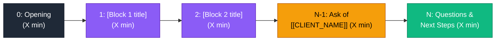

# [DRAFT] Gate {N} ({Gate Name}) Agenda — [DATE]

_[[CLIENT_NAME]] × DataArt ADLC discovery — Gate {N}'s [{Gate Name}](/AI%20SDLC/01%20Process/03%20How%20the%20Engagement%20Runs.md#the-four-gates) session. [One line: what kind of session this is — a formal leadership-level recap, a working review.]_

**Audience:** [Names/roles — who needs to be in the room]

**Format:** [One line: the session's shape, e.g. "recap → decision points → what we need next"]

**Source:** [What internal sync or prior conversation this agenda's shape was agreed in, if any — omit this line if there wasn't one]

**Duration:** [Target, e.g. "Roughly 60 minutes" — same time-boxing discipline as other ADLC sessions; name which block compresses first if time runs short]

**Pre-read:** [Whether materials go out in advance, to whom, and why]

---

## Session Flow

_Add or drop blocks to match what this gate actually needs to cover — the fixed points are Opening (always first), the Explicit Ask (always second-to-last), and Questions & Next Steps (always last)._

---

## 0. Opening and Purpose of the Session (X min)

- [Why we're here]
- [What we need from this meeting]
- [Format note — short, to the point, room for questions]

## 1. [Block 1 — Recap or decision topic] (X min)

- [Content, cited to the artifact it recaps]
- **Check question for the audience:** [FILL_ME]

## 2. [Block 2 — Recap or decision topic] (X min)

- [Content, cited to the artifact it recaps]
- **Check question for the audience:** [FILL_ME]

_(repeat as many numbered blocks as this gate's package actually has content for — don't pad, don't compress two distinct decisions into one block)_

## N-1. What We Need From [[CLIENT_NAME]] (Explicit Ask) (X min)

- [Ask 1 — concrete, with what happens if it isn't met]
- [Ask N]

## N. Questions and Next Steps (X min)

- Open questions from the audience.
- Lock in agreements and owners for each item in the Ask block.
- Confirm the next milestone/session date.

---

## Preparation Notes

- [Who's preparing materials, and by when]
- [Delivery format — deck / PDF / live walkthrough]
- **Deck:** [Path under `decks/<deck-name>/` once generated via `deck-design-corporate`, or "not requested for this session"]
