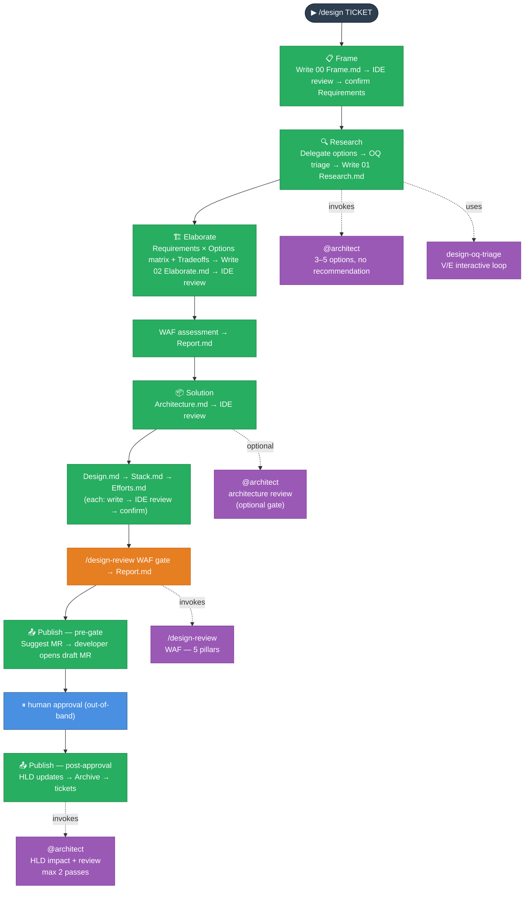

# Design Lifecycle — Frame → Research → Elaborate → Solution → Publish

_Produces an approved architectural design before implementation begins._

---

## Intent

The Design lifecycle front-loads the hard thinking. It frames the problem, researches options without bias, surfaces trade-offs across WAF pillars, makes a falsifiable recommendation, specifies integration and security detail, runs a WAF gate, and requires out-of-band human approval before any code is written.

The output is a `solution/` folder that serves as the implementation spec for the Dev tickets created at Publish.

---

## When to use it

- Ticket is large or spans multiple sprints
- A new container or integration is being introduced
- Non-functional concerns (security, reliability, cost) are meaningfully affected
- The team is uncertain about the right approach

## When NOT to use it

Small, well-understood changes within a single container that introduce no new integrations or architecture decisions. Use `/dev` directly.

---

## Flow

## Phases

**Orchestrator:** `/design <TICKET>` — runs all five phases in one session, stopping at each boundary for confirmation. Bail out at any point and resume with the individual command. Publish has two entry points: the pre-gate session opens the draft MR; the post-approval session runs after out-of-band human approval.

| Phase         | Individual command           | What it produces                                                                                       |
| ------------- | ---------------------------- | ------------------------------------------------------------------------------------------------------ |
| **Frame**     | `/design-frame <TICKET>`     | Problem statement, known + proposed requirements, boundaries → `design/00 Frame.md`                    |
| **Research**  | `/design-research <TICKET>`  | 3–5 neutral options via `@architect` — no recommendation → `design/01 Research.md`                     |
| **Elaborate** | `/design-elaborate <TICKET>` | Requirements × Options matrix, tradeoffs, recommendation, WAF assessment → `design/02 Elaborate.md`    |
| **Solution**  | `/design-solution <TICKET>`  | Certainty-principle artifacts → `solution/Architecture.md`, `Design.md`, `Stack.md`, `Efforts.md`      |
| **Publish**   | `/design-publish <TICKET>`   | Pre-gate: draft MR opened, session pauses. Post-approval: HLD updated, tickets created, story archived |

---

## Invariants

**Frame:** Requirements must include both known (from ticket) and proposed (gaps found by AI — NFRs, observability, GDPR). Proposed requirements are labelled `[proposed]` and must be explicitly accepted or rejected by the developer before the phase saves. These requirements become the evaluation criteria rows in the Requirements × Options matrix during Elaborate.

**Research:** `@architect` returns options only — no recommendation. At least one "minimal change" option and at least one industry-standard approach must be included. No judgment is made here. Open questions from `@architect` are triaged interactively — one at a time — as **(V) Viability** (would disqualify an option) or **(E) Elaboration-input** (affects cost/detail only). All `(V)` OQs must be resolved before Research saves. See `pattern-design-oq-triage.md`.

**Elaborate:** Every requirement from `00 Frame.md` and every WAF pillar must be addressed. The recommendation must be falsifiable: it states which assumption, if wrong, would change the recommendation. Open questions are resolved with the developer before Solution begins. A closing WAF assessment runs on the recommended option only. `02 Elaborate.md` is written to disk for IDE review before the WAF assessment runs.

**Solution:** Certainty principle applies. `solution/` files contain only settled decisions and their direct consequences — no rationale, no rejected alternatives, no open questions. Each file is written to disk for IDE review as it is completed. After `Architecture.md` is confirmed, an optional `@architect` read-only review gate checks structural completeness before `Design.md` is started (see `pattern-design-architect-review.md`). A `/design-review` WAF gate runs after all four files are confirmed. `Efforts.md` must include an Operational Costs section (ongoing infra consumption at expected scale). These files drive HLD updates (Publish) and implementation (`/dev`).

**Publish (pre-gate):** The AI suggests the MR title/body but does not open it. The developer opens the MR and pastes the URL. Session ends here.

**Publish (post-approval):** The AI does not approve its own gate. A human must approve the MR out-of-band. `@architect` identifies HLD docs that need updating; the AI applies updates and `@architect` reviews (max 2 passes). Archive and ticket creation happen after the HLD review is clean.

---

## Patterns

Patterns are shared multi-step protocols co-located in `.claude/skills/design/`. They are not registered in `AGENTS.md` — each workflow skill loads them on-demand via explicit path reference.

| Pattern                             | File                                 | What it enforces                                                                                      | Applied in                                                                  |
| ----------------------------------- | ------------------------------------ | ----------------------------------------------------------------------------------------------------- | --------------------------------------------------------------------------- |
| **do → report → commit** _(design)_ | `pattern-do-report-commit.md`        | Update Report.md tracker → append Efforts row → present commit → STOP → announce next phase           | End of every phase (Frame, Research, Elaborate, Solution, Publish)          |
| **announce-progress** _(design)_    | `pattern-announce-progress.md`       | `✅ Done / 📋 After this phase` at every phase boundary                                               | `design/SKILL.md` phase transitions; `pattern-do-report-commit.md` step 4   |
| **design-oq-triage**                | `pattern-design-oq-triage.md`        | Two-tier OQ classification (V/E), interactive one-at-a-time loop, persist as Assumptions in Report.md | Research Step 3b, Elaborate Step 1b                                         |
| **design-architect-review**         | `pattern-design-architect-review.md` | `@architect` read-only gate after Architecture.md; max 2 iterations; excludes HLD doc gaps from scope | Solution Step 2b                                                            |
| **satellite-review** _(design)_     | `pattern-satellite-review.md`        | `@architect` read-only reviewer of design artifacts; OK / corrections; max 2 iterations               | Solution Step 2b (via `pattern-design-architect-review.md`), Publish Step 7 |
| **write-confirm** _(design)_        | `pattern-write-confirm.md`           | Write file to disk before asking for approval; developer reviews in IDE; iterate until confirmed      | All phases (per artifact)                                                   |
| **session-continuity** _(design)_   | `pattern-session-continuity.md`      | Re-read SKILL.md on resume; re-read orchestrator on phase exit (Publish: lifecycle closed)            | All five phase skills                                                       |

---

## What lives where

| Content                        | Lives in                                                    |
| ------------------------------ | ----------------------------------------------------------- |
| Options, trade-offs, rationale | `Stories/<TICKET>/design/` — never graduates                |
| WAF assessment                 | `design/Report.md` WAF section — never graduates            |
| Chosen approach (outcome only) | `Stories/<TICKET>/solution/` → drives HLD update at Publish |
| Implementation spec            | `Stories/<TICKET>/solution/` → guides Dev tickets           |
