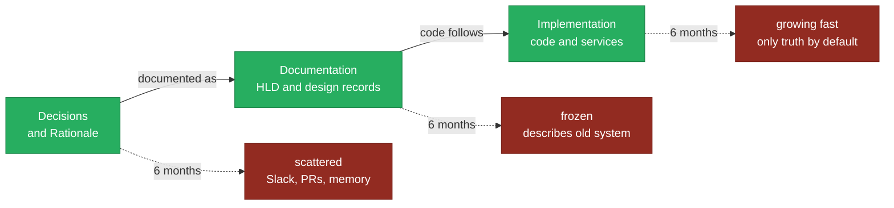
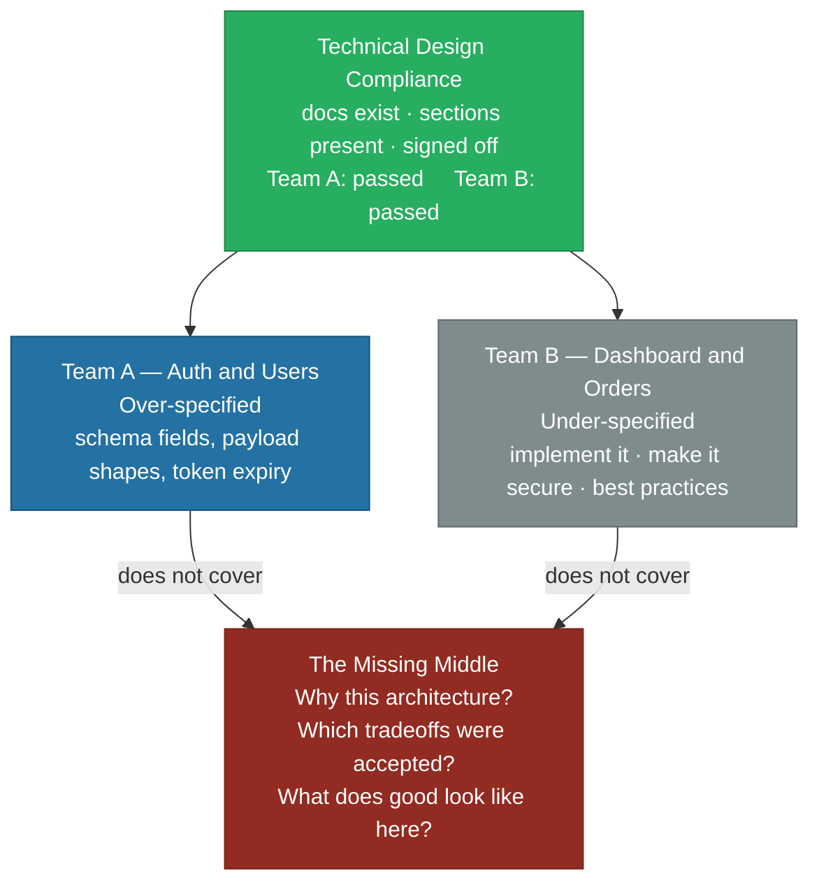
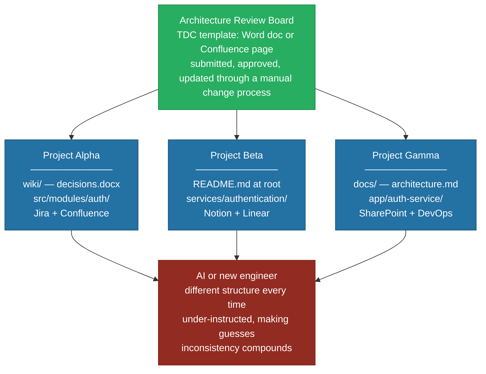
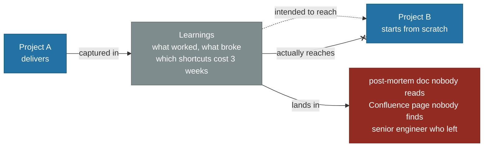
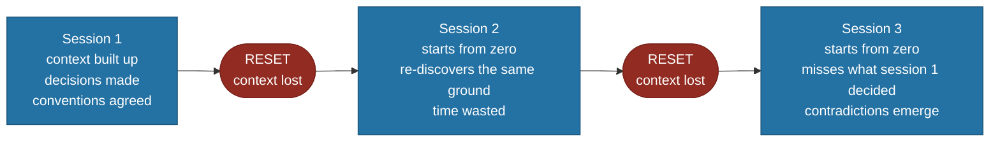

# The Real Problem: Context

Think about onboarding a new engineer. You would give them:

- the system architecture — how the product is designed and why
- the team conventions — how things are done here, not just anywhere
- the current state — what has been built, what has diverged, what is still pending
- a scoped task — one ticket, not the whole backlog

Without that onboarding, a senior engineer will still produce output — fast, confident, and inconsistent. They will contradict decisions already made, miss conventions already established, and lose thread between sessions.

**An AI assistant has exactly the same problem.** Every session starts from zero. It has no memory of your architecture decisions, no awareness of your conventions, and no connection to your documentation. Execution is fast. Direction is absent.

The fix is the same as with a new colleague: structured onboarding, maintained context, and a shared source of truth that stays current as the project evolves.

---

## Problem 1 — The Drift

> **By the time a system is mature:** decisions live in Slack, implementation is the only thing that's current, and documentation describes a system that no longer exists.

This is not a new problem. It exists on every project, with or without AI.

The gap between all three compounds over time. Decisions made six months ago are invisible. The documentation describes a system that no longer exists. Implementation becomes the only source of truth — by accident, not by design.

This is the environment an AI assistant inherits every session.

A human engineer at least carries some of that history in memory. An AI starts from zero — and if the context it receives is stale, partial, or contradictory, its output will be too. Fast, confident, and wrong in ways that are hard to trace back.

---

## Problem 2 — The Uneven Depth

> **Over-documented where it doesn't matter. Silent where it does.**

Meet the customer portal. Two teams. Both have docs in Confluence. Both passed Technical Design Compliance.

| Area               | Team A wrote                            | Team B wrote              | AI produces                                                       |
| ------------------ | --------------------------------------- | ------------------------- | ----------------------------------------------------------------- |
| **Auth**           | JWT payload fields, token expiry: 3600s | "implement secure auth"   | Invents the session strategy — contradicts undocumented decisions |
| **Error handling** | HTTP status codes per endpoint          | "handle errors properly"  | Applies generic patterns — misses any project convention          |
| **Performance**    | _(not documented)_                      | _(not documented)_        | Assumes generic targets — actual SLAs exist nowhere               |
| **Dashboard data** | _(not in scope for Team A)_             | "show relevant user info" | Invents the data model — inconsistent with Team A's schema        |

The problem is not that teams write too much or too little. It is that **TDC checked whether docs exist — not whether they are useful.** The middle layer — why decisions were made, what tradeoffs were accepted, what good looks like on this project — is absent from both teams and invisible to the compliance process.

A human engineer fills that gap from experience and asking colleagues. **An AI fills it with generic patterns** — whatever looks reasonable with no project-specific signal. The output is plausible, consistent with itself, and quietly wrong in ways that only surface later.

---

## Problem 3 — Inconsistent Topology

> **No two projects speak the same language.** Without a shared skeleton, every new contributor — human or AI — navigates by guesswork.

Every team, every project, every engagement starts from scratch — different folder structures, different naming conventions, different doc formats, different definition of "done." There is no shared skeleton.

In regulated industries — healthcare, government, finance — architecture must pass an **Architecture Review Board** via a Technical Design Compliance document. The ARB does real work: it checks security posture, cost estimates, alignment with company standards. Each project having its own conventions is expected and fine at that level.

But the ARB operates at the **company level**. It does not produce a project-level skeleton. Once approved, every project is still on its own — different folder structures, different doc formats, different definition of done, different way of capturing decisions.

|             | Project Alpha            | Project Beta               | Project Gamma       |
| ----------- | ------------------------ | -------------------------- | ------------------- |
| **Docs**    | `wiki/` — Word docs      | `README.md` at root        | `docs/` — Markdown  |
| **ADRs**    | `decisions.docx` in wiki | PR descriptions            | nothing             |
| **Code**    | `src/modules/auth/`      | `services/authentication/` | `app/auth-service/` |
| **Tests**   | alongside `src/`         | `__tests__/` at root       | no convention       |
| **Tracker** | Jira + Confluence        | Notion + Linear            | SharePoint + DevOps |

The ARB is not the problem. The gap is one level below it — at the project level, there is no shared skeleton. The harness-bootstrap fills exactly that: a consistent project-level structure generated once, so that AI always knows where things are, what conventions apply, and how to interpret context. Not replacing company governance — complementing it one layer down.

Every new engineer, every SA scoping a project, every team inheriting a legacy codebase pays the cost of that missing skeleton. There is no portable foundation — only starting over.

---

## Problem 4 — No Feedback Loop

> **Hard-won patterns die with the project. The next team starts from zero.**

Hard-won lessons stay in post-mortems, retrospectives, and the memories of people who were there. The next project inherits the same starting point — and often the same mistakes.

The cost is invisible because the next project never knows what it missed.

---

## Problem 5 — Session Amnesia

> **Good context at 9am. Gone by tomorrow.**

Even when an AI is given good context at the start of a session, it does not persist. The next session starts from zero. Mid-session, context degrades as the conversation grows. There is no memory of decisions made last Tuesday, no awareness of the convention established three sprints ago.

A team that runs AI without structured context management is re-onboarding a new colleague every morning.
