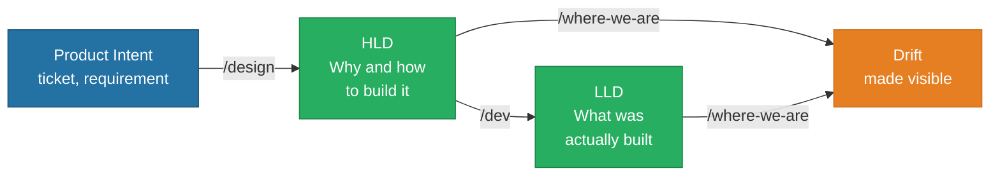
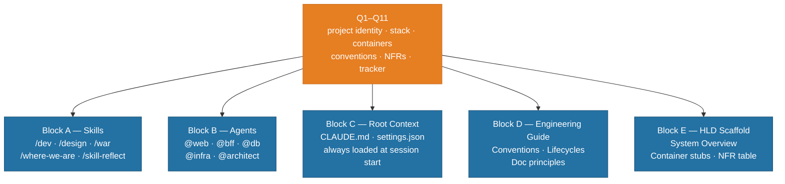
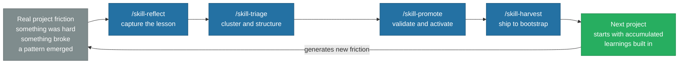
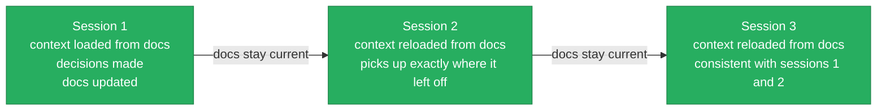

# The Solution: The AI Harness

The five problems in [02 Problem Statement](02%20Problem%20Statement.md) all live at the project level. The harness addresses each one directly — not by adding more process, but by making the right context a first-class output of the work itself.

---

## Problem 1 — The Drift

The drift happens because documentation is treated as an afterthought — written once, then abandoned. The harness makes docs a required output of every phase, not a separate task.

> Docs as a Lifecycle Output — not a separate task.

| Phase           | What ships                                                           |
| --------------- | -------------------------------------------------------------------- |
| `/design`       | Approved solution published to HLD — decisions, tradeoffs, rules     |
| `/dev`          | Implementation documented in LLD — what was built, deviations logged |
| `/where-we-are` | HLD vs LLD diff — delivery debt made visible at any point            |

Decisions, implementation, and documentation stay in sync because the workflow enforces it — not because teams remember to update the wiki.

---

## Problem 2 — The Uneven Depth

The missing middle — architectural rationale, accepted tradeoffs, what good looks like — is exactly what the HLD is designed to hold. The harness enforces a three-layer structure where each layer has a specific purpose and a specific level of abstraction.

> The Right Layer at the Right Level

| Layer                 | What it holds                                              | What it does NOT hold                           |
| --------------------- | ---------------------------------------------------------- | ----------------------------------------------- |
| **HLD**               | Why this architecture. Which tradeoffs. Rules and KPIs.    | Field names, payload shapes, enum values        |
| **LLD**               | What was actually built. Deviations from HLD.              | Intentions, aspirations, generic best practices |
| **Engineering Guide** | How this team works. Conventions specific to this project. | Generic "best practices"                        |

The `/design` lifecycle forces the rationale to be written and approved **before** a line of code is written. The middle layer is no longer optional — it is the gate.

---

## Problem 3 — Inconsistent Topology

The harness-bootstrap generates a consistent project-level skeleton in a single session. Five blocks, generated from Q1–Q11 answers about the specific project:

> Bootstrap Once, Own Forever

Every project starts from the same skeleton — consistent structure, consistent conventions, consistent place for every type of artifact. The AI always knows where things are.

---

## Problem 4 — No Feedback Loop

Hard-won patterns are captured, validated, and shipped to the next project through a dedicated lifecycle — not left in a post-mortem that nobody reads.

> The Skill Lifecycle

The bootstrap is a living platform. Every project improves it. Every lesson compounds.

---

## Problem 5 — Session Amnesia

The harness solves session amnesia not by giving the AI memory — but by making the context structured enough to reload instantly at the start of any session.

> Structured, Reloadable Context

| What gets loaded | What it contains                                                          |
| ---------------- | ------------------------------------------------------------------------- |
| `CLAUDE.md`      | Project identity, stack, containers, guarded commands — always in context |
| HLD              | Current architectural decisions — authoritative, always up to date        |
| LLD              | Current system state — what was actually built                            |
| Scoped agents    | `@web`, `@bff`, `@infra` — each sees only its container, no noise         |

Every session starts from the same structured baseline. The AI does not need to rediscover the project — it is handed the map.

The difference: sessions are no longer isolated events. They are a continuous thread — because the docs are the memory.

---

## The Common Answer

Every problem has the same fix at its core:

> **Make the right context a first-class output of the work — not a by-product that gets skipped under pressure.**

The harness does not add documentation overhead. It restructures the work so that documentation is what the work produces. The code is the derivative.
