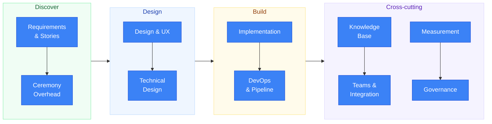
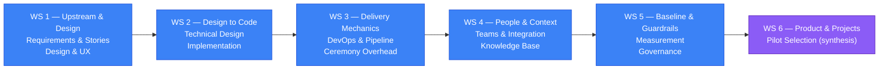

# Workshops Overview

The discovery workshop programme is a structured set of sessions designed to locate where [[CLIENT_NAME]]'s delivery time is lost across the SDLC — and to identify where agentic AI approaches could change the outcome, not just accelerate the existing process.

Each topic follows a consistent format: **current-state walkthrough → time-loss estimate → AI opportunity → evidence needed.** The programme closes with a pilot selection decision grounded in the evidence gathered across workshops, not the loudest voice in the room.

---

## Terminology

| Term         | Meaning                                                                                                                                                                                                                                                                         |
| ------------ | ------------------------------------------------------------------------------------------------------------------------------------------------------------------------------------------------------------------------------------------------------------------------------- |
| **Workshop** | A calendar event with the client. Target: **one session, ≤2 hours.** Has its own folder with an Agenda, Notes, Outcomes, and a Transcript — only Agenda exists ahead of a live session; the rest populate once it runs.                                                         |
| **Session**  | A continuous facilitated block within a workshop. Almost always one per workshop; a workshop occasionally runs two sessions if scheduling forces a split.                                                                                                                       |
| **Topic**    | A specific thread on a session's agenda — as many as fit in the time available, realistically 1–3 with real depth. Each topic is tagged to the Area it's diagnosing.                                                                                                            |
| **Area**     | A fixed diagnostic domain. The same 10 domains defined in [Connect Framework → Problem Space](/AI%20SDLC/Connect%20Framework/03%20Problem%20Space.md); every topic belongs to exactly one Area, and every Area has a waiting [Problem Space](/AI%20SDLC/Problem%20Space/) page. |

## Purpose

- Test the hypothesis that most delivery time is lost _before_ code is written — code was never the problem
- Walk the full SDLC and land findings, area by area, into the [Problem Space](/AI%20SDLC/Problem%20Space/)
- Surface the governance and measurement prerequisites for a credible pilot
- Produce a prioritised problem ranking and an agreed pilot candidate grounded in evidence from the workshops

---

## Areas

The 10 Areas below are the fixed vocabulary that ties every workshop topic to a Problem Space domain. This list does not change during the engagement — how Areas are grouped into workshops (below) does.

| Area                                                                                   | What it diagnoses                                                              |
| -------------------------------------------------------------------------------------- | ------------------------------------------------------------------------------ |
| [Requirements & Stories](/AI%20SDLC/Problem%20Space/02%20Requirements%20%26%20Stories) | How a request becomes a story ready to build                                   |
| [Design & UX](/AI%20SDLC/Problem%20Space/03%20Design%20%26%20UX)                       | Design cycle time and the creative-vs-waiting split                            |
| [DevOps & Pipeline](/AI%20SDLC/Problem%20Space/04%20DevOps%20%26%20Pipeline)           | CI/CD, test trust, deployment friction                                         |
| [Knowledge Base](/AI%20SDLC/Problem%20Space/05%20Knowledge%20Base)                     | Where knowledge lives, who owns it, how AI-consumable it is                    |
| [Teams & Integration](/AI%20SDLC/Problem%20Space/06%20Teams%20%26%20Integration)       | Squad structure and cross-team dependency friction                             |
| [Technical Design](/AI%20SDLC/Problem%20Space/07%20Technical%20Design)                 | Impact analysis and architectural documentation                                |
| [Ceremony Overhead](/AI%20SDLC/Problem%20Space/08%20Ceremony%20Overhead)               | Refinement, planning, and what shrinks if upstream information improves        |
| [Measurement](/AI%20SDLC/Problem%20Space/09%20Measurement)                             | What's tracked today, and the smallest credible pilot baseline                 |
| [Governance](/AI%20SDLC/Problem%20Space/10%20Governance)                               | Data exposure, IP, and AI token/consumption controls                           |
| [Implementation](/AI%20SDLC/Problem%20Space/11%20Implementation)                       | Where AI is already applied to coding, and why that hasn't moved delivery time |

---

## Workshop Programme

> [!IMPORTANT] Draft Structure — Adjust Per Engagement
> The workshop count, Area groupings, and ordering below are an illustrative starting point, not a fixed plan. Re-group Areas across workshops based on [[CLIENT_NAME]]'s scope, stakeholder availability, and the depth required, before scheduling anything.

| Workshop                     | Areas covered                         | Why paired                                                                |
| ---------------------------- | ------------------------------------- | ------------------------------------------------------------------------- |
| WS 1 — Upstream & Design     | Requirements & Stories · Design & UX  | Upstream, product-facing — both typically need product/design in the room |
| WS 2 — Design to Code        | Technical Design · Implementation     | How code actually gets designed and built                                 |
| WS 3 — Delivery Mechanics    | DevOps & Pipeline · Ceremony Overhead | Delivery mechanics and the process overhead around them                   |
| WS 4 — People & Context      | Teams & Integration · Knowledge Base  | The organisational and context layer                                      |
| WS 5 — Baseline & Guardrails | Measurement · Governance              | Cross-cutting; usually needs Compliance/Security and Finance stakeholders |
| WS 6 — Product & Projects    | — (synthesis across all Areas)        | Capstone; synthesises WS 1–5 evidence into a pilot candidate decision     |

WS 6 sits outside the Area taxonomy above — it is evidence synthesis, not diagnosis, so it does not get a Problem Space page.

### Coverage tracker

| Area                   | Workshop | Status               |
| ---------------------- | -------- | -------------------- |
| Requirements & Stories | WS 1     | ⚫ Not yet scheduled |
| Design & UX            | WS 1     | ⚫ Not yet scheduled |
| Technical Design       | WS 2     | ⚫ Not yet scheduled |
| Implementation         | WS 2     | ⚫ Not yet scheduled |
| DevOps & Pipeline      | WS 3     | ⚫ Not yet scheduled |
| Ceremony Overhead      | WS 3     | ⚫ Not yet scheduled |
| Teams & Integration    | WS 4     | ⚫ Not yet scheduled |
| Knowledge Base         | WS 4     | ⚫ Not yet scheduled |
| Measurement            | WS 5     | ⚫ Not yet scheduled |
| Governance             | WS 5     | ⚫ Not yet scheduled |

| Legend   | Status                                           |
| -------- | ------------------------------------------------ |
| 🟢 Green | Covered — substantive signal captured            |
| 🟡 Amber | Partial — touched but gaps remain                |
| 🔵 Blue  | Planned — on the agenda for an upcoming workshop |
| ⚫ Grey  | Not yet scheduled                                |

---

## Workshops

| #                            | Areas                                 | Date     | Agenda                                                                          | Notes                                                                         | Outcomes                                                                            | Transcript                                                                                         |
| ---------------------------- | ------------------------------------- | -------- | ------------------------------------------------------------------------------- | ----------------------------------------------------------------------------- | ----------------------------------------------------------------------------------- | -------------------------------------------------------------------------------------------------- |
| WS 1 — Upstream & Design     | Requirements & Stories · Design & UX  | Date TBD | [Agenda](<./WS%201%20(Upstream%20%26%20Design)%20-%20Date%20TBD/Agenda.md>)     | [Notes](<./WS%201%20(Upstream%20%26%20Design)%20-%20Date%20TBD/Notes.md>)     | [Outcomes](<./WS%201%20(Upstream%20%26%20Design)%20-%20Date%20TBD/Outcomes.md>)     | [Transcript](<./WS%201%20(Upstream%20%26%20Design)%20-%20Date%20TBD/transcript/Transcript.md>)     |
| WS 2 — Design to Code        | Technical Design · Implementation     | Date TBD | [Agenda](<./WS%202%20(Design%20to%20Code)%20-%20Date%20TBD/Agenda.md>)          | [Notes](<./WS%202%20(Design%20to%20Code)%20-%20Date%20TBD/Notes.md>)          | [Outcomes](<./WS%202%20(Design%20to%20Code)%20-%20Date%20TBD/Outcomes.md>)          | [Transcript](<./WS%202%20(Design%20to%20Code)%20-%20Date%20TBD/transcript/Transcript.md>)          |
| WS 3 — Delivery Mechanics    | DevOps & Pipeline · Ceremony Overhead | Date TBD | [Agenda](<./WS%203%20(Delivery%20Mechanics)%20-%20Date%20TBD/Agenda.md>)        | [Notes](<./WS%203%20(Delivery%20Mechanics)%20-%20Date%20TBD/Notes.md>)        | [Outcomes](<./WS%203%20(Delivery%20Mechanics)%20-%20Date%20TBD/Outcomes.md>)        | [Transcript](<./WS%203%20(Delivery%20Mechanics)%20-%20Date%20TBD/transcript/Transcript.md>)        |
| WS 4 — People & Context      | Teams & Integration · Knowledge Base  | Date TBD | [Agenda](<./WS%204%20(People%20%26%20Context)%20-%20Date%20TBD/Agenda.md>)      | [Notes](<./WS%204%20(People%20%26%20Context)%20-%20Date%20TBD/Notes.md>)      | [Outcomes](<./WS%204%20(People%20%26%20Context)%20-%20Date%20TBD/Outcomes.md>)      | [Transcript](<./WS%204%20(People%20%26%20Context)%20-%20Date%20TBD/transcript/Transcript.md>)      |
| WS 5 — Baseline & Guardrails | Measurement · Governance              | Date TBD | [Agenda](<./WS%205%20(Baseline%20%26%20Guardrails)%20-%20Date%20TBD/Agenda.md>) | [Notes](<./WS%205%20(Baseline%20%26%20Guardrails)%20-%20Date%20TBD/Notes.md>) | [Outcomes](<./WS%205%20(Baseline%20%26%20Guardrails)%20-%20Date%20TBD/Outcomes.md>) | [Transcript](<./WS%205%20(Baseline%20%26%20Guardrails)%20-%20Date%20TBD/transcript/Transcript.md>) |
| WS 6 — Product & Projects    | — (synthesis across all Areas)        | Date TBD | [Agenda](<./WS%206%20(Product%20%26%20Projects)%20-%20Date%20TBD/Agenda.md>)    | [Notes](<./WS%206%20(Product%20%26%20Projects)%20-%20Date%20TBD/Notes.md>)    | [Outcomes](<./WS%206%20(Product%20%26%20Projects)%20-%20Date%20TBD/Outcomes.md>)    | [Transcript](<./WS%206%20(Product%20%26%20Projects)%20-%20Date%20TBD/transcript/Transcript.md>)    |

_All four documents ship as placeholder shapes for this reference structure. In a live engagement, only Agenda exists ahead of a workshop — Notes, Outcomes, and Transcript are populated once the session actually runs._
