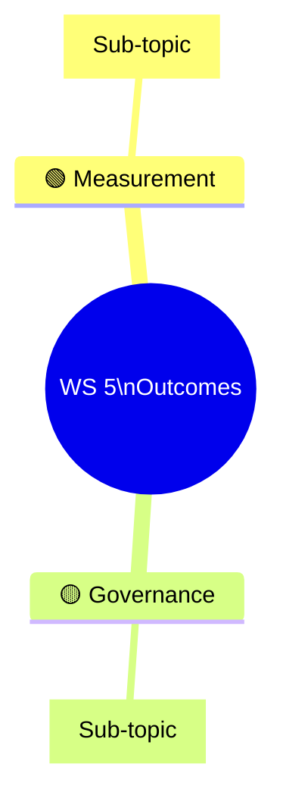
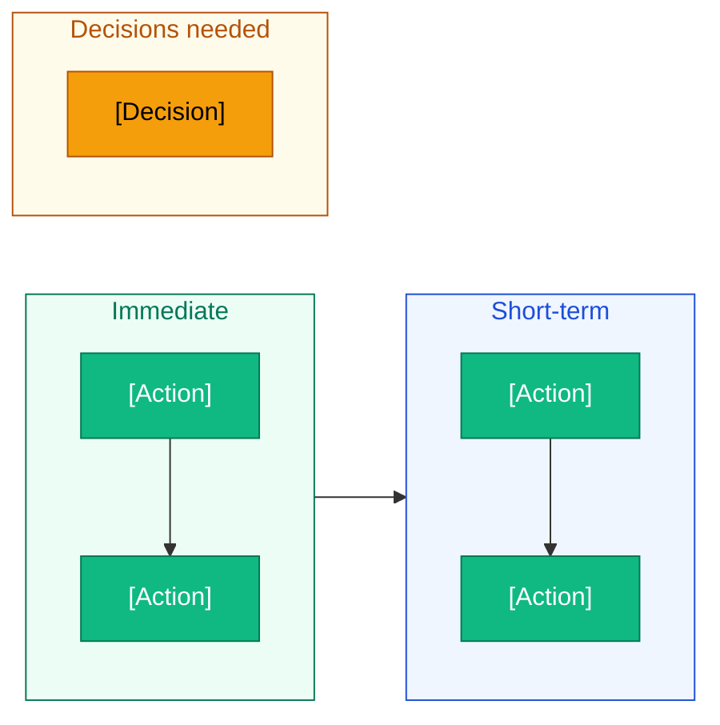

# Outcomes — WS 5 (Baseline & Guardrails) — Date TBD

_Live capture during session + post-session synthesis. Added once the session has actually run — this is a placeholder shape, not real content._

---

## Summary

[3-5 sentence synthesis: what was covered, what the session established, what it did not reach.]

---

## Areas & Topics

_Captured live during the brainstorm._

| Legend | Reception                                             | Priority |
| ------ | ----------------------------------------------------- | -------- |
| 🟢     | Energised — team leaned in, asked follow-up questions | High     |
| 🟡     | Neutral — acknowledged, no strong reaction            | Med      |
| 🔴     | Flat — dismissed, felt abstract or irrelevant         | Low      |

| #   | Area / Topic | Reception    | Priority         |
| --- | ------------ | ------------ | ---------------- |
| 1   | Measurement  | 🟢 / 🟡 / 🔴 | High / Med / Low |
| 2   | Governance   | 🟢 / 🟡 / 🔴 | High / Med / Low |

---

## Findings

_Post-session. One sub-section per Area that generated signal. Feeds the relevant [Problem Space](/AI%20SDLC/Problem%20Space/) domain page(s) directly — do not let a finding stop here._

### Measurement — [finding title]

[Narrative finding — what was learned, what was confirmed, what surprised.]

### Governance — [finding title]

[Narrative finding.]

---

## Next Steps

| Legend   | Meaning                           |
| -------- | --------------------------------- |
| 🟢 Green | Immediate action — start now      |
| 🔵 Blue  | Short-term action                 |
| 🟡 Amber | Decision needed before proceeding |

|                  | Item          | Owner | By  |
| ---------------- | ------------- | ----- | --- |
| ✅ Action        | [description] |       |     |
| 🔵 Decision      | [description] |       |     |
| 📋 Carry-forward | [description] |       |     |

_Pilot candidate synthesis now happens in [WS 6 — Product & Projects](<../WS%206%20(Product%20%26%20Projects)%20-%20Date%20TBD/Outcomes.md>); this session's job is to leave clean, validated findings for it to draw on._
