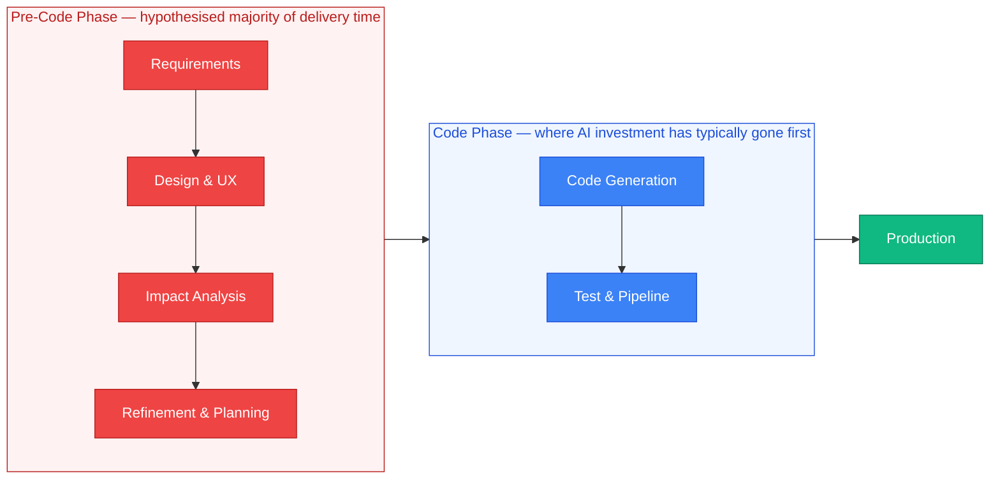
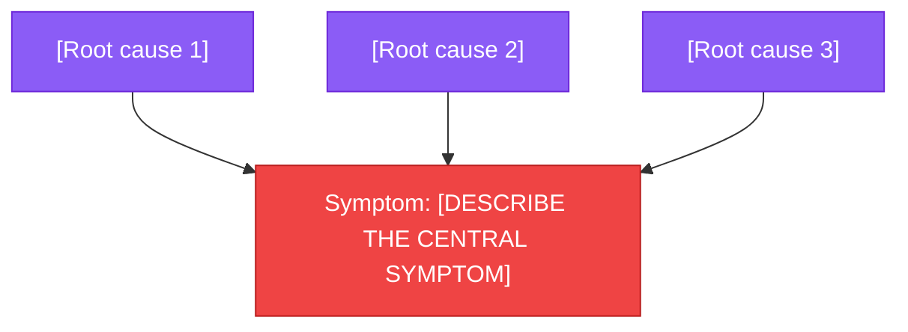

# Problem Space

_Gate 0.1 findings: the central symptom, its root causes, and the open questions that must be answered before solution design begins._

> [!WARNING] Populated During Engagement
> This page synthesizes findings gathered across [Current State](./Current%20State/) and the discovery workshops. It is a placeholder until that evidence exists.

---

## SDLC Time Distribution

The founding hypothesis this engagement tests: most delivery time is lost before code is written, not during it.

---

## Root Cause Landscape

_Populated once root causes are confirmed — the diagram below is a shape to fill in, not a fixed count. Six is illustrative._

---

## Central Symptom

[DESCRIBE THE CENTRAL SYMPTOM — the observable, measurable delivery problem this engagement exists to diagnose, e.g. lead time, DORA metrics, or another concrete indicator, stuck despite rising AI usage.]

---

## Root Causes

| #   | Root cause   | Evidence   | Why it matters   |
| --- | ------------ | ---------- | ---------------- |
| 1   | [ROOT CAUSE] | [EVIDENCE] | [WHY IT MATTERS] |

---

## Open Questions

- [OPEN QUESTION]

---

Supporting evidence for the root causes above is gathered in [Current State](./Current%20State/) — [[CLIENT_NAME]]'s existing AI initiative and bottom-up team pain-point data.
