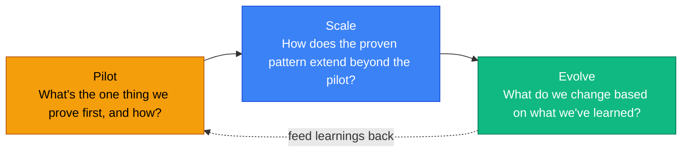

# Overview

> [!NOTE] Static Page
> This page describes the solution's three-phase shape and does not change during the engagement. Each phase page below holds draft ideas — provisional, not commitments — updated as [Problem Space](/AI%20SDLC/03%20Problem%20Space/) findings mature.

This is about the solution itself — what gets built and rolled out for [[CLIENT_NAME]], not the process for reaching it or the engagement's own logistics.

> Think Big, Start Small, Scale Fast.

- **Think Big** — identify long-term, transformative future trends, disruptions, and ambitious visions. Do not restrict the imagination.
- **Start Small** — break the massive vision down into bite-sized, low-risk, experimental projects to gather real data and test assumptions. This is [Pilot](./02%20Pilot.md).
- **Scale Fast** — once a small prototype proves its value, aggressively pour resources into it to expand into full-fledged, widespread operations. This is [Scale](./03%20Scale.md).

This engagement pivots the mantra into a closed loop, not a one-shot sequence: Think Big sets the ambition behind the whole solution, Start Small becomes Pilot, Scale Fast becomes Scale — and [Evolve](./04%20Evolve.md) closes the loop, feeding what's learned back into the next Think Big.

| Phase  | Purpose                                                                                                                                                                             | Deliverables                                                                                        | Page                       |
| ------ | ----------------------------------------------------------------------------------------------------------------------------------------------------------------------------------- | --------------------------------------------------------------------------------------------------- | -------------------------- |
| Pilot  | Define the pilot workload, stand up an AI-assisted process and toolset, scope a knowledge base to it (phased), and educate the team on how to work with it                          | Workload defined; AI-assisted process & toolset live; scoped knowledge base; team educated          | [Pilot](./02%20Pilot.md)   |
| Scale  | Extend the workload to the wider product context, wire governance control from product down to project, widen the knowledge base, and educate and control access as the group grows | Workload at product scope; governance wired; wider knowledge base; team educated; access controlled | [Scale](./03%20Scale.md)   |
| Evolve | Gather metrics, analyse them, build dashboards and reporting, identify problems, and reiterate the solution                                                                         | Metrics gathered; dashboards & reporting live; problems identified; solution reiterated             | [Evolve](./04%20Evolve.md) |

Each phase page is grounded in current [Problem Space](/AI%20SDLC/03%20Problem%20Space/) findings and linked back to the specific evidence behind each idea.
