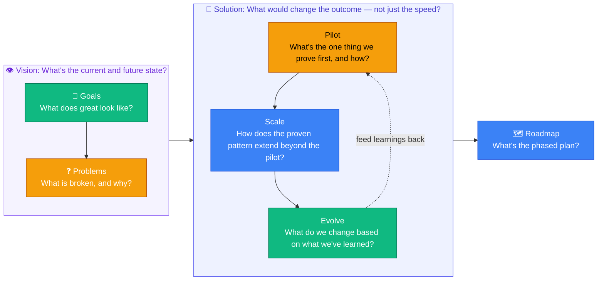

# Overview

> [!TIP] Five Stages, One Living System
>
> This engagement runs Vision → Goals → Problems → Solution → Roadmap. Each stage is a living artifact that evolves as the team learns, not a static document. The process is inspired by [DataArt's Connect Framework](./06%20Connect%20Framework.md) (Goals → Problem Space → Solution Space → Milestones) — adapted with an upfront Vision stage and a Pilot → Scale → Evolve solution loop. See [06 Connect Framework](./06%20Connect%20Framework.md) for the original methodology and exactly how this adapts it.

## How the Stages Connect

Vision surfaces the raw material. Goals anchor it. Problems get diagnosed. Solutions get evaluated and piloted. Roadmap is the settled shape the engagement converges on.

The process applies at every scale: to the engagement as a whole, to each workshop day, and to each individual session. The arc is the same; only the grain changes.

---

## The Five Stages

> [!NOTE] Living Pages
> This page describes the process itself and does not change during the engagement. Each stage below has its own home holding today's best understanding — a placeholder at the start, filled in and revised as workshops progress.

### 👁️ Vision

> **What's the current state, the future state, and the solution hypotheses in between?**

Discovery workshops that build a shared picture of where delivery time is lost and where agentic AI could change the outcome. This is the mechanism that feeds every other stage — not a stage with its own list, but the source of evidence for Goals and Problems alike.

→ [02 Vision](/AI%20SDLC/02%20Vision/) for the workshop programme and coverage tracker.

### 🎯 Goals

> **What does great look like for [[CLIENT_NAME]]?**

Strategic intents, ordered by importance. Goals define what success looks like and anchor every other stage. They answer: why does this engagement exist?

→ [02 Goals](./02%20Goals.md) for [[CLIENT_NAME]]'s current goals.

### ❓ Problems

> **Where is time lost, and what is the root cause?**

Things to figure out, in priority order. Problems enter, get worked, produce solutions and decisions, then resolve.

→ [03 Problem Space](./03%20Problem%20Space.md) for the current hypothesis and domains under diagnosis.

### 🔧 Solution

> **What would change the outcome — not just the speed?**

Options evaluated against diagnosed problems, structured as a Pilot → Scale → Evolve closed loop — start small and prove the hypothesis, scale what works, evolve based on what's learned, and feed that back into the next Pilot.

→ [04 Solution Space](./04%20Solution%20Space.md) for the current evaluation dimensions, pilot options, and the full Pilot → Scale → Evolve pattern.

### 🗺️ Roadmap

> **What's the phased delivery plan, and who owns each step?**

The settled shape the engagement converges on — scope, phases, timelines, team composition. Fed by the day-to-day tracked milestone list ([05 Milestones](./05%20Milestones.md)) as commitments firm up.

→ [05 Roadmap](/AI%20SDLC/05%20Roadmap/) for the current phased plan.
