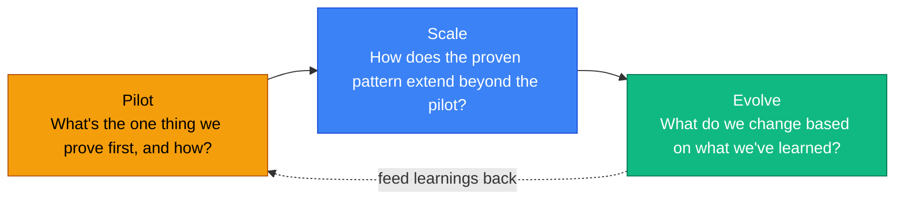

# 🔧 Solution Space

> What would change the outcome — not just the speed?

The solution phase evaluates options against the diagnosed problems. Genuinely different options are generated and scored against explicit criteria before any commitment is made.

> [!WARNING] Populated During Engagement
> This page is a placeholder. It is populated during discovery workshops and refined through the design phase.

---

Candidate evaluation dimensions for the ADLC pilot:

- **Impact** — how much of the diagnosed time-loss does this address?
- **Confidence** — how well evidenced is the root cause it targets?
- **Ease** — how quickly can a squad prove the hypothesis?
- **Governance fit** — does it stay within what data classification and tooling currently allow?

These four dimensions are applied per-workload in [WS 6 — Product & Projects](</AI%20SDLC/02%20Vision/WS%206%20(Product%20%26%20Projects)%20-%20Date%20TBD/Agenda.md>) to select the pilot candidate, alongside one scored pilot-readiness dimension specific to that workshop (Team AI-readiness). Each candidate's named owner is recorded alongside the score for context, not scored or gated. Keep evaluation vocabulary in sync between the two pages rather than letting them drift.

---

## Pilot → Scale → Evolve

The solution itself is a closed loop, not a one-shot sequence: start small and prove the hypothesis, scale the pattern that works, then evolve based on what's learned — feeding that learning back into the next Pilot.

It is drafted in [Solution Space](/AI%20SDLC/04%20Solution%20Space/).
