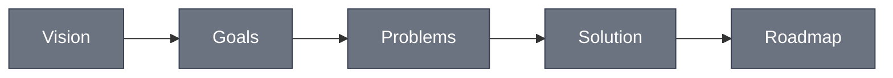

# Status

> Where the engagement is right now, and what's next.

> [!WARNING] Populated During Engagement
> This page is a placeholder until discovery starts. The `@discovery` agent keeps it current as workshops complete, findings land, and gates close.

---

## Where We Are

_TBD — recolor the current stage green, completed stages stay green, upcoming stages stay grey. See [01 Overview](./01%20Overview.md) for what each stage means._

| Stage    | Status         | Last Updated |
| -------- | -------------- | ------------ |
| Vision   | ⏳ Not started | —            |
| Goals    | ⏳ Not started | —            |
| Problems | ⏳ Not started | —            |
| Solution | ⏳ Not started | —            |
| Roadmap  | ⏳ Not started | —            |

_TBD — flip each row to 🔄 in progress or ✅ done as the stage moves, and stamp the date. Keep this table and the diagram above in sync — one glance at either should tell the same story._

_TBD — one-paragraph narrative: current gate, what's happened since the last update._

## What's Next

_TBD — next workshop(s) scheduled, open Problem Space domains, Solution Space ideas awaiting validation._

## Blockers

_TBD — anything stalled on a [[CLIENT_NAME]] decision, data access, or stakeholder availability._
