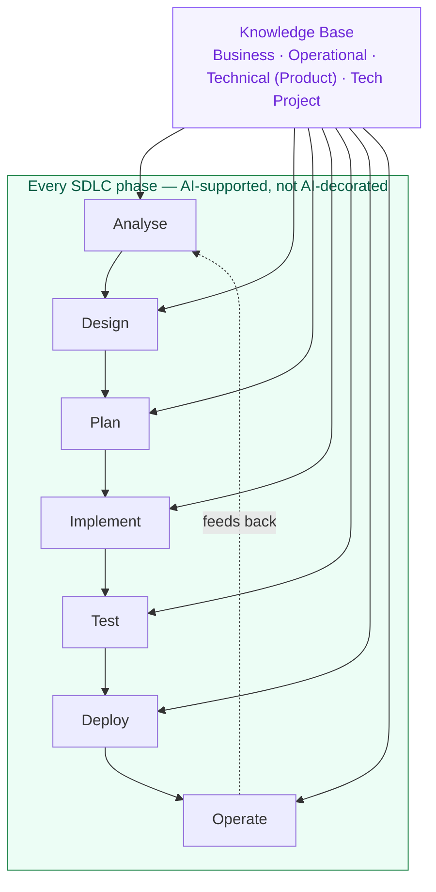
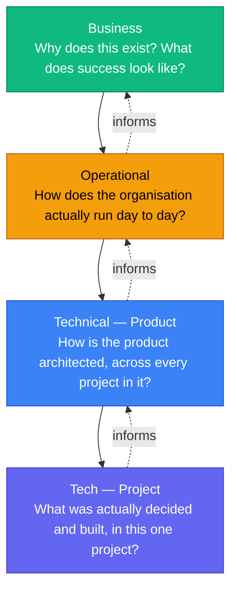

# The Full ADLC Loop

> [!WARNING] Draft
> This page is a working draft — the phase list, the knowledge-base layers, and the adoption signals below are all subject to revision.

The [Story](./00%20The%20Story.md) explains why the wheel wobbles. The [Landscape](./01%20Landscape.md) explains which layer is missing. The [Challenges](./02%20Challenges.md) answer each symptom on its own. This page is not about any one engagement — it's the picture of the perfect world once ADLC is fully adopted: every SDLC phase running with real AI support, on top of a knowledge base that actually exists and is actually wired together.

---

## The Whole Picture

Every phase is AI-supported the same way: the AI reads from the knowledge base before it acts, and writes back to it as a normal part of doing the work — not a separate documentation step someone remembers to do later. Analyse produces a diagnosed problem, not a guess. Design and Plan produce approved decisions, not a pile of options. Implement produces working software _and_ the record of what was actually built. Test and Deploy produce evidence, not just a green checkmark. Operate produces the signal that starts the next Analyse. Remove the knowledge base and every phase reverts to what it is without AI support: fast, confident, and disconnected from the last phase.

---

## The Knowledge Base Has Four Layers

"Knowledge base" isn't one document — it's four layers, each answering a different question, each owned differently.

| Layer                   | Answers                                                                                                 | Typically owned by                   |
| ----------------------- | ------------------------------------------------------------------------------------------------------- | ------------------------------------ |
| **Business**            | Why does this exist? What outcome are we actually paying for?                                           | Leadership, product strategy         |
| **Operational**         | How does the organisation actually run — processes, support, incident response, governance in practice? | Operations, platform, compliance     |
| **Technical (Product)** | How is the product architected as a whole, across every project and team that touches it?               | Architecture, engineering leadership |
| **Tech (Project)**      | What was actually decided and built, in this specific project, right now?                               | The team doing the work              |

Each layer flows into the next, and each one occasionally corrects the layer above it — a project-level decision that turns out to be a pattern feeds back up into how the product is architected; enough of those feed back into how operations actually runs; enough of _those_ eventually inform what the business believes is possible. **Wired** means those flows are real, not aspirational: a question asked at any layer can actually be answered by looking, not by asking around.

---

## What "Fully Adopted" Actually Changes

The difference between partial and full adoption isn't how many phases have an AI tool attached — every organisation gets that far. It's whether the loop closes.

| Signal                                                     | Partial adoption                          | Full adoption                                                   |
| ---------------------------------------------------------- | ----------------------------------------- | --------------------------------------------------------------- |
| Where does Analyse get its evidence?                       | Whoever remembers, or a fresh guess       | The knowledge base, all four layers, current                    |
| What does Design/Plan actually reference?                  | Generic best practice                     | The Technical (Product) layer — this product's own architecture |
| What does Implement leave behind?                          | Code, and maybe a PR description          | Code, plus the Tech (Project) record of what and why            |
| Does Operate feed anything?                                | A dashboard nobody built, or nobody reads | The next Analyse, directly                                      |
| Does a project-level pattern ever reach the product level? | Rarely — it stays in that team            | Yes — Technical (Product) absorbs it, every project benefits    |

A single project can get most of the way there on its own. The last mile — the product and business layers actually staying current, actually flowing down into every project's Analyse phase — is what "fully adopted" means, and it's an organisational commitment, not a tool choice.
