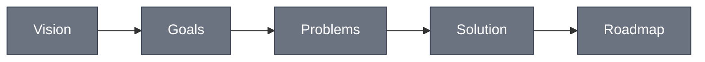

# Status Report

> Where the engagement is right now, and what's next.

> [!WARNING] Populated During Engagement
> This page is a placeholder until discovery starts. The `@discovery` agent keeps it current as workshops complete, findings land, and gates close.

---

## Where We Are

_TBD — recolor the current stage green, completed stages stay green, upcoming stages stay grey. See [01 Overview](./01%20Overview.md) for what each stage means._

| Stage    | Status         | Last Updated |
| -------- | -------------- | ------------ |
| Vision   | ⏳ Not started | —            |
| Goals    | ⏳ Not started | —            |
| Problems | ⏳ Not started | —            |
| Solution | ⏳ Not started | —            |
| Roadmap  | ⏳ Not started | —            |

_TBD — flip each row to 🔄 in progress or ✅ done as the stage moves, and stamp the date. Keep this table and the diagram above in sync — one glance at either should tell the same story._

_TBD — one-paragraph narrative: current gate, what's happened since the last update._

---

## Workshop & Evidence Tracker

The stage table above is the 30,000-ft view. This is the granular one — every row below is a workshop, or an artifact somewhere along the [Evidence Chain](./01%20Overview.md#the-evidence-chain) that workshop evidence eventually feeds: Workshops → Current State → Problems, and Problems + Goals → Solution → Roadmap. Coverage counts Areas landed into [Problem Space](/AI%20SDLC/03%20Problem%20Space/); Goals status is **Shaped** once a candidate list is drafted from workshop signals, **Confirmed** once validated with stakeholders.

_TBD — flip each row as workshops run and artifacts fill in; stamp the date on every change._

| ID  | Item                                                                                                                                               | Status           | Coverage              | Last Updated |
| --- | -------------------------------------------------------------------------------------------------------------------------------------------------- | ---------------- | --------------------- | ------------ |
| WS1 | [Upstream & Design](</AI%20SDLC/02%20Vision/WS%201%20(Upstream%20%26%20Design)%20-%20Date%20TBD/Agenda.md>) — Requirements & Stories · Design & UX | ⏳ Not scheduled | 0/2 Areas             | —            |
| WS2 | [Design to Code](</AI%20SDLC/02%20Vision/WS%202%20(Design%20to%20Code)%20-%20Date%20TBD/Agenda.md>) — Technical Design · Implementation            | ⏳ Not scheduled | 0/2 Areas             | —            |
| WS3 | [Delivery Mechanics](</AI%20SDLC/02%20Vision/WS%203%20(Delivery%20Mechanics)%20-%20Date%20TBD/Agenda.md>) — DevOps & Pipeline · Ceremony Overhead  | ⏳ Not scheduled | 0/2 Areas             | —            |
| WS4 | [People & Context](</AI%20SDLC/02%20Vision/WS%204%20(People%20%26%20Context)%20-%20Date%20TBD/Agenda.md>) — Teams & Integration · Knowledge Base   | ⏳ Not scheduled | 0/2 Areas             | —            |
| WS5 | [Baseline & Guardrails](</AI%20SDLC/02%20Vision/WS%205%20(Baseline%20%26%20Guardrails)%20-%20Date%20TBD/Agenda.md>) — Measurement · Governance     | ⏳ Not scheduled | 0/2 Areas             | —            |
| WS6 | [Product & Projects](</AI%20SDLC/02%20Vision/WS%206%20(Product%20%26%20Projects)%20-%20Date%20TBD/Agenda.md>) — pilot selection synthesis          | ⏳ Not scheduled | — (synthesis only)    | —            |
| CS  | [Current State — Process](/AI%20SDLC/02%20Vision/01%20Current%20State/Process.md)                                                                  | ⏳ Placeholder   | —                     | —            |
| CS  | [Current State — Architecture](/AI%20SDLC/02%20Vision/01%20Current%20State/Architecture.md)                                                        | ⏳ Placeholder   | —                     | —            |
| CS  | [Current State — Context Topology](/AI%20SDLC/02%20Vision/01%20Current%20State/Context%20Topology.md)                                              | ⏳ Placeholder   | —                     | —            |
| GO  | [Goals](./02%20Goals.md)                                                                                                                           | ⏳ Not shaped    | 0 drafted             | —            |
| PR  | [Problems](./03%20Problem%20Space.md) — 10 Areas                                                                                                   | ⏳ Not diagnosed | 0/10 domains          | —            |
| SO  | [Solution](./04%20Solution%20Space.md) — pilot candidate + coverage matrix                                                                         | ⏳ Not evaluated | 0/4 dimensions scored | —            |
| RM  | [Milestones](./05%20Milestones.md)                                                                                                                 | ⏳ Not set       | 0 milestones          | —            |
| RM  | [WBS](/AI%20SDLC/05%20Roadmap/02%20WBS.md)                                                                                                         | ⏳ Placeholder   | 0 items               | —            |
| RM  | [Team Composition](/AI%20SDLC/05%20Roadmap/01%20Overview.md#team-composition)                                                                      | ⏳ Placeholder   | —                     | —            |
| RM  | [Timeline](/AI%20SDLC/05%20Roadmap/03%20Timeline.md)                                                                                               | ⏳ Placeholder   | —                     | —            |

_Status legend: ⏳ Not started/scheduled/shaped · 🔄 In progress/drafted · ✅ Done/confirmed. For Goals specifically: ⏳ Not shaped → 🔄 Shaped (drafted, not yet validated) → ✅ Confirmed (validated with stakeholders). Solution's coverage matrix and Roadmap's WBS/Timeline only start filling in once Problems and Goals are both confirmed — see [Evidence Chain](./01%20Overview.md#the-evidence-chain)._

---

## What's Next

_TBD — next workshop(s) scheduled, open Problem Space domains, Solution Space ideas awaiting validation._

## Blockers

_TBD — anything stalled on a [[CLIENT_NAME]] decision, data access, or stakeholder availability._
