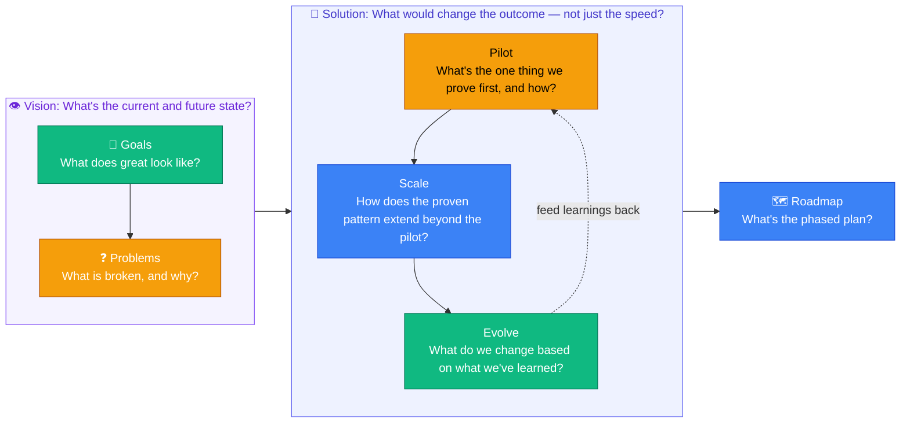
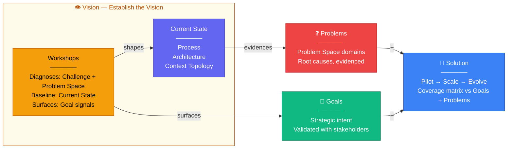

# Overview

> [!TIP] Five Stages, One Living System
>
> This engagement runs Vision → Goals → Problems → Solution → Roadmap. Each stage is a living artifact that evolves as the team learns, not a static document. The process is inspired by [DataArt's Connect Framework](./06%20Connect%20Framework.md) (Goals → Problem Space → Solution Space → Milestones) — adapted with an upfront Vision stage and a Pilot → Scale → Evolve solution loop. See [06 Connect Framework](./06%20Connect%20Framework.md) for the original methodology and exactly how this adapts it.

## How the Stages Connect

Vision surfaces the raw material. Goals anchor it. Problems get diagnosed. Solutions get evaluated and piloted. Roadmap is the settled shape the engagement converges on.

The process applies at every scale: to the engagement as a whole, to each workshop day, and to each individual session. The arc is the same; only the grain changes.

---

## The Evidence Chain

Every claim in Problem Space or Solution Space should trace back to a workshop, not an assumption. This is what that trace looks like:

Each [workshop topic](/AI%20SDLC/02%20Vision/) carries two tags — **Baseline** (which Current State page it fills) and **Diagnoses** (which [Context Challenge](/The%20Story/03%20Challenges.md) and Problem Space domain it validates) — plus goal signals surfaced the same way, captured in every workshop's closing rather than a separate leadership-only track. Workshops shape Current State directly and surface Goals directly; Current State in turn is the evidence Problems are diagnosed from. Solution is not derived from Problems alone — it's **Problems + Goals**: a diagnosed root cause without an agreed Goal has no priority, and a Goal without a diagnosed Problem behind it has no evidence it's the right thing to solve. Both have to hold before a Solution element earns a place in the coverage matrix.

---

## The Five Stages

> [!NOTE] Living Pages
> This page describes the process itself and does not change during the engagement. Each stage below has its own home holding today's best understanding — a placeholder at the start, filled in and revised as workshops progress.

### 👁️ Vision — Establish the Vision

> **What's the current state, the future state, and the solution hypotheses in between?**

Discovery workshops that build a shared picture of where delivery time is lost and where agentic AI could change the outcome. This is the mechanism that feeds every other stage — not a stage with its own list, but the source of evidence for **both** Goals and Problems: the same workshops that diagnose root causes are where leadership's strategic intent gets surfaced and validated. Goals are not a separate top-down track — they come out of Establish the Vision same as Problems do.

**How it runs — loop until clear:**

1. **Internal survey pass** — where a DataArt team already has context, run a survey internally first: past engagement notes, artifacts, Confluence pages, anything that saves [[CLIENT_NAME]]'s time before their first session.
2. **Process the output** — synthesize the pass into a working draft: what's confirmed, what's still open, what needs a workshop to resolve.
3. **Run the workshop with the client** — validate the previous session's findings first (goal signals and problem signals alike), then cover what isn't yet evidenced on either front; close by arranging the next follow-up.
4. **Process the output** — fold workshop findings into the working draft, the [Problem Space](/AI%20SDLC/03%20Problem%20Space/) coverage tracker, and the candidate goal list.
5. **Repeat 3–4** until coverage is clear — every domain in Problem Space has moved past _TBD_, and the goal list holds steady across a session.
6. Once there's enough context, start drafting Current State ([Process](/AI%20SDLC/02%20Vision/01%20Current%20State/Process.md), [Architecture](/AI%20SDLC/02%20Vision/01%20Current%20State/Architecture.md), [Context Topology](/AI%20SDLC/02%20Vision/01%20Current%20State/Context%20Topology.md)) **and** the candidate [Goals](./02%20Goals.md) list — both graduate from Vision into their own stage from here.

→ [02 Vision](/AI%20SDLC/02%20Vision/) for the workshop programme and coverage tracker.

### 🎯 Goals

> **What does great look like for [[CLIENT_NAME]]?**

Strategic intents, ordered by importance. Goals define what success looks like and anchor every other stage. They answer: why does this engagement exist?

**How it runs:**

1. Goal signals surfaced during Establish the Vision (step 3–5 above) are the raw material — not a separate intake. [02 Goals](./02%20Goals.md)'s Common Goals list is a starting prompt for that conversation, not a checklist to accept as-is.
2. Once Vision's goal list holds steady, draft it as candidate goals, ordered by importance.
3. Validate the draft with stakeholders — confirm, reorder, cut what doesn't actually matter to this client. This can close out inside a later Vision workshop rather than needing its own session.
4. Repeat draft → validate until goals are agreed and prioritised.

→ [02 Goals](./02%20Goals.md) for [[CLIENT_NAME]]'s current goals.

### ❓ Problems

> **Where is time lost, and what is the root cause?**

Things to figure out, in priority order. Problems enter, get worked, produce solutions and decisions, then resolve.

**How it runs:**

1. Once there's enough context from Vision and Goals, draft the problem hypotheses per domain.
2. Validate the draft with stakeholders.
3. Reiterate while still green — keep looping draft → validate as long as each pass still changes the picture; stop once root causes hold across a validation session.

→ [03 Problem Space](./03%20Problem%20Space.md) for the current hypothesis and domains under diagnosis.

### 🔧 Solution

> **What would change the outcome — not just the speed?**

Options evaluated against diagnosed problems, structured as a Pilot → Scale → Evolve closed loop — start small and prove the hypothesis, scale what works, evolve based on what's learned, and feed that back into the next Pilot.

**How it runs — engineer the solution against Goals and Problems, and prove full coverage of both:**

1. **Define the pilot workload** — which project, which process slice, which context scope proves the hypothesis first.
2. **Define the topology** — the context layers, repo structure, and process wiring the pilot needs.
3. **Define the context and bootstrap** — at project, product, and organisation scale, per the [Target Agentic SDLC Setup](/The%20Story/05%20Target%20Agentic%20SDLC%20Setup.md).
4. **Define the wiring** — process ↔ context ↔ code: the actual mechanism (skills, agents, lifecycles) that keeps all three in sync once the pilot runs.
5. **Build the coverage matrix** — every agreed Goal and every diagnosed Problem mapped to the solution element(s) that address it. Nothing proposed here should be unaccounted for on either axis.

> [!IMPORTANT] Steps 2–4 are specified by running `/design`, not decided on a Solution Space page
> Topology, context/bootstrap, and process↔context↔code wiring are architecture decisions — spanning metrics/observability/KPIs, tooling choice, repo composition, and context topology. [Target State](/AI%20SDLC/04%20Solution%20Space/02%20Target%20State.md) states _what_ the gap is; closing it is a `/design` ticket that produces the actual HLD-level spec (`Architecture.md`, `Design.md`, `Stack.md`) in [Target Architecture (HLD)](/Target%20Architecture%20%28HLD%29/) — same as any other architecture decision in this repo, not a special case for the pilot.

→ [04 Solution Space](./04%20Solution%20Space.md) for the current evaluation dimensions, pilot options, and the full Pilot → Scale → Evolve pattern.

### 🗺️ Roadmap

> **What's the phased delivery plan, and who owns each step?**

The settled shape the engagement converges on — scope, phases, timelines, team composition. Fed by the day-to-day tracked milestone list ([05 Milestones](./05%20Milestones.md)) as commitments firm up.

**How it runs — sequence the roadmap:**

1. **Milestones** — the accountable, dated commitments; tracked live in [05 Milestones](./05%20Milestones.md).
2. **WBS** — break each milestone down into scoped, sized work items; see [Roadmap — WBS](/AI%20SDLC/05%20Roadmap/02%20WBS.md).
3. **Team composition** — who's needed, by role, per phase; see [Roadmap — Overview](/AI%20SDLC/05%20Roadmap/01%20Overview.md).
4. **Timeline (Gantt)** — sequence the WBS against milestones and team availability into a phased schedule; see [Roadmap — Timeline](/AI%20SDLC/05%20Roadmap/03%20Timeline.md).

→ [05 Roadmap](/AI%20SDLC/05%20Roadmap/) for the current phased plan.
