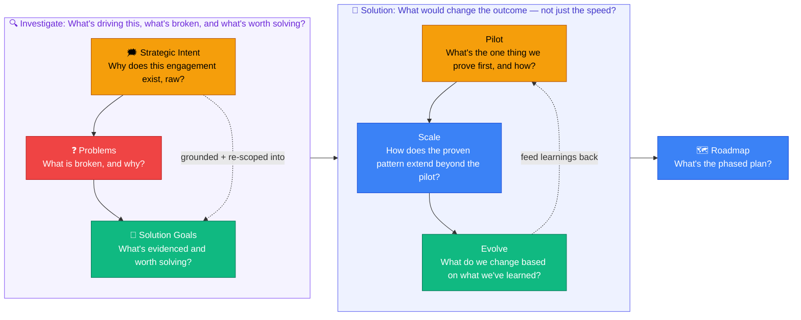
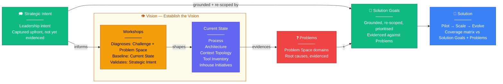

# Overview

> [!TIP] Six Stages, One Living System
>
> This engagement runs Strategic Intent → Vision → Problems → Solution Goals → Solution → Roadmap. Each stage is a living artifact that evolves as the team learns, not a static document. The process is inspired by [DataArt's Connect Framework](./02%20Connect%20Framework.md) (Goals → Problem Space → Solution Space → Milestones) — adapted with an upfront Vision stage, Goals split into a raw upfront form (Strategic Intent) and a grounded, re-scoped form (Solution Goals), and a Pilot → Scale → Evolve solution loop. See [02 Connect Framework](./02%20Connect%20Framework.md) for the original methodology and exactly how this adapts it.

## How the Stages Connect

Strategic Intent sets the target upfront, raw. Vision surfaces the raw material and validates it. Problems get diagnosed. Solution Goals grounds Intent and re-scopes it against that evidence, in one step. Solutions get evaluated and piloted against the scoped target. Roadmap is the settled shape the engagement converges on.

The process applies at every scale: to the engagement as a whole, to each workshop day, and to each individual session. The arc is the same; only the grain changes.

---

## The Evidence Chain

Every claim in Problem Space or Solution Space should trace back to a workshop or a leadership conversation, not an assumption. This is what that trace looks like:

Each [workshop topic](/AI%20SDLC/02%20Vision/) carries two tags — **Baseline** (which Current State page it fills) and **Diagnoses** (which [Context Challenge](/The%20Story/03%20Challenges.md) and Problem Space domain it validates). Workshops also validate Strategic Intent as they run — confirming, reordering, or cutting what leadership stated upfront — rather than surfacing it from scratch the way Problems are. Workshops shape Current State directly; Current State in turn is the evidence Problems are diagnosed from. Solution is not derived from Problems alone — it's **Problems + Solution Goals**: a diagnosed root cause without an agreed goal behind it has no priority, and a goal without a diagnosed problem behind it has no evidence it's the right thing to solve. Strategic Intent becomes Solution Goals once that filter is applied — both have to hold before a Solution element earns a place in the coverage matrix.

---

## The Six Stages

> [!NOTE] Living Pages
> This page describes the process itself and does not change during the engagement. Each stage below has its own home holding today's best understanding — a placeholder at the start, filled in and revised as workshops progress.

### 🗯️ Strategic Intent

> **Why does this engagement exist for [[CLIENT_NAME]], in their own words?**

The raw trigger, captured close to verbatim before diagnosis starts — usually a blunt statement of spend, ambition, or discomfort, not yet a scored objective. Real enough to be the actual reason budget got approved.

**How it runs:**

1. Captured via `/bootstrap-client` from sales conversations, an RFP, or kickoff discussions with [[CLIENT_NAME]] leadership — before Vision workshops begin. [02 Strategic Intent](/AI%20SDLC/04%20Goals/02%20Strategic%20Intent.md)'s Illustrative Patterns are a starting prompt for that conversation, not a checklist to accept as-is.
2. [Vision](#-vision-establish-the-vision) workshops validate it as they run — confirm, reorder, cut what doesn't actually matter to this client — rather than a separate leadership-only check-in later.
3. Once Problem Space root causes hold steady, [Solution Goals](#-solution-goals) grounds and re-scopes it in one step.

→ [04 Goals](/AI%20SDLC/04%20Goals/) for [[CLIENT_NAME]]'s current goals, both forms.

### 👁️ Vision — Establish the Vision

> **What's the current state, the future state, and the solution hypotheses in between?**

Discovery workshops that build a shared picture of where delivery time is lost and where agentic AI could change the outcome. This is the mechanism that feeds Problem Space directly and validates Strategic Intent along the way: the same workshops that diagnose root causes confirm, reorder, or cut what leadership stated upfront. Strategic Intent is captured before Vision starts, not surfaced by it — but nothing in it is treated as final until Vision validates it.

**How it runs — loop until clear:**

1. **Internal survey pass** — where a DataArt team already has context, run a survey internally first: past engagement notes, artifacts, Confluence pages, anything that saves [[CLIENT_NAME]]'s time before their first session.
2. **Process the output** — synthesize the pass into a working draft: what's confirmed, what's still open, what needs a workshop to resolve.
3. **Run the workshop with the client** — validate the previous session's findings first (Strategic Intent and problem signals alike), then cover what isn't yet evidenced on either front; close by arranging the next follow-up.
4. **Process the output** — fold workshop findings into the working draft, the [Problem Space](/AI%20SDLC/03%20Problem%20Space/) coverage tracker, and Strategic Intent.
5. **Repeat 3–4** until coverage is clear — every domain in Problem Space has moved past _TBD_, and Strategic Intent holds steady across a session.
6. Once there's enough context, start drafting Current State ([Process](/AI%20SDLC/02%20Vision/01%20Current%20State/Process.md), [Architecture](/AI%20SDLC/02%20Vision/01%20Current%20State/Architecture.md), [Context Topology](/AI%20SDLC/02%20Vision/01%20Current%20State/Context%20Topology.md), [Tool Inventory](/AI%20SDLC/02%20Vision/01%20Current%20State/Tool%20Inventory.md), [Inhouse Initiatives](/AI%20SDLC/02%20Vision/02%20Inhouse%20Initiatives/Overview.md)) — it graduates from Vision into its own stage from here. Strategic Intent, confirmed through this same loop, is ready to ground and re-scope into Solution Goals once Problem Space root causes hold too.

→ [02 Vision](/AI%20SDLC/02%20Vision/) for the workshop programme and coverage tracker.

### ❓ Problems

> **Where is time lost, and what is the root cause?**

Things to figure out, in priority order. Problems enter, get worked, produce solutions and decisions, then resolve.

**How it runs:**

1. Once there's enough context from Vision and Strategic Intent, draft the problem hypotheses per domain.
2. Validate the draft with stakeholders.
3. Reiterate while still green — keep looping draft → validate as long as each pass still changes the picture; stop once root causes hold across a validation session.

→ [03 Problem Space](/AI%20SDLC/03%20Problem%20Space/) for the current hypothesis and domains under diagnosis.

### 🎯 Solution Goals

> **Of what we set out to achieve, what's actually evidenced and worth solving?**

The grounded, evidenced version of [Strategic Intent](#-strategic-intent) — narrowed to what Problem Space has actually diagnosed a root cause for. A goal without a diagnosed problem behind it has no evidence it's the right thing to solve; this is where that filter gets applied, in the same step as grounding it.

**How it runs:**

1. Once Problem Space root causes hold steady, revisit [Strategic Intent](/AI%20SDLC/04%20Goals/02%20Strategic%20Intent.md) against that evidence — ground each surviving piece into an achievable objective with a horizon and a justification.
2. Draft the re-scoped list, each entry linked to the Problem Space domain(s) that evidence it.
3. Validate with stakeholders alongside the Problem Space findings that support them.
4. Once agreed, this list is what [Solution](#-solution)'s Target State and coverage matrix are checked against.

→ [04 Goals — 03 Solution Goals](/AI%20SDLC/04%20Goals/03%20Solution%20Goals.md) for the current re-scoped list.

### 🔧 Solution

> **What would change the outcome — not just the speed?**

Options evaluated against diagnosed problems, structured as a Pilot → Scale → Evolve closed loop — start small and prove the hypothesis, scale what works, evolve based on what's learned, and feed that back into the next Pilot.

**How it runs — engineer the solution against Solution Goals and Problems, and prove full coverage of both:**

1. **Define the pilot workload** — which project, which process slice, which context scope proves the hypothesis first.
2. **Define the topology** — the context layers, repo structure, and process wiring the pilot needs.
3. **Define the context and bootstrap** — at project, product, and organisation scale, per the [Target Agentic SDLC Setup](/The%20Story/05%20Target%20Agentic%20SDLC%20Setup.md).
4. **Define the wiring** — process ↔ context ↔ code: the actual mechanism (skills, agents, lifecycles) that keeps all three in sync once the pilot runs.
5. **Build the coverage matrix** — every Solution Goal and every diagnosed Problem mapped to the solution element(s) that address it. Nothing proposed here should be unaccounted for on either axis.

> [!IMPORTANT] Steps 2–4 are specified by running `/design`, not decided on a Solution Space page
> Topology, context/bootstrap, and process↔context↔code wiring are architecture decisions — spanning metrics/observability/KPIs, tooling choice, repo composition, and context topology. [Target State](/AI%20SDLC/05%20Solution%20Space/02%20Target%20State.md) states _what_ the gap is; closing it is a `/design` ticket that produces the actual HLD-level spec (`Architecture.md`, `Design.md`, `Stack.md`) in [Target Architecture (HLD)](/Target%20Architecture%20%28HLD%29/) — same as any other architecture decision in this repo, not a special case for the pilot.

→ [05 Solution Space](/AI%20SDLC/05%20Solution%20Space/) for the current evaluation dimensions, pilot options, and the full Pilot → Scale → Evolve pattern.

### 🗺️ Roadmap

> **What's the phased delivery plan, and who owns each step?**

The settled shape the engagement converges on — scope, phases, timelines, team composition. Fed by the day-to-day tracked milestone list ([Roadmap — Milestones](/AI%20SDLC/06%20Roadmap/02%20Milestones.md)) as commitments firm up.

**How it runs — sequence the roadmap:**

1. **Milestones** — the accountable, dated commitments; tracked live in [Roadmap — Milestones](/AI%20SDLC/06%20Roadmap/02%20Milestones.md).
2. **WBS** — break each milestone down into scoped, sized work items; see [Roadmap — WBS](/AI%20SDLC/06%20Roadmap/03%20WBS.md).
3. **Team composition** — who's needed, by role, per phase; see [Roadmap — Overview](/AI%20SDLC/06%20Roadmap/01%20Overview.md).
4. **Timeline (Gantt)** — sequence the WBS against milestones and team availability into a phased schedule; see [Roadmap — Timeline](/AI%20SDLC/06%20Roadmap/04%20Timeline.md).

→ [06 Roadmap](/AI%20SDLC/06%20Roadmap/) for the current phased plan.
