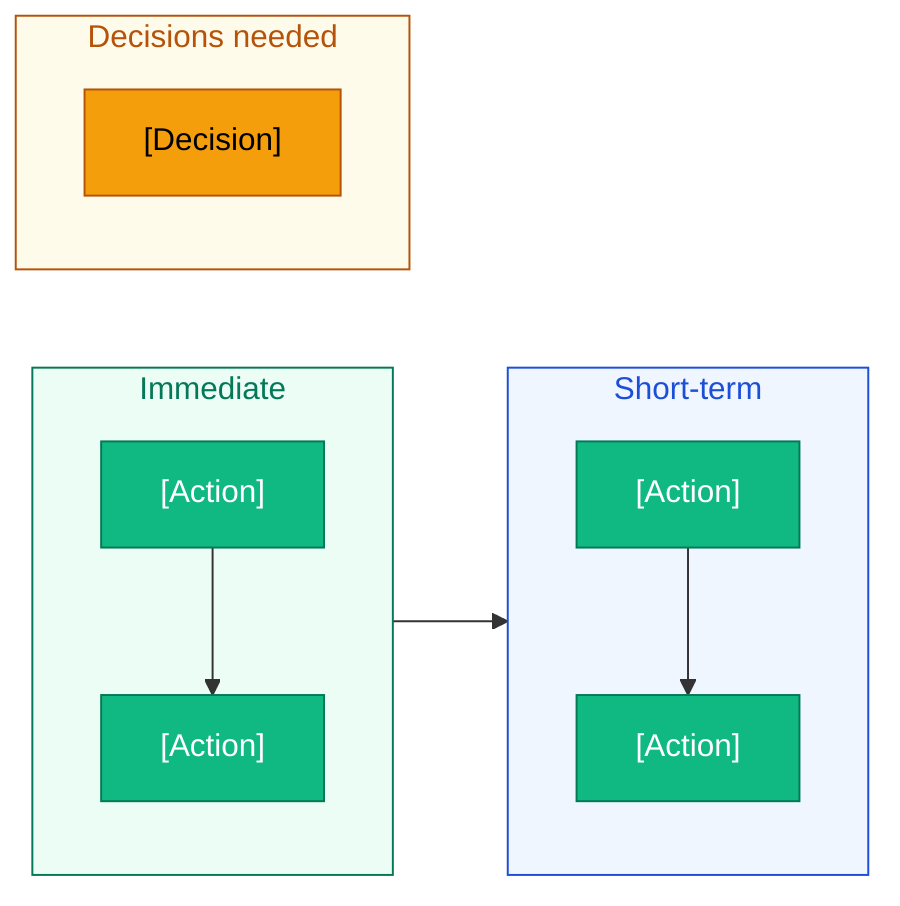

# Outcomes — WS 6 (Product & Projects) — Date TBD

_Live capture during session + post-session synthesis. Added once the session has actually run — this is a placeholder shape, not real content._

_This workshop synthesises evidence from WS 1–5 into a pilot decision. It is not Area-diagnostic and does not feed a Problem Space page directly — its output feeds [Solution Space](/AI%20SDLC/05%20Solution%20Space/)._

---

## Summary

[3-5 sentence synthesis: what candidates were considered, what the session established, what it did not reach.]

---

## Pilot Evaluation Matrix

_Dimensions 1–4 are the Solution Space candidate evaluation dimensions applied per-workload; dimension 5 is a pilot-readiness addition specific to this workshop. Each scored 1–5; Total is a simple sum unless the room agrees a weighting live. Named owner is recorded for context, not scored._

| Candidate     | Named owner  | Impact | Confidence | Ease  | Governance fit | Team AI-readiness | Total   | Rank   |
| ------------- | ------------ | ------ | ---------- | ----- | -------------- | ----------------- | ------- | ------ |
| [CANDIDATE_1] | [OWNER_NAME] | [1-5]  | [1-5]      | [1-5] | [1-5]          | [1-5]             | [TOTAL] | [RANK] |
| [CANDIDATE_2] | [OWNER_NAME] | [1-5]  | [1-5]      | [1-5] | [1-5]          | [1-5]             | [TOTAL] | [RANK] |
| [CANDIDATE_3] | [OWNER_NAME] | [1-5]  | [1-5]      | [1-5] | [1-5]          | [1-5]             | [TOTAL] | [RANK] |

| Legend | Reception                                             | Priority |
| ------ | ----------------------------------------------------- | -------- |
| 🟢     | Energised — team leaned in, asked follow-up questions | High     |
| 🟡     | Neutral — acknowledged, no strong reaction            | Med      |
| 🔴     | Flat — dismissed, felt abstract or irrelevant         | Low      |

| #   | Candidate     | Reception    | Priority         |
| --- | ------------- | ------------ | ---------------- |
| 1   | [CANDIDATE_1] | 🟢 / 🟡 / 🔴 | High / Med / Low |
| 2   | [CANDIDATE_2] | 🟢 / 🟡 / 🔴 | High / Med / Low |
| 3   | [CANDIDATE_3] | 🟢 / 🟡 / 🔴 | High / Med / Low |

---

## Decision

**Recommended pilot candidate:** [CANDIDATE_NAME]

**Runner-up:** [CANDIDATE_NAME]

**Rationale:** [DECISION_RATIONALE — why the recommended candidate scored/ranked highest, and what would change the recommendation.]

**Open risks against the recommendation:** [RISK_LIST]

---

## Findings

_Post-session. Feeds [Solution Space](/AI%20SDLC/05%20Solution%20Space/) directly — do not let a finding stop here._

### Candidate Inventory — [finding title]

[Narrative finding — what was learned, what was confirmed, what surprised.]

### Evaluation & Scoring — [finding title]

[Narrative finding.]

---

## Next Steps

| Legend   | Meaning                           |
| -------- | --------------------------------- |
| 🟢 Green | Immediate action — start now      |
| 🔵 Blue  | Short-term action                 |
| 🟡 Amber | Decision needed before proceeding |

|                  | Item          | Owner | By  |
| ---------------- | ------------- | ----- | --- |
| ✅ Action        | [description] |       |     |
| 🔵 Decision      | [description] |       |     |
| 📋 Carry-forward | [description] |       |     |

_This is the final workshop in the base programme. The evidence-synthesis job — pulling findings across WS 1–5 into a prioritised pilot decision — lives here, not folded into WS 5._
