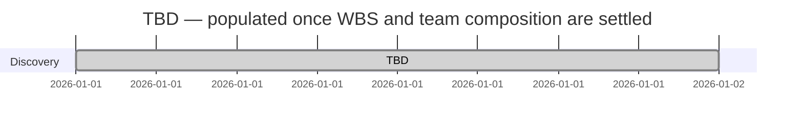

# 🗓️ Timeline

> What is the phased schedule, and how do WBS items sequence against milestones and team availability?

The Gantt-level view of the roadmap — [WBS](./03%20WBS.md) items sequenced against [02 Milestones](./02%20Milestones.md) and the team composition in [01 Overview](./01%20Overview.md).

> [!WARNING] Populated During Engagement
> This page is a placeholder. It is filled in once WBS items are sized and team composition is confirmed.

---

_TBD — real phases, work items, and dates replace the placeholder Gantt above once [WBS](./03%20WBS.md) is populated._
