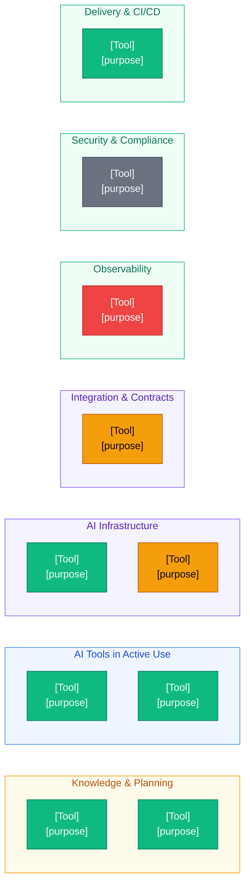

# Tool Inventory (Current State)

> [!WARNING] Populated During Engagement
> This page is a placeholder until current-state tooling evidence exists. It adds no new evidence of its own — every row here should already be findable in [Process](./Process.md), [Architecture](./Architecture.md), [Context Topology](./Context%20Topology.md), [AI Adoption](./AI%20Adoption.md), [Metrics](./Metrics.md), or [Inhouse Initiatives](/AI%20SDLC/02%20Vision/02%20Inhouse%20Initiatives/Overview.md). This is a reorganization by tool identity, not new discovery.

A consolidated, tool-by-tool inventory of what [[CLIENT_NAME]] runs today — not the target stack, not recommendations. Facts here are reorganized from [Process](./Process.md), [Architecture](./Architecture.md), [Context Topology](./Context%20Topology.md), [AI Adoption](./AI%20Adoption.md), [Metrics](./Metrics.md), and [Inhouse Initiatives](/AI%20SDLC/02%20Vision/02%20Inhouse%20Initiatives/Overview.md); this page adds no new evidence, only a single index by tool identity.

_Sources: TBD — list the workshop sessions and SDLC Domains this inventory was reorganized from, once they run (e.g. "Workshop 1 Session 3 (DevOps & Pipeline), Session 4 (Knowledge Base) · Workshop 3 Session 9 (AI Governance)")._

---

## Adoption Status Across the Stack

_Populated once tool evidence exists — the categories and grouping below are a shape to fill in, not a fixed taxonomy. Drop categories that don't apply to [[CLIENT_NAME]]; add ones that do._

**Legend:** 🟢 Live/adopted · 🟠 Live but flagged — ungoverned, partial, or gated on a decision · 🔴 Explicit gap — named but unaddressed · ⚫ Planned — not yet started.

---

## Knowledge & Planning Systems

| Tool   | Category   | Purpose / Use Case | Status/Detail                   | Source                 |
| ------ | ---------- | ------------------ | ------------------------------- | ---------------------- |
| [TOOL] | [CATEGORY] | [PURPOSE]          | [Live / Gap / Planned — detail] | [Workshop/Session ref] |

## AI Tools in Active Use

| Tool   | Category   | Purpose / Use Case | Status/Detail                   | Source                 |
| ------ | ---------- | ------------------ | ------------------------------- | ---------------------- |
| [TOOL] | [CATEGORY] | [PURPOSE]          | [Live / Gap / Planned — detail] | [Workshop/Session ref] |

## AI Infrastructure

| Tool   | Category   | Purpose / Use Case | Status/Detail                   | Source                 |
| ------ | ---------- | ------------------ | ------------------------------- | ---------------------- |
| [TOOL] | [CATEGORY] | [PURPOSE]          | [Live / Gap / Planned — detail] | [Workshop/Session ref] |

## Integration & Contracts

| Tool   | Category   | Purpose / Use Case | Status/Detail                   | Source                 |
| ------ | ---------- | ------------------ | ------------------------------- | ---------------------- |
| [TOOL] | [CATEGORY] | [PURPOSE]          | [Live / Gap / Planned — detail] | [Workshop/Session ref] |

## Observability

| Tool   | Category   | Purpose / Use Case | Status/Detail                   | Source                 |
| ------ | ---------- | ------------------ | ------------------------------- | ---------------------- |
| [TOOL] | [CATEGORY] | [PURPOSE]          | [Live / Gap / Planned — detail] | [Workshop/Session ref] |

## Security & Compliance

| Tool   | Category   | Purpose / Use Case | Status/Detail                   | Source                 |
| ------ | ---------- | ------------------ | ------------------------------- | ---------------------- |
| [TOOL] | [CATEGORY] | [PURPOSE]          | [Live / Gap / Planned — detail] | [Workshop/Session ref] |

## Delivery & CI/CD

| Tool   | Category   | Purpose / Use Case | Status/Detail                   | Source                 |
| ------ | ---------- | ------------------ | ------------------------------- | ---------------------- |
| [TOOL] | [CATEGORY] | [PURPOSE]          | [Live / Gap / Planned — detail] | [Workshop/Session ref] |

## Product Analytics & Experimentation

_Distinct from the engineering stack above — flag overlaps (e.g. a backend observability tool doubling as a product-metrics source) rather than listing the same tool twice with no cross-reference._

| Tool   | Category   | Purpose / Use Case | Status/Detail                   | Source                 |
| ------ | ---------- | ------------------ | ------------------------------- | ---------------------- |
| [TOOL] | [CATEGORY] | [PURPOSE]          | [Live / Gap / Planned — detail] | [Workshop/Session ref] |

---

This is raw baseline material, not synthesis. Diagnosis and root-cause analysis happen in [Problem Space](/AI%20SDLC/03%20Problem%20Space/), not here — a row flagged 🟠 or 🔴 above is a candidate for a Problem Space finding, not a conclusion in itself.

---

## Changelog

_This page adds no evidence of its own — every change traces to the Current State page it was reorganized from, not to a workshop directly._

| Date   | Change         | Evidence                                                    |
| ------ | -------------- | ----------------------------------------------------------- |
| [DATE] | [WHAT CHANGED] | [Current State page — e.g. Architecture](./Architecture.md) |
