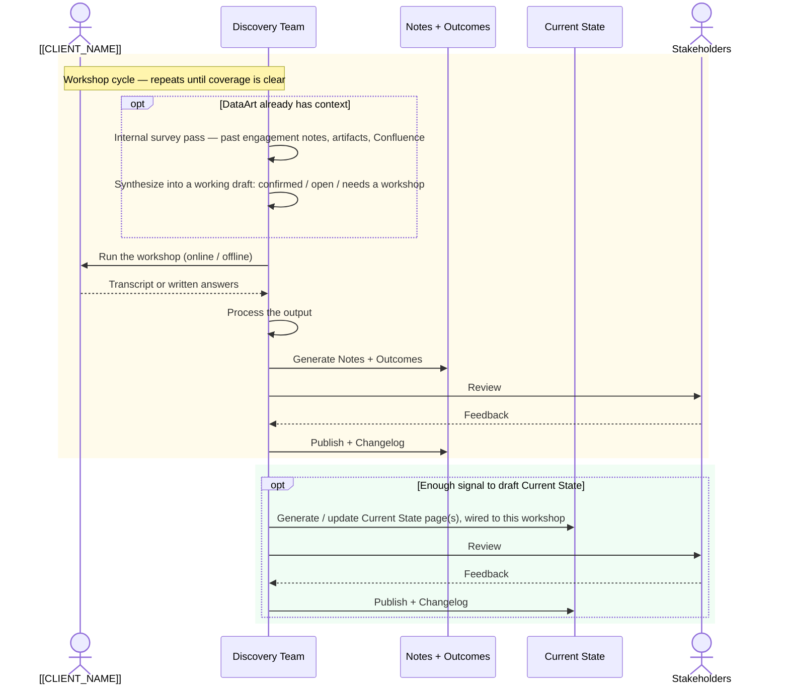

# 1 — Current State

_A workshop cycle turns into Notes, Outcomes, and — once there's enough signal — an updated Current State page._

**Workshop cycle.** Loop until clear: internal survey first where DataArt already has context (saves [[CLIENT_NAME]]'s time before their first session), then the workshop itself — validate the previous session's findings before covering what isn't yet evidenced, close by arranging the next follow-up. Each pass produces a [workshop folder](/AI%20SDLC/02%20Vision/)'s Notes and Outcomes from its Transcript.

**Current State — optional on any given pass.** Not every workshop moves a Current State page — only draft or update the relevant [Current State](/AI%20SDLC/02%20Vision/01%20Current%20State/Process.md) page(s) (Process, Architecture, Context Topology, AI Adoption, Metrics, Tool Inventory, Inhouse Initiatives) when that same session surfaced enough signal to justify it, wiring only what it actually evidenced. When it does happen, it happens right after that workshop's Notes/Outcomes are published — not deferred to a later pass.

→ [2 — SDLC Domains](./02%20SDLC%20Domains.md) for how this evidence turns into a diagnosed domain. → [Orchestration](./00%20Orchestration.md) for how all four parts chain together.
