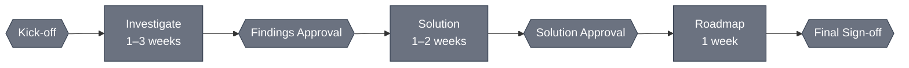

# Where We Are — Engagement

> Where the engagement is right now, and what's next — one page per phase, plus a log of how these pages themselves have changed.

> [!WARNING] Populated During Engagement
> These pages are placeholders until discovery starts. The `@discovery` agent keeps them current as workshops complete, findings land, and gates close.

The top-level view — which gate the engagement is at, and the overall timeline. See [How the Engagement Runs](../02%20How%20the%20Engagement%20Runs.md) for what each gate means.

_TBD — recolor everything up to and including the current gate/phase green, the current one amber, everything after stays grey._

| Gate                       | Target Date | Closed Date | Status         |
| -------------------------- | ----------- | ----------- | -------------- |
| Gate 0 — Kick-off          | [DATE]      | [DATE]      | ⏳ Not started |
| Gate 1 — Findings Approval | [DATE]      | [DATE]      | ⏳ Not started |
| Gate 2 — Solution Approval | [DATE]      | [DATE]      | ⏳ Not started |
| Gate 3 — Final Sign-off    | [DATE]      | [DATE]      | ⏳ Not started |

_TBD — one-paragraph narrative: current gate, what's happened since the last update._

**What's Next.** _TBD — next workshop(s) scheduled, open Problem Space SDLC Domains, Solution Space ideas awaiting validation._

**Blockers.** _TBD — anything stalled on a [[CLIENT_NAME]] decision, data access, or stakeholder availability._

→ [02 Investigate](./02%20Investigate.md) for the first phase's status.
