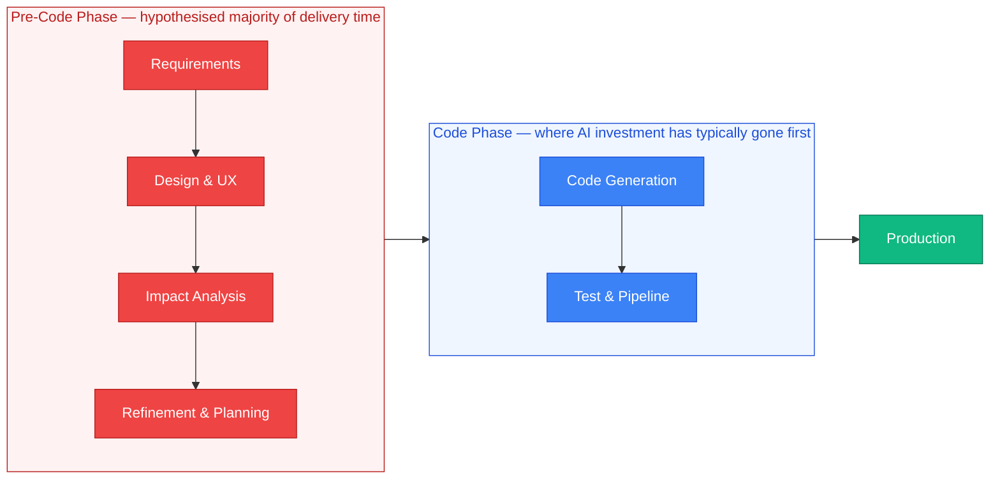

# Where Gaps Sit

_The path one piece of work takes from idea to production, and where it actually breaks down. Not only time — a stage can lose time, but it can also lose quality, coverage, or ownership without losing a single minute on the clock._

> [!WARNING] Populated During Engagement
> This page synthesizes findings gathered across [SDLC Domains](/AI%20SDLC/02%20Vision/00%20Overview.md#sdlc-domains) and the discovery workshops. It is a placeholder until that evidence exists.

---

## The Founding Hypothesis

Most delivery time is lost before code is written, not during it — this engagement exists to confirm or refute that, not assume it. Time is the primary lens, not the only one: the same stage-by-stage walk can also surface a quality gap (output nobody trusts), a coverage gap (nothing captured at all), or a governance gap (no one owns the decision) — worth naming even where the clock isn't the problem.

---

## One Task, Idea to Production

_[DESCRIBE THE REPRESENTATIVE TASK — a real, recent, mid-sized piece of work, walked stage by stage. Not an average across all tickets; one concrete example the room will recognise.]_

| Stage                   | Typical Duration | Gap Type                                        | Notes                |
| ----------------------- | ---------------- | ----------------------------------------------- | -------------------- |
| Idea → Backlog          | [DURATION]       | [Time / Quality / Coverage / Governance / None] | [NOTES / BOTTLENECK] |
| Refinement & Planning   | [DURATION]       | [Time / Quality / Coverage / Governance / None] | [NOTES / BOTTLENECK] |
| Design & UX             | [DURATION]       | [Time / Quality / Coverage / Governance / None] | [NOTES / BOTTLENECK] |
| Technical Design        | [DURATION]       | [Time / Quality / Coverage / Governance / None] | [NOTES / BOTTLENECK] |
| Build (code generation) | [DURATION]       | [Time / Quality / Coverage / Governance / None] | [NOTES / BOTTLENECK] |
| Test & Pipeline         | [DURATION]       | [Time / Quality / Coverage / Governance / None] | [NOTES / BOTTLENECK] |
| Review → Production     | [DURATION]       | [Time / Quality / Coverage / Governance / None] | [NOTES / BOTTLENECK] |

**Baseline: [TOTAL DURATION] idea to production, against a target of [TARGET DURATION]. [Note any stage above where the gap isn't time — a quality, coverage, or governance gap belongs here even if the duration itself looks fine.]**

---

## Central Symptom

[DESCRIBE THE CENTRAL SYMPTOM — the observable, measurable delivery problem this engagement exists to diagnose. Usually a time metric (lead time, DORA metrics) but not always — a quality, coverage, or governance indicator counts too if that's where the room's pain actually sits, stuck despite rising AI usage.]

---

The stage-by-stage detail behind this baseline is gathered in [SDLC Domains](/AI%20SDLC/02%20Vision/00%20Overview.md#sdlc-domains) — each stage above maps to one or more SDLC Domain pages, which hold the underlying evidence. Named problems drawn from this picture are tracked in [Problems](./02%20Problems.md).

---

## Changelog

_Every change to this page traces to the SDLC Domain page(s) whose evidence moved it — link the source, don't just describe the change._

| Date   | Change         | Evidence                                                                                                                                   |
| ------ | -------------- | ------------------------------------------------------------------------------------------------------------------------------------------ |
| [DATE] | [WHAT CHANGED] | [SDLC Domain page — e.g. Requirements & Stories](/AI%20SDLC/03%20Problem%20Space/03%20SDLC%20Domains/01%20Requirements%20%26%20Stories.md) |
