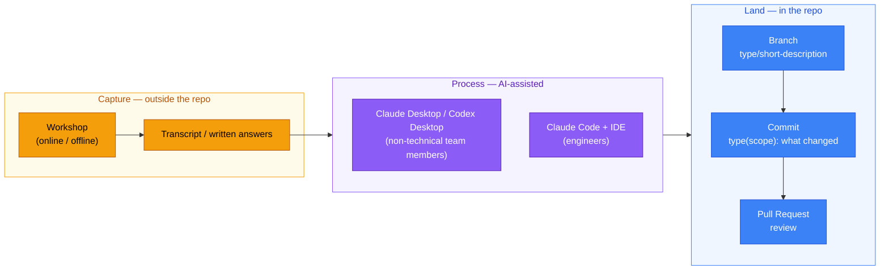

# Team Collaboration

_How the engagement team actually works in this repo — who touches what, with which tool, and how it lands. Not dev-environment setup (→ [Engineering Guide — Getting Started](/Engineering%20Guide/05%20Getting%20Started.md)) or commit-format mechanics (→ [Engineering Guide — Conventions](/Engineering%20Guide/01%20Conventions.md)) — those are covered once, there._

## Who uses what

| Role                                                    | Tool                           | Does                                                                                                                                                   |
| ------------------------------------------------------- | ------------------------------ | ------------------------------------------------------------------------------------------------------------------------------------------------------ |
| Engineers doing repo work (docs, skills, agents, infra) | Claude Code + IDE              | Runs the `/dev`, `/design`, `/discovery`-agent workflows directly against this repo; owns the actual commits.                                          |
| Non-technical team members processing workshop output   | Claude Desktop / Codex Desktop | Turns a raw transcript or written-answer set into a draft Notes/Outcomes write-up _before_ it enters the repo — no repo access required for this step. |
| Whoever runs the workshop                               | Any note-taking tool           | Captures the transcript itself; the tool doesn't matter, only that it lands as `transcript/Transcript.md` for the workshop folder to process.          |

> [!WARNING] Populated During Bootstrap
> The exact desktop-app roles above are illustrative — confirm which tools the [[CLIENT_NAME]] engagement team actually has access to (Claude Desktop, Codex Desktop, or neither) during `/bootstrap-client`, and replace this table with what's real for this engagement.

## Landing content in the repo

Whatever produced the draft — a desktop app outside the repo, or Claude Code directly inside it — the same rule applies before it's published: it goes through [Workflows](./06%20Workflows/01%20Initiation.md)'s review → publish → wire-traceability pattern, not straight from draft to merged.

1. **Branch** — `<type>/short-description`, per [Engineering Guide — Conventions](/Engineering%20Guide/01%20Conventions.md).
2. **Commit** — `<type>(<scope>): <what changed>`, Conventional Commits. Scope is the AI SDLC section (`process`, `vision`, `problem-space`, `goals`, `solution-space`, `roadmap`) or the workshop ID (`ws1`, `ws2`, …).
3. **Pull Request** — opened against `main`; reviewed by `@workshop` for a change inside a `02 Vision/WS N (…)` folder, `@discovery` for everything else under `docs/AI SDLC/` (see the agent table in `CLAUDE.md`) — before merge. A PR that adds a workshop's Notes/Outcomes should also show the Changelog rows it triggered downstream (Current State, SDLC Domain, Solution Goals) — see [04 Evidence Chain](./04%20Evidence%20Chain.md).

Guarded commands (`git push`, `cdk deploy`, `yarn nx run infra:provision`) are never run directly — they're presented as instructions for the developer to run themselves, same as everywhere else in this repo.
