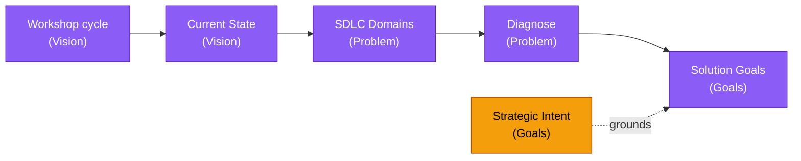

# Investigate

_How raw workshop evidence turns into Current State (Vision), SDLC Domain evidence and a diagnosed Problem (Problem), and — where evidence is already strong enough — an early Solution Goals draft (Goals). Runs on loop for 1–3 weeks, until Problem Space coverage is clear and Strategic Intent holds steady across a session._

Four parts, each a link in the same chain — the output of one is the input of the next:

| Part                                                             | Turns                                  | Into                                       |
| ---------------------------------------------------------------- | -------------------------------------- | ------------------------------------------ |
| [Vision — Current State](./01%20Vision%20-%20Current%20State.md) | A workshop cycle                       | Notes, Outcomes, and updated Current State |
| [Problem — SDLC Domains](./02%20Problem%20-%20SDLC%20Domains.md) | Current State evidence                 | An updated SDLC Domain page                |
| [Problem — Diagnose](./03%20Problem%20-%20Diagnose.md)           | SDLC Domain evidence                   | A diagnosed Problem (registry entry)       |
| [Goals — Solution Goals](./04%20Goals%20-%20Solution%20Goals.md) | A diagnosed Problem + Strategic Intent | An early Solution Goals draft              |

Coverage is clear when every [Problems/SDLC Domain](/AI%20SDLC/02%20Vision/00%20Overview.md#sdlc-domains) page has a real, workshop-evidenced working hypothesis in place of its placeholder, and Strategic Intent holds steady across a validation session — that's what unblocks [Gate Review](../02%20Gate%20Review.md).
