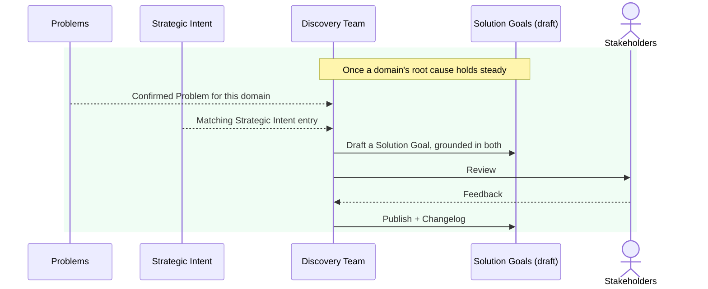

# Goals — Solution Goals

_A diagnosed Problem plus the matching Strategic Intent combine into an early Solution Goals draft — the same grounding filter [Gate Review](../02%20Gate%20Review.md) applies formally, run early per domain when the evidence is already solid._

**Optional, once a root cause holds steady.** A domain doesn't have to wait for the formal [Gate Review](../02%20Gate%20Review.md) to get an early Solution Goals draft if its Problem Space evidence is already solid — same capture → review → publish pattern, same Changelog trail. Gate Review is still where the full set gets aligned, prioritised, and scored against Strategic Intent.

This is the last part of Investigate — its output feeds [Gate Review](../02%20Gate%20Review.md) directly. → [Orchestration](./00%20Orchestration.md) for how all four parts chain together.
