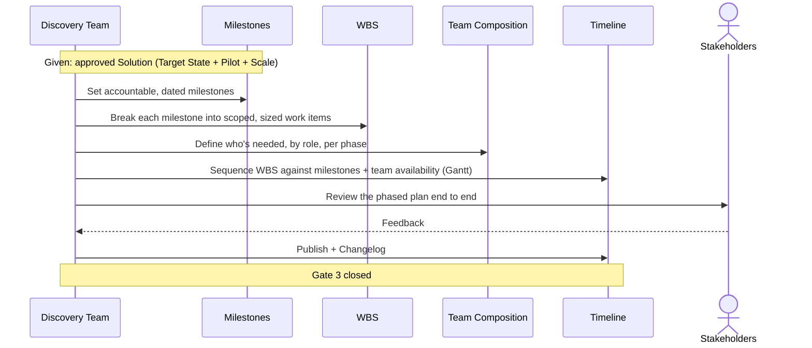

# Roadmap

_How an approved Solution turns into a phased delivery plan — the sequence Gate 3 closes on._

**Milestones.** The accountable, dated commitments; tracked live in [Roadmap — Milestones](/AI%20SDLC/06%20Roadmap/02%20Milestones.md).

**WBS.** Each milestone broken down into scoped, sized work items; see [Roadmap — WBS](/AI%20SDLC/06%20Roadmap/03%20WBS.md).

**Team composition.** Who's needed, by role, per phase; see [Roadmap — Overview](/AI%20SDLC/06%20Roadmap/01%20Overview.md).

**Timeline.** The WBS sequenced against milestones and team availability into a phased schedule (Gantt); see [Roadmap — Timeline](/AI%20SDLC/06%20Roadmap/04%20Timeline.md).

Roadmap is the last workflow in the arc — its output is what [[CLIENT_NAME]] staffs and funds against. From here the engagement's live state is tracked on [Where We Are](../../07%20Where%20We%20Are/01%20Engagement.md), not on this page.
