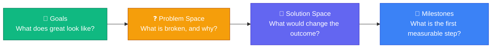

# Connect Framework

DataArt's structured engagement methodology — four interconnected, living lists: **Goals**, **Problem Space**, **Solution Space**, and **Milestones**. Goals anchor problems, problems produce solutions, solutions feed milestones, milestones prove goal achievement.

→ Full framework reference: [transform.artisyn.dataart.com/catalog/frameworks#connect](https://transform.artisyn.dataart.com/catalog/frameworks#connect)

## How the Lists Connect

Goals anchor Problems. Problems produce Solutions. Solutions feed Milestones. Milestones prove Goals.

## Key Principles

| Principle              | What it means                                                                                                                                                   |
| ---------------------- | --------------------------------------------------------------------------------------------------------------------------------------------------------------- |
| **Living, not static** | These lists evolve as the team learns; priorities change and items get added, split, merged, resolved, or deferred.                                             |
| **Traceability**       | Every solution traces back to a problem; every milestone traces forward to an outcome; every decision is logged. You can always answer "why did we build this?" |
| **AI-augmented**       | Agents process meeting notes and recommend list changes as change sets for human review; the AI proposes, the team decides — judgment stays with people.        |

## The Four Lists

### 🎯 Goals

> **What does great look like for [[CLIENT_NAME]]?**

Strategic intents, ordered by importance. Goals define what success looks like and anchor every other list. They answer: why does this engagement exist?

**Examples**

- Achieve 60% digital adoption rate
- Reduce transaction processing costs by 30%
- Establish zero-trust security architecture

→ [04 Goals](/AI%20SDLC/04%20Goals/) for [[CLIENT_NAME]]'s current goals.

### ❓ Problem Space

> **Where is time lost, and what is the root cause?**

Things to figure out, in priority order. Problems enter, get worked, produce solutions and decisions, then resolve. The priority ordering across types is what matters.

**Examples**

- Legacy system integration constraints
- Data quality and fitness gaps
- Security and compliance interpretation

→ [03 Problem Space](/AI%20SDLC/03%20Problem%20Space/) for the current hypothesis and domains under diagnosis.

### 🔧 Solution Space

> **What would change the outcome — not just the speed?**

Work to do, organized by team. Each solution traces back to the problem it addresses and points forward to the milestone it enables. Solutions are sized and assigned.

**Examples**

- API anti-corruption layer
- ML risk scoring engine
- HIPAA compliance infrastructure

→ [05 Solution Space](/AI%20SDLC/05%20Solution%20Space/) for the current evaluation dimensions and pilot options.

### 🚩 Milestones

> **What is the first measurable step, and who owns it?**

Outcome-based waypoints. Defined not by scope delivered but by what becomes possible. Each milestone has a target date, budget envelope, and measurable outcomes.

**Examples**

- Platform foundation complete
- MVP features live in production
- Full digital suite & cost targets met

→ [Roadmap — Milestones](/AI%20SDLC/06%20Roadmap/02%20Milestones.md) for the current milestone plan.

## How this engagement adapts it

This engagement's actual process — see [01 Overview](../01%20Overview.md) — is inspired by Connect but adapted in three ways:

- A dedicated **Vision** stage runs upfront: discovery workshops that surface the raw material Connect's Problem Space list needs, and validate Goals against it, rather than assuming either is already known.
- **Goals** splits into two artifacts instead of Connect's single list: an upfront **Strategic Intent** capture (raw, before Vision, from leadership conversations) and a grounded, re-scoped **Solution Goals** list (narrowed once Problem Space evidence exists) — see [04 Goals](/AI%20SDLC/04%20Goals/).
- **Solution Space** is structured as a **Target State → Pilot → Scale → Evolve** closed loop (see [05 Solution Space](/AI%20SDLC/05%20Solution%20Space/)), and the settled delivery shape graduates to a dedicated **Roadmap** section — which also holds the Milestones list — rather than staying inside the Milestones list alone.

The principles above carry over unchanged — only the stage names and where each list's output lands differ.
