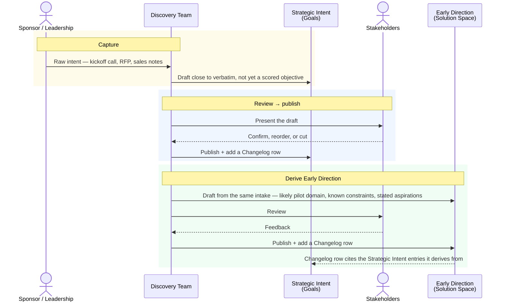

# Initiation

_How a raw trigger becomes a published Strategic Intent and an Early Direction — the two artifacts Gate 0 closes on._

**Capture.** Strategic Intent is captured via `/bootstrap-client` from sales conversations, an RFP, or kickoff discussions — before Capture workshops begin. [Strategic Intent](/AI%20SDLC/04%20Goals/02%20Strategic%20Intent.md)'s Illustrative Patterns are a starting prompt for that conversation, not a checklist to accept as-is.

**Review → publish.** The draft goes to whoever's sponsoring the engagement for a sanity check before it's treated as settled — this is a light pass, not a workshop; Capture does the real validation later. Publishing means editing `Strategic Intent.md` directly and adding a row to its `## Changelog`.

**Derive Early Direction.** The same intake conversation almost always signals more than raw intent — a likely pilot domain, a known constraint, a stated aspiration. That goes into [Solution Space](/AI%20SDLC/05%20Solution%20Space/index.md)'s `## Early Direction` section as an explicit, labelled hypothesis — not a confirmed finding, refined once Problem Space evidence exists. Its Changelog row cites the Strategic Intent it was derived from, so the trace holds in both directions.

Initiation runs once, at Gate 0. Strategic Intent isn't re-captured after this — it's only ever _validated_ (by [Investigate](./03%20Investigate/00%20Orchestration.md)) or _grounded and re-scoped_ (by [Gate Review](./02%20Gate%20Review.md)).
