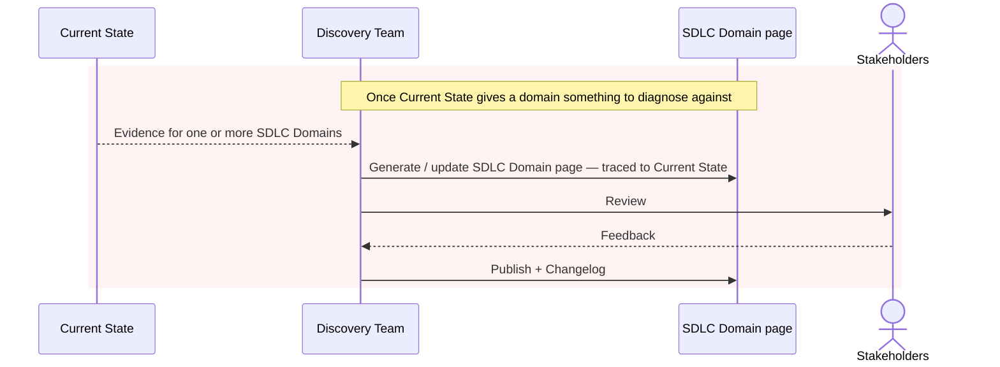

# Problem — SDLC Domains

_Current State evidence turns into an updated SDLC Domain page — the raw, per-domain evidence Diagnose synthesizes from next._

**Optional, once root cause is emerging.** A [Problem Space](/AI%20SDLC/03%20Problem%20Space/) domain page updates once Current State gives it something to diagnose against — reiterate while still green, keep looping draft → validate as long as each pass still changes the picture. Not every Current State update moves an SDLC Domain page; only wire the ones this evidence actually speaks to.

→ [Problem — Diagnose](./03%20Problem%20-%20Diagnose.md) for how this evidence gets synthesized into a Problem. → [Capture — Current State](./01%20Capture%20-%20Current%20State.md) for where this evidence comes from.
