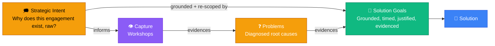

# Overview

> [!NOTE] Static Page
> This page describes why Goals has two artifacts and how they connect. It does not change during the engagement. [02 Strategic Intent](./02%20Strategic%20Intent.md) and [03 Solution Goals](./03%20Solution%20Goals.md) hold [[CLIENT_NAME]]'s actual content and are updated as the engagement progresses.

Goals shows up twice in this engagement, because it does two different jobs:

- **Strategic Intent** — the raw trigger, captured close to verbatim from whoever's sponsoring this engagement. Not grounded, not yet a scored objective — often a blunt statement of spend, ambition, or discomfort. Captured upfront, before [Capture](/AI%20SDLC/02%20Capture/) workshops begin.
- **Solution Goals** — Strategic Intent shaped and narrowed in one step: grounded (achievable within a stated horizon, wired to the piece of Intent that justifies it) and evidenced (only what [Problem Space](/AI%20SDLC/03%20Problem%20Space/) has actually diagnosed a root cause for survives). It is what [Solution Space](/AI%20SDLC/05%20Solution%20Space/)'s Target State and coverage matrix are actually checked against.

