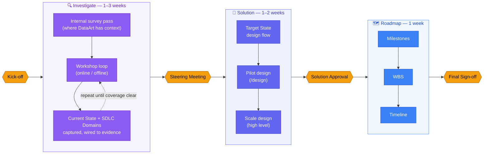

# How the Engagement Runs

_The shape every ADLC discovery engagement takes, gate to gate — a template, not a schedule. [Where We Are](./06%20Where%20We%20Are/01%20Engagement.md) is where this gets filled in with [[CLIENT_NAME]]'s actual dates and findings; this page never changes during the engagement._

Four gates bound three working phases — every phase is gated on both sides: opened by the gate before it, closed by the gate after. A gate is a checkpoint, not a ceremony — it only closes when its entry criteria hold, evidenced, not scheduled. A phase can run short or long depending on what it finds; the gate is what moves, not the calendar.

## The Three Phases, Gated on Both Sides

| Phase          | Opens at              | Closes at             | Duration  |
| -------------- | --------------------- | --------------------- | --------- |
| 🔍 Investigate | (0) Kick-off          | (1) Steering Meeting  | 1–3 weeks |
| 🔧 Solution    | (1) Steering Meeting  | (2) Solution Approval | 1–2 weeks |
| 🗺️ Roadmap     | (2) Solution Approval | (3) Final Sign-off    | 1 week    |

Every gate except the first and last does double duty — it's the exit criteria for the phase before it and the entry criteria for the phase after. Nothing skips a side: a phase can't start without its opening gate closed, and its own output isn't trusted until its closing gate closes.

## The Four Gates

| Gate                  | Closes when                                                                                                                                                                                                                                                                  | Produces                                                                         |
| --------------------- | ---------------------------------------------------------------------------------------------------------------------------------------------------------------------------------------------------------------------------------------------------------------------------- | -------------------------------------------------------------------------------- |
| (0) Kick-off          | [Strategic Intent](/AI%20SDLC/04%20Goals/02%20Strategic%20Intent.md) + [Early Direction](/AI%20SDLC/05%20Solution%20Space/index.md#early-direction) are captured and published                                                                                               | The raw target the rest of the engagement is measured against                    |
| (1) Steering Meeting  | [Problem Space](/AI%20SDLC/03%20Problem%20Space/) coverage is clear, [findings](/AI%20SDLC/03%20Problem%20Space/02%20Diagnose/02%20Problems.md) + [goal fit](/AI%20SDLC/04%20Goals/03%20Solution%20Goals.md) are approved                                                    | Confirmed Problems + prioritised Solution Goals, scored against Strategic Intent |
| (2) Solution Approval | [Target State](/AI%20SDLC/05%20Solution%20Space/02%20Target%20State.md) and [Pilot](/AI%20SDLC/05%20Solution%20Space/03%20Pilot.md) designs are published and reviewed, and [Scale](/AI%20SDLC/05%20Solution%20Space/04%20Scale.md) design too where the engagement runs one | An approved Solution, proven against Solution Goals + Problems                   |
| (3) Final Sign-off    | [Milestones](/AI%20SDLC/06%20Roadmap/02%20Milestones.md), [WBS](/AI%20SDLC/06%20Roadmap/03%20WBS.md), [team composition](/AI%20SDLC/06%20Roadmap/01%20Overview.md#team-composition), and [Timeline](/AI%20SDLC/06%20Roadmap/04%20Timeline.md) are sequenced                  | A phased delivery plan [[CLIENT_NAME]] can staff and fund                        |

> [!NOTE] Loops are normal, not a failure of the template
> Any gate can flag a captured statement for re-evaluation — that item re-opens at whichever stage or phase originated it (most often an Investigate stage — Capture, Problem, or Goals — sometimes the Solution or Roadmap phase directly) and reprocesses forward through every layer downstream of it. Not the whole engagement, and not a failure of the template. See [Process Grain](./01%20Overview.md#process-grain) for why the same arc repeats at every scale, and [04 Evidence Chain](./04%20Evidence%20Chain.md) for what justifies re-opening a phase that already closed.
