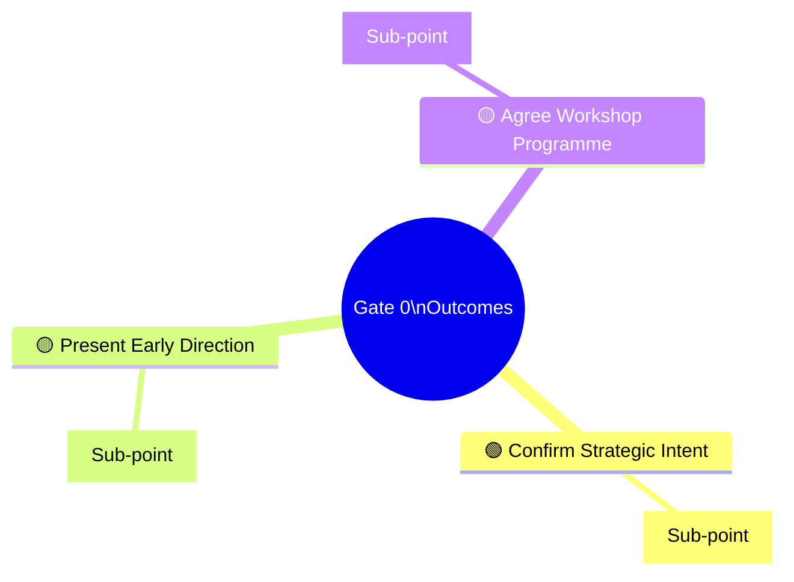
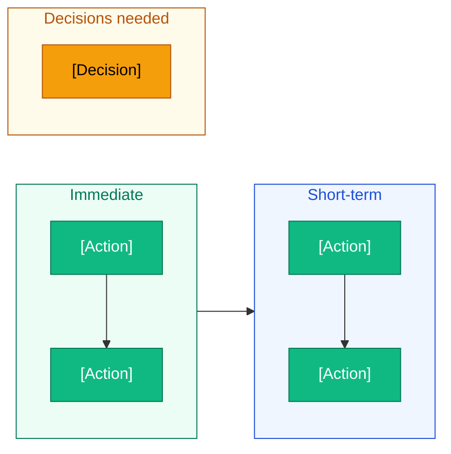

# Outcomes — Gate 0 (Kick-off) · Date TBD

_Live capture during session + post-session synthesis. Added once the session has actually run — this is a placeholder shape, not real content._

---

## Summary

[3-5 sentence synthesis: what was covered, what the session established, what it did not reach.]

---

## Session Blocks

_Captured live during the session._

| Legend | Reception                                                    |
| ------ | ------------------------------------------------------------ |
| 🟢     | Confirmed — no pushback, straightforward approval            |
| 🟡     | Confirmed with caveats — approved, but flagged for follow-up |
| 🔴     | Not confirmed — flagged for re-evaluation                    |

| #   | Block                    | Reception    |
| --- | ------------------------ | ------------ |
| 1   | Confirm Strategic Intent | 🟢 / 🟡 / 🔴 |
| 2   | Present Early Direction  | 🟢 / 🟡 / 🔴 |
| 3   | Agree Workshop Programme | 🟢 / 🟡 / 🔴 |

---

## Findings

_Post-session. One sub-section per block that produced a decision or a flag. Feeds Strategic Intent / Early Direction publishing directly — do not let a finding stop here._

### Confirm Strategic Intent — [finding title]

[Narrative finding — what was confirmed, flagged, or corrected.]

### Present Early Direction — [finding title]

[Narrative finding.]

---

## Next Steps

| Legend   | Meaning                           |
| -------- | --------------------------------- |
| 🟢 Green | Immediate action — start now      |
| 🔵 Blue  | Short-term action                 |
| 🟡 Amber | Decision needed before proceeding |

|                  | Item          | Owner | By  |
| ---------------- | ------------- | ----- | --- |
| ✅ Action        | [description] |       |     |
| 🔵 Decision      | [description] |       |     |
| 📋 Carry-forward | [description] |       |     |

---

## Gate Outcome

**Result:** [approved / flagged: `<items>`]

[If flagged, name the item(s) and where they re-open per `03 How the Engagement Runs.md`'s loop-back note.]
