# [DRAFT] Gate 1 (Steering Meeting) Agenda — Date TBD

_[[CLIENT_NAME]] × DataArt ADLC discovery — Gate 1's [Gate Review](/AI%20SDLC/01%20Process/07%20Workflows/02%20Gate%20Review.md) session. A leadership-level recap of what Investigate found, and alignment on where the engagement goes next._

**Audience:** Whoever sponsors the engagement and needs to approve the Problems + Solution Goals before Solution design starts.

**Format:** Recap vision → recap goals → recap problem understanding → where we go deeper.

**Duration:** Roughly 60 minutes — same time-boxing discipline as other ADLC sessions; compress the Problem Understanding block first if time runs short.

**Pre-read:** Share a short version of the recap materials in advance where the audience prefers to review before the meeting.

---

## Session Flow

```mermaid
flowchart LR
    B0["0: Opening\n(5 min)"] --> B1["1: Recap Vision\n(10 min)"] --> B2["2: Recap Goals\n(10 min)"] --> B3["3: Recap Problem\nUnderstanding (15-20 min)"] --> B4["4: Where We Go\nFrom Here (10-15 min)"] --> B5["5: Ask of\n[[CLIENT_NAME]] (5-10 min)"] --> B6["6: Questions &\nNext Steps (5-10 min)"]

    classDef opening fill:#1F2937,stroke:#111827,color:#fff
    classDef recap fill:#8B5CF6,stroke:#5B21B6,color:#fff
    classDef problem fill:#EF4444,stroke:#B91C1C,color:#fff
    classDef forward fill:#3B82F6,stroke:#1D4ED8,color:#fff
    classDef ask fill:#F59E0B,stroke:#B45309,color:#000
    classDef closing fill:#10B981,stroke:#047857,color:#fff

    class B0 opening
    class B1,B2 recap
    class B3 problem
    class B4 forward
    class B5 ask
    class B6 closing
```

---

## 0. Opening and Purpose of the Session (5 min)

- Why we're here: Investigate coverage is clear — this is where the findings get approved before Solution design starts.
- What we need from this meeting: confirmation of the vision and goals, a shared understanding of where we are, and agreement on what comes next.

## 1. Recap: Vision (10 min)

- Restate the [Strategic Intent](/AI%20SDLC/04%20Goals/02%20Strategic%20Intent.md) confirmed at Gate 0.
- Show the contrast: today's typical problem versus the target picture Investigate's evidence points at.
- **Check question for the audience:** does this match how `[[CLIENT_NAME]]` itself sees the target picture?

## 2. Recap: Engagement Goals (10 min)

Restate the [Solution Goals](/AI%20SDLC/04%20Goals/03%20Solution%20Goals.md) confirmed so far, and explicitly ask for confirmation on each:

1. [Goal 1 — cite its Solution Goals entry]
2. [Goal 2]
3. [Goal N — mark any still reserved/blocked, and on what]

**Check question for the audience:** do these goals still match what matters to the business right now?

## 3. Recap: How We Understand the Problem Today (15–20 min)

Don't dive into workshop-level detail — just the headline findings that already have evidence:

- [Problem headline 1 — cite its Problems registry entry]
- [Problem headline 2]
- State explicitly: this isn't the full list, just the most representative findings.

**Check question for the audience:** does leadership recognise this picture, and is there anything to correct or add?

## 4. Where We Go From Here (10–15 min)

- [Any Investigate gaps still open, or workshops still to run]
- **Solution model:** Target State → Pilot → Scale
- **Milestones and timing:** [What's confirmed vs. still needs an owner/date]

## 5. What We Need From [[CLIENT_NAME]] (Explicit Ask) (5–10 min)

- [Ask 1 — concrete, with what happens if it isn't met]
- [Ask N]

## 6. Questions and Next Steps (5–10 min)

- Open questions from the audience.
- Lock in agreements and owners for each item in block 5.
- Confirm the next milestone/session date.

---

## Preparation Notes

- [Who's preparing materials, and by when]
- [Delivery format — deck / PDF / live walkthrough]
- **Deck:** [Path under `decks/<deck-name>/` once generated via `deck-design-corporate`, or "not requested for this session"]
