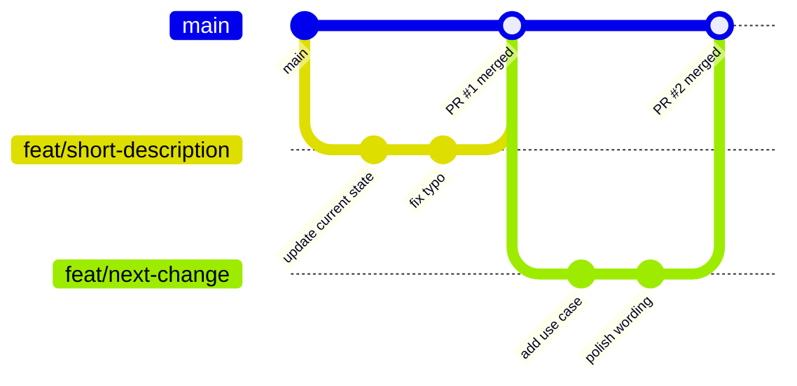

# Branching Policy

_Trunk-based development: `main` is always mergeable, all work happens on short-lived feature branches._

## Model

`main` is the trunk — always in a mergeable state, never worked on directly. Every change, big or small, gets its own short-lived feature branch that merges back via PR and is deleted afterward.

## Before starting new work

Always start from a fresh `main`, not wherever your last branch left off — start a new session per new task rather than continuing in an old branch's session:

| Situation            | Example prompt                    |
| -------------------- | --------------------------------- |
| Starting a new task  | "switch to main and pull"         |
| Just want to sync up | "pull latest version of the repo" |

Claude runs `checkout-main` and `pull` directly as named launch configs (`.claude/launch.json`) — no need to type git yourself.

1. Click **+** next to the project name to start a new session.
2. Check the branch picker — pick `main`, or ask Claude to switch to it.
3. Ask: "pull latest version of the repo."

_Red arrows: **+** starts a new session (left), the branch picker shows every local branch with a checkmark on the current one (right)._

Once it confirms the pull, you're on a clean, current `main` and ready to describe the next task.

## Rules

- One feature branch per PR — don't stack unrelated changes.
- Branch naming: `<type>/short-description`, same `type` as Conventional Commits (`feat`, `fix`, `docs`, `refactor`, `test`, `chore`) — see [Engineering Guide — Conventions](/Engineering%20Guide/01%20Conventions.md).
- Feature branches are short-lived — open the PR as soon as there's something reviewable, don't let it drift from `main`.
- Delete the branch after merge.

## After opening a PR

Watch the **CI** badge next to the PR bar — it turns from pending to pass/fail once checks run. A common failure is a deadlink the docs-site build check caught.

_Red arrow: the CI badge next to your PR — click it to see what failed._

If CI fails: ask Claude, "CI failed, can you check what's wrong and fix it?" — Claude fixes the issue and pushes the update to the same branch. Don't merge until CI is green.

_Red arrow: CI is green — the PR is ready. Ask colleagues to review, then merge._

→ See [Team Collaboration](./01%20Team%20Collaboration.md) for how commit/push/PR actually lands in this repo, plus the setup guide for [Claude Desktop](./02%20Claude%20Desktop%20Setup.md) or [Codex Desktop](./03%20Codex%20Desktop%20Setup.md).
