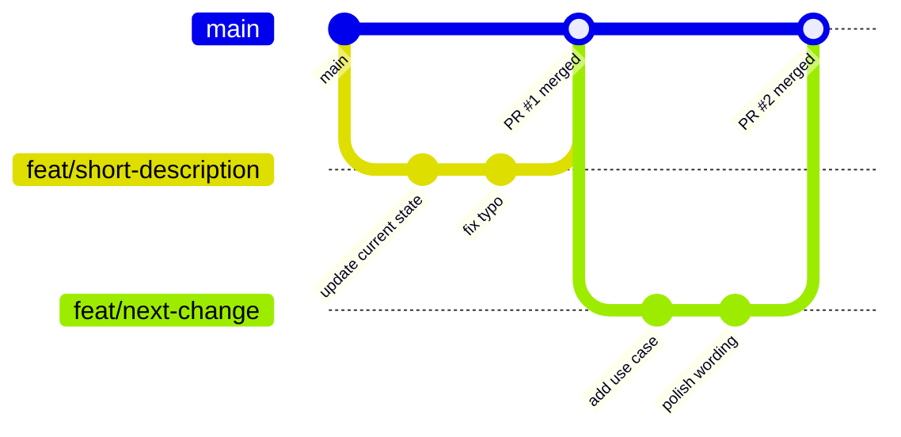

# Branching Policy

_Trunk-based development: `main` is always mergeable, all work happens on short-lived feature branches._

## Model

`main` is the trunk — always in a mergeable state, never worked on directly. Every change, big or small, gets its own short-lived feature branch that merges back via PR and is deleted afterward.

## Before starting new work

Always start from a fresh `main`, not wherever your last branch left off. Start a new assistant session for each task rather than continuing in an old branch's context.

| Situation            | Example prompt                                                                           |
| -------------------- | ---------------------------------------------------------------------------------------- |
| Starting a new task  | "Switch to `main`, pull the latest changes, then create a feature branch for this task." |
| Just want to sync up | "Pull the latest version of the repo."                                                   |

The assistant should confirm the resulting branch and whether `main` is current before beginning the task. If a command needs approval, approve it in the provider's normal command flow.

1. Start a new session for the task.
2. Ask: "Switch to `main` and pull the latest changes."
3. Ask: "Create a `<type>/short-description` branch for this task."

The screenshots below show the same flow in Claude Desktop. Codex Desktop screenshots can be added later; the prompts and policy are the same for both providers.

_Red arrows: **+** starts a new session (left), the branch picker shows every local branch with a checkmark on the current one (right)._

Once the assistant confirms the pull and new branch, describe the task in that session.

## Rules

- One feature branch per PR — don't stack unrelated changes.
- Branch naming: `<type>/short-description`, same `type` as Conventional Commits (`feat`, `fix`, `docs`, `refactor`, `test`, `chore`) — see [Engineering Guide — Conventions](/Engineering%20Guide/01%20Conventions.md).
- Feature branches are short-lived — open the PR as soon as there's something reviewable, don't let it drift from `main`.
- Delete the branch after merge.

## After opening a PR

After opening a PR, ask the assistant to monitor its checks:

> Watch the PR checks and tell me when CI passes or what failed.

A common failure is a dead link caught by the docs-site build. The screenshots below show Claude Desktop's CI indicator; other providers expose the same repository checks through their own interface.

_Red arrow: the CI badge next to your PR — click it to see what failed._

If CI fails, prompt:

> CI failed. Check the failing checks, explain the cause, fix it on this branch, and ask before pushing.

Don't merge until CI is green.

_Red arrow: CI is green — the PR is ready. Ask colleagues to review, then merge._

→ See [Team Collaboration](./01%20Team%20Collaboration.md) for how commit/push/PR actually lands in this repo, plus the setup guide for [Claude Desktop](./02%20Claude%20Desktop%20Setup.md) or [Codex Desktop](./03%20Codex%20Desktop%20Setup.md).
