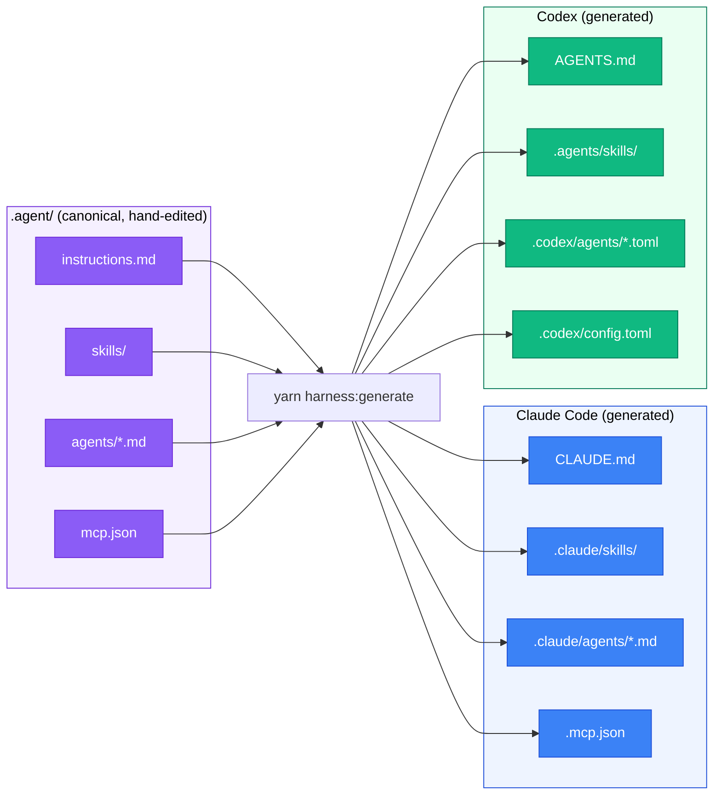

# Harness Generation

_How `.agent/` becomes `CLAUDE.md`/`AGENTS.md` and their tool-specific trees, and the safety guarantees the generator enforces along the way._

---

## Problem

Claude Code and Codex each expect their own root context file, skill layout, agent format, and MCP config. Hand-maintaining `.claude/` and `.codex/` as two parallel copies of the same rules drifts the moment one is edited and the other is forgotten — a fixed convention silently applies to only one tool. `.agent/` is the single canonical source; a generator renders it into both providers' native shapes so a change is made once and both tools stay in sync.

For the conceptual mapping of which file does what per tool, and the day-to-day `harness:generate` / `harness:check` commands, see `04 AI Coding Tool Compatibility.md`. This page covers the generator itself: its guarantees, its architecture, and how to extend it.

---

## Steps

### Canonical source → generated projections



`.agent/manifest.json` declares this whole mapping: canonical paths, and each provider's `instructions`/`skills`/`agents`/`mcp` output paths plus its slash-invocation prefix (`/` for Claude, `$` for Codex). Never hand-edit a generated tree — edit `.agent/`, then regenerate.

### Commands

Already wired into `package.json` and CI/pre-commit — see `04 AI Coding Tool Compatibility.md` for day-to-day usage:

```bash
yarn harness:generate                    # regenerate all providers
yarn harness:check                       # CI-safe: writes nothing, nonzero exit on drift
yarn harness:generate --provider claude  # scope to one provider (repeatable flag)
```

### Architecture — Template Method

`HarnessProvider.generate()` (`scripts/harness/lib/harness-provider.mts`) is a fixed sequence: write root instructions → sync the skills tree → write agents → write MCP config. `ClaudeProvider` and `CodexProvider` (`scripts/harness/providers/`) each override only the three hooks that differ:

| Hook                | Claude                                                  | Codex                                                                       |
| ------------------- | ------------------------------------------------------- | --------------------------------------------------------------------------- |
| `transformMarkdown` | No-op — canonical prose is already Claude-shaped        | `/skill` → `$skill`, `$ARGUMENTS` → prose, "Claude Code" → "Codex"          |
| `writeAgents`       | Syncs `.agent/agents/*.md` as-is into `.claude/agents/` | Parses each agent's YAML frontmatter and renders one `.toml` file per agent |
| `writeMcp`          | Writes `.mcp.json` (plain JSON, no header)              | Renders `.codex/config.toml` with a generated-file header                   |

To add a third provider: add its output paths to `.agent/manifest.json`, add a `HarnessProvider` subclass implementing the three hooks, and register the constructor in `PROVIDER_CLASSES` in `scripts/harness/generate.mts`. `generate.mts` never branches on a provider name.

### Safety properties

A manifest or canonical-content mistake here could delete or overwrite real repository content, so the generator is defensive at every stage:

| Property                            | What it prevents                                                                                                                                                                                                                             |
| ----------------------------------- | -------------------------------------------------------------------------------------------------------------------------------------------------------------------------------------------------------------------------------------------- |
| Manifest validation up front        | `validateManifest()` rejects any provider output root that equals the repo root, overlaps a canonical input path, or overlaps another provider's output tree — before any file is touched                                                    |
| Writer allowlist (defense in depth) | Every `write`/`remove`/`removeEmptyDir` call is checked against the manifest's declared output roots, independent of the repo-boundary check — a bug elsewhere in the pipeline still can't write outside a declared generated root           |
| Sync, not copy                      | Skills and agents are synced for both providers: files with no remaining canonical source are deleted, and directories left empty by that pruning are removed — renaming or deleting something in `.agent/` never leaves a stale file behind |
| `.md`-only text rewrites            | Provider text rewrites apply only to `.md` files; every other file (scripts, JSON, TOML, binary assets) is copied byte-for-byte, never text-transformed — a shell script comment containing "Claude Code" is never silently rewritten        |
| Agent name validation               | Canonical agent `name:` values are checked against `^[a-z][a-z0-9-]*$` before being used to build a filename, blocking path traversal via a bad frontmatter value                                                                            |
| Real YAML parsing                   | Agent frontmatter is parsed with the `yaml` npm package, not a hand-rolled regex subset — quoted scalars, inline arrays (`tools: [Read, Glob, Grep]`), and block scalars all parse correctly                                                 |
| Dual provenance hashes              | Every generated file carries a header with a `canonical-sha256` (hash of the exact canonical source bytes) and a `rendered-*-sha256` (hash of the provider-specific output) — two distinct hashes, never conflated                           |

---

## Notes

**Codex has no per-agent tool allowlist.** Claude's `tools:` frontmatter mechanically restricts which tools a subagent can call. Codex's closest primitive is `sandbox_mode` (`read-only` or `workspace-write`) — a coarser two-way split — so the generator additionally writes the narrower intended role and path scope into Codex's `developer_instructions` as explicit prose. On Codex this is guidance the model can violate, not a sandboxed guarantee. This is a permanent property of the two tools, not a gap to be fixed later.

→ See `04 AI Coding Tool Compatibility.md` for the cross-tool primitive mapping and daily commands.
→ See `scripts/harness/README.md` for the module layout, read alongside the code.
