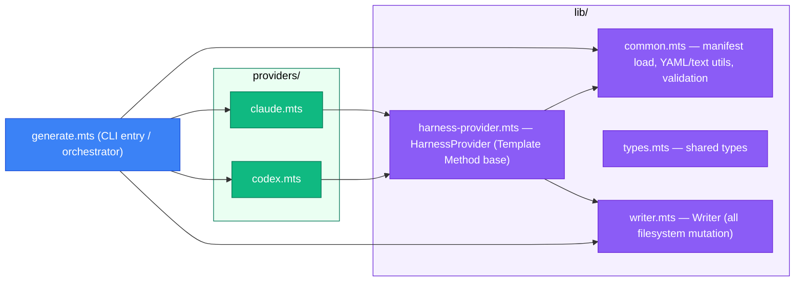

# Harness Generator

Regenerates Claude Code's and Codex's configuration files from the canonical `.harness/` harness, so both tools can run this repo's `/dev`, `/design`, `/discovery`, etc. workflows independently. `.harness/manifest.json` maps canonical paths to each provider's output paths.



## How to run locally

```bash
yarn harness:generate                    # regenerate all providers
yarn harness:check                       # CI-safe: writes nothing, nonzero exit on drift
yarn harness:generate --provider claude  # scope to one provider (repeatable)
yarn harness:generate --provider codex
```

Never hand-edit `CLAUDE.md`, `AGENTS.md`, `.claude/`, `.agents/`, or `.codex/` — edit `.harness/`, then regenerate.

Adding a third provider: add its paths to `.harness/manifest.json`, add a `HarnessProvider` subclass under `providers/`, and register the constructor in `PROVIDER_CLASSES` in `generate.mts`.

## Links

- `docs/Engineering Guide/09 Harness Generation.md` — full rationale, architecture, and safety-property writeup
- `docs/Engineering Guide/04 AI Coding Tool Compatibility.md` — cross-tool primitive mapping
