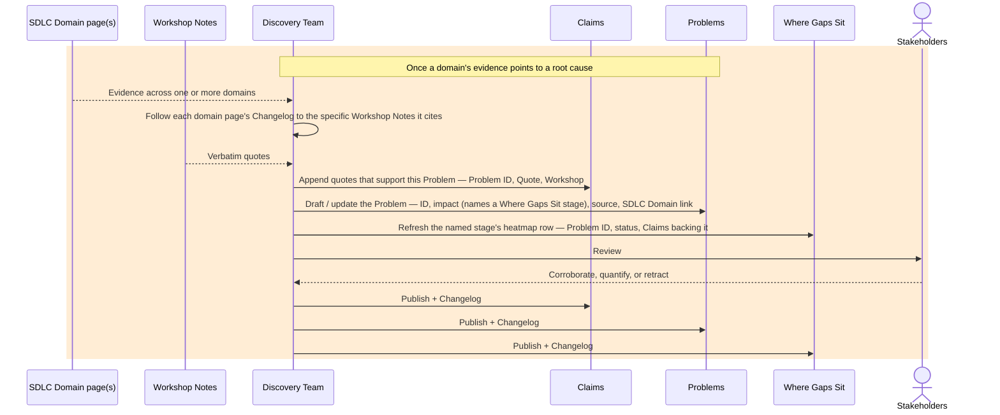

# Problem — Diagnose

_SDLC Domain evidence gets synthesized into a Problem — a root cause, ranked and evidenced, added to the [Problems](/AI%20SDLC/03%20Problem%20Space/02%20Diagnose/02%20Problems.md) registry, its supporting quotes traced back to the originating Workshop Notes and extracted into [Claims](/AI%20SDLC/03%20Problem%20Space/02%20Diagnose/03%20Claims.md), and rolled into the [Where Gaps Sit](/AI%20SDLC/03%20Problem%20Space/02%20Diagnose/01%20Where%20Gaps%20Sit.md) heatmap. The derivation runs one way — Claims → Problems → Where Gaps Sit — a stage only shows up hot on the heatmap because a Problem names it, and a Problem only exists because Claims back it. This stage owns the whole chain: it doesn't inherit pre-tagged Claims from Capture, it extracts them itself._

**Status moves forward only.** A Problem is 🟡 **Reported** the moment a single source names it, 🟢 **Confirmed** once a second, independent source corroborates it — in practice, a second Claims row on the same Problem ID from a different workshop — 🔵 **Measured** once a number backs the impact claim, or ⚫ **Retracted** if it turns out to be wrong — the reason stays on record, the ID is never reused. Most problems in a discovery-scale engagement settle at 🟡 or 🟢; few reach 🔵.

**Reiterate while still green.** Keep looping draft → validate as long as each pass still changes the picture — stop once the root cause holds steady across a validation session. That's what makes the Problem eligible for [Solution Goals](./04%20Goals%20-%20Solution%20Goals.md).

→ [Goals — Solution Goals](./04%20Goals%20-%20Solution%20Goals.md) for how a confirmed Problem turns into a grounded goal. → [Problem — SDLC Domains](./02%20Problem%20-%20SDLC%20Domains.md) for where this evidence comes from.
