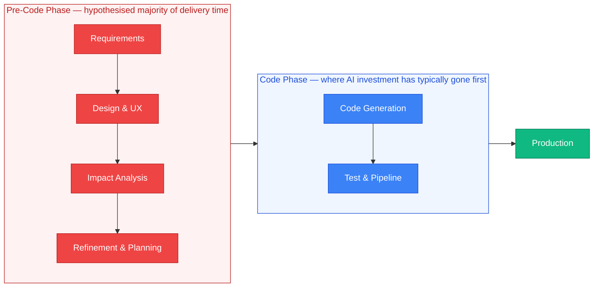

# Where Gaps Sit

_The path one piece of work takes from idea to production, and where it actually breaks down. Not only time — a stage can lose time, but it can also lose quality, coverage, or ownership without losing a single minute on the clock. A heatmap of [Problems](./02%20Problems.md), not an independent finding — each Problem's own **Impact on delivery speed** field says which stage it slows; this page rolls that up. Problems themselves are diagnosed from [Claims](./03%20Claims.md), the raw quotes each one draws on._

> [!WARNING] Populated During Engagement
> This page aggregates [Problems](./02%20Problems.md) — which draw on [Claims](./03%20Claims.md) and [SDLC Domains](/AI%20SDLC/02%20Capture/00%20Overview.md#sdlc-domains) — onto the pipeline below. It is a placeholder until that evidence exists.

---

## The Founding Hypothesis

Most delivery time is lost before code is written, not during it — this engagement exists to confirm or refute that, not assume it. Time is the primary lens, not the only one: the same stage-by-stage walk can also surface a quality gap (output nobody trusts), a coverage gap (nothing captured at all), or a governance gap (no one owns the decision) — worth naming even where the clock isn't the problem.

---

## Problem Density Heatmap

_One row per pipeline stage, aggregated from every Problem's **Impact on delivery speed** field on [Problems](./02%20Problems.md) — not filled in independently. A Problem that names two stages appears in both rows. Re-derive this table whenever a Problem is added, moves status, or is retracted._

| Stage                   | Problems                               | Dominant Gap Type                               | Claims Backing                   |
| ----------------------- | -------------------------------------- | ----------------------------------------------- | -------------------------------- |
| Idea → Backlog          | _[Problem IDs + status, e.g. 🟢 P-01]_ | [Time / Quality / Coverage / Governance / None] | _[Claims IDs from 03 Claims.md]_ |
| Refinement & Planning   | _[Problem IDs + status]_               | [Time / Quality / Coverage / Governance / None] | _[Claims IDs]_                   |
| Design & UX             | _[Problem IDs + status]_               | [Time / Quality / Coverage / Governance / None] | _[Claims IDs]_                   |
| Technical Design        | _[Problem IDs + status]_               | [Time / Quality / Coverage / Governance / None] | _[Claims IDs]_                   |
| Build (code generation) | _[Problem IDs + status]_               | [Time / Quality / Coverage / Governance / None] | _[Claims IDs]_                   |
| Test & Pipeline         | _[Problem IDs + status]_               | [Time / Quality / Coverage / Governance / None] | _[Claims IDs]_                   |
| Review → Production     | _[Problem IDs + status]_               | [Time / Quality / Coverage / Governance / None] | _[Claims IDs]_                   |

**Where it's worst:** [Name the 1-2 stages carrying the most/highest-status Problems — that's the headline this page exists to produce.]

---

## One Task, Idea to Production

_A single concrete example, not the aggregate — complements the heatmap above with one representative task the room will recognise, rather than a rollup across all diagnosed Problems. [DESCRIBE THE REPRESENTATIVE TASK — a real, recent, mid-sized piece of work, walked stage by stage.]_

| Stage                   | Typical Duration | Gap Type                                        | Notes                |
| ----------------------- | ---------------- | ----------------------------------------------- | -------------------- |
| Idea → Backlog          | [DURATION]       | [Time / Quality / Coverage / Governance / None] | [NOTES / BOTTLENECK] |
| Refinement & Planning   | [DURATION]       | [Time / Quality / Coverage / Governance / None] | [NOTES / BOTTLENECK] |
| Design & UX             | [DURATION]       | [Time / Quality / Coverage / Governance / None] | [NOTES / BOTTLENECK] |
| Technical Design        | [DURATION]       | [Time / Quality / Coverage / Governance / None] | [NOTES / BOTTLENECK] |
| Build (code generation) | [DURATION]       | [Time / Quality / Coverage / Governance / None] | [NOTES / BOTTLENECK] |
| Test & Pipeline         | [DURATION]       | [Time / Quality / Coverage / Governance / None] | [NOTES / BOTTLENECK] |
| Review → Production     | [DURATION]       | [Time / Quality / Coverage / Governance / None] | [NOTES / BOTTLENECK] |

**Baseline: [TOTAL DURATION] idea to production, against a target of [TARGET DURATION]. [Note any stage above where the gap isn't time — a quality, coverage, or governance gap belongs here even if the duration itself looks fine.]**

---

## Central Symptom

[DESCRIBE THE CENTRAL SYMPTOM — the observable, measurable delivery problem this engagement exists to diagnose. Usually a time metric (lead time, DORA metrics) but not always — a quality, coverage, or governance indicator counts too if that's where the room's pain actually sits, stuck despite rising AI usage.]

---

To dig into why a stage is hot, follow a Problem ID in the heatmap above to its full entry on [Problems](./02%20Problems.md).

---

## Changelog

_Every change to this page traces to the Problem whose addition, status move, or retraction shifted the heatmap — link the Problem entry, don't just describe the change._

| Date   | Change         | Evidence                                  |
| ------ | -------------- | ----------------------------------------- |
| [DATE] | [WHAT CHANGED] | [Problem — e.g. P-01](./02%20Problems.md) |
