# Overview

> [!TIP] Three Phases, Six Stages, One Living System
>
> This engagement runs three phases — Investigate (Capture → Problem → Goals), Solution (Target State → Pilot → Scale → Evolve), Roadmap (no stages of its own) — see [02 Terminology](./02%20Terminology.md) if "phase" and "stage" aren't already clear. Every stage is a living artifact that evolves as the team learns, not a static document. The process is inspired by [DataArt's Connect Framework](../06%20Reference/01%20Connect%20Framework.md) (Goals → Problem Space → Solution Space → Milestones) — adapted with an upfront Capture stage, Goals split into a raw upfront form (Strategic Intent) and a grounded, re-scoped form (Solution Goals), and a Target State → Pilot → Scale → Evolve solution loop. See [Connect Framework](../06%20Reference/01%20Connect%20Framework.md) for the original methodology and exactly how this adapts it.

## Process Grain

_How the phases and stages depend on each other, and why the same arc runs at every scale — the engagement as a whole, each workshop day, and each individual session._

```mermaid
flowchart LR
    IN["🗯️ Strategic Intent\nWhy does this engagement exist, raw?"]

    subgraph InvestigateGroup["🔍 Investigate: What's driving this, what's broken, and what's worth solving?"]
        direction TB
        G["🎯 Goals\nWhat's evidenced and worth solving?"]
        C["👁️ Capture\nWhat's actually happening today?"]
        P["❓ Problem\nWhat is broken, and why?"]
        C --> P --> G
    end

    subgraph SolutionGroup["🔧 Solution: What would change the outcome — not just the speed?"]
        direction TB
        TSt["Target State\nWhat does the end state actually look like?"]
        Pi["Pilot\nWhat's the one thing we prove first, and how?"]
        Sc["Scale\nHow does the proven pattern extend beyond the pilot?"]
        Ev["Evolve\nWhat do we change based on what we've learned?"]
        TSt --> Pi --> Sc --> Ev
        Ev -.->|"feed learnings back"| Pi
        Ev -.->|"refines"| TSt
    end

    R["🗺️ Roadmap\nWhat's the phased plan?"]

    IN -.->|"informs"| C
    IN -.->|"grounds + re-scopes"| G
    IN -.->|"anchors"| TSt
    InvestigateGroup --> SolutionGroup --> R

    classDef intent fill:#F59E0B,stroke:#B45309,color:#000
    classDef capture fill:#8B5CF6,stroke:#5B21B6,color:#fff
    classDef problem fill:#EF4444,stroke:#B91C1C,color:#fff
    classDef goals fill:#10B981,stroke:#047857,color:#fff
    classDef target fill:#8B5CF6,stroke:#5B21B6,color:#fff
    classDef pilot fill:#F59E0B,stroke:#B45309,color:#000
    classDef scale fill:#3B82F6,stroke:#1D4ED8,color:#fff
    classDef evolve fill:#10B981,stroke:#047857,color:#fff
    classDef roadmap fill:#3B82F6,stroke:#1D4ED8,color:#fff

    class IN intent
    class C capture
    class P problem
    class G goals
    class TSt target
    class Pi pilot
    class Sc scale
    class Ev evolve
    class R roadmap

    style InvestigateGroup fill:#F5F3FF,stroke:#8B5CF6,color:#6D28D9
    style SolutionGroup fill:#EEF2FF,stroke:#6366F1,color:#4338CA
```

Strategic Intent sets the target upfront, raw, before Investigate's stage loop even starts. Capture surfaces the raw material and validates it. Problem gets diagnosed. Goals grounds Intent and re-scopes it against that evidence, in one step, producing Solution Goals. Solution turns Intent and Goals into a concrete Target State, proves one piece of it as Pilot, then extends and revises what worked through Scale → Evolve. Roadmap is the settled shape the engagement converges on.

The process applies at every scale: to the engagement as a whole, to each workshop day, and to each individual session. The arc is the same; only the grain changes.

→ [02 Terminology](./02%20Terminology.md) for what "phase," "stage," and "artifact" mean and where each artifact actually lives. → [03 How the Engagement Runs](./03%20How%20the%20Engagement%20Runs.md) for how this arc maps onto gates and weeks. → [04 Evidence Chain](./04%20Evidence%20Chain.md) for how each stage's claims trace back to source.

## 🔍 Investigate

> **What's driving this, what's broken, and what's worth solving?**

> [!NOTE] Living Pages
> This page describes the process itself and does not change during the engagement. Each stage below has its own home holding today's best understanding — a placeholder at the start, filled in and revised as workshops progress. For the concrete, step-by-step mechanics of how each stage actually moves, see [Workflows](../05%20Workflows/01%20Initiation.md).

### 👁️ Capture — Capture the Current State

> **What's actually happening today, and where is delivery time being lost?**

Discovery workshops that build a shared, evidenced picture of today's SDLC — process, architecture, context topology, AI adoption, metrics, tooling. Current State only: Capture doesn't set a target state, propose solutions, or draft goals — that's [Goals](#-goals) and [Solution](#-solution)'s job, once this evidence exists. This is the mechanism that feeds Problem directly and validates Strategic Intent along the way: the same workshops that diagnose root causes confirm, reorder, or cut what leadership stated upfront. Strategic Intent is captured before Capture starts, not surfaced by it — but nothing in it is treated as final until Capture validates it.

→ [02 Capture](/AI%20SDLC/02%20Capture/) for the workshop programme and coverage tracker. → [Investigate workflow](../05%20Workflows/03%20Investigate/00%20Orchestration.md) for how a workshop cycle actually runs.

### ❓ Problem

> **Where is time lost, and what is the root cause?**

Things to figure out, in priority order. Problems enter, get worked, produce solutions and decisions, then resolve.

→ [03 Problem Space](/AI%20SDLC/03%20Problem%20Space/) for the current hypothesis and domains under diagnosis. → [Investigate workflow](../05%20Workflows/03%20Investigate/00%20Orchestration.md) and [Gate Review workflow](../05%20Workflows/02%20Gate%20Review.md) for how a hypothesis gets diagnosed and confirmed.

### 🎯 Goals

> **Of what we set out to achieve, what's actually evidenced and worth solving?**

Two artifacts, one stage. **Intent** — the raw trigger, captured close to verbatim before diagnosis starts, usually a blunt statement of spend, ambition, or discomfort, not yet a scored objective; real enough to be the actual reason budget got approved. **Solution** — the grounded, evidenced version of Intent, narrowed to what Problem has actually diagnosed a root cause for. A goal without a diagnosed problem behind it has no evidence it's the right thing to solve; this is where that filter gets applied, in the same step as grounding it.

→ [04 Goals](/AI%20SDLC/04%20Goals/) for [[CLIENT_NAME]]'s current goals, both forms. → [Initiation workflow](../05%20Workflows/01%20Initiation.md) for how Intent is captured and published. → [Gate Review workflow](../05%20Workflows/02%20Gate%20Review.md) for how Solution's fit against Intent gets scored.

## 🔧 Solution

> **What would change the outcome — not just the speed?**

Target State first — the concrete end-state picture, grounded in Strategic Intent and Solution Goals. Everything after it is a Target State → Pilot → Scale → Evolve closed loop: Pilot isn't picked independently of Target State, it's the one slice of it the team commits to proving first; Scale extends what Pilot proved; Evolve closes the loop, feeding learnings back into Pilot and refining Target State itself.

> [!IMPORTANT] Target State, Pilot design, and Scale design are specified by running `/design`, not decided on a Solution Space page
> Topology, context/bootstrap, and process↔context↔code wiring are architecture decisions — spanning metrics/observability/KPIs, tooling choice, repo composition, and context topology. [Target State](/AI%20SDLC/05%20Solution%20Space/02%20Target%20State.md) states _what_ the gap is; closing it is a `/design` ticket that produces the actual HLD-level spec (`Architecture.md`, `Design.md`, `Stack.md`) in [Target Architecture (HLD)](/Target%20Architecture%20%28HLD%29/) — same as any other architecture decision in this repo, not a special case for the pilot.

→ [05 Solution Space](/AI%20SDLC/05%20Solution%20Space/) for the current evaluation dimensions, pilot options, and the full Target State → Pilot → Scale → Evolve pattern. → [Solution workflow](../05%20Workflows/04%20Solution/00%20Overview.md) for the three concrete design flows (Target State, Pilot, Scale).

## 🗺️ Roadmap

> **What's the phased delivery plan, and who owns each step?**

The settled shape the engagement converges on — scope, phases, timelines, team composition. No stages of its own — its artifacts (Milestones, WBS, Timeline) sit directly under the phase, per [02 Terminology](./02%20Terminology.md). Fed by the day-to-day tracked milestone list ([Roadmap — Milestones](/AI%20SDLC/06%20Roadmap/02%20Milestones.md)) as commitments firm up.

→ [06 Roadmap](/AI%20SDLC/06%20Roadmap/) for the current phased plan. → [Roadmap workflow](../05%20Workflows/05%20Roadmap/00%20Overview.md) for how Milestones, WBS, team composition, and Timeline get sequenced.
