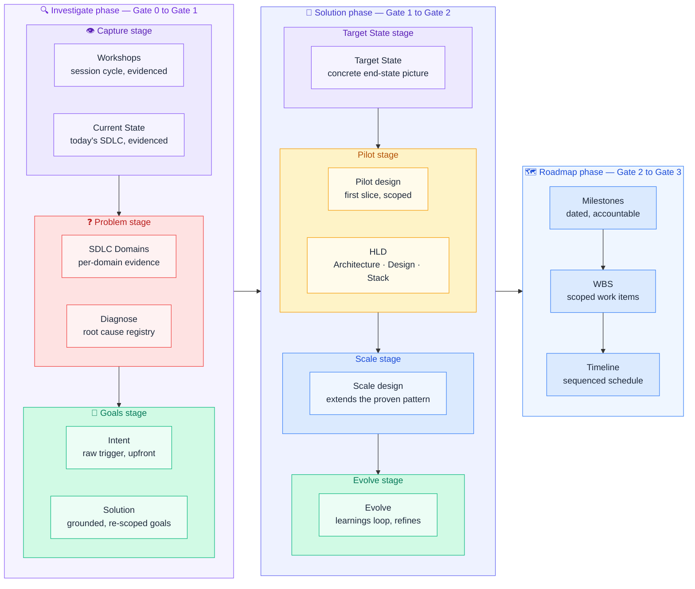

# Terminology

_The three words every other page in this section uses without redefining: **Phase**, **Stage**, **Artifact**. Read this once and the rest of the section stops needing to be reverse-engineered from context. Static — doesn't change during the engagement._

| Level        | What it is                                                                                    | How many                                         |
| ------------ | --------------------------------------------------------------------------------------------- | ------------------------------------------------ |
| **Phase**    | A gate-bound execution window — has a start gate, an end gate, and a rough calendar duration. | 3 — Investigate, Solution, Roadmap               |
| **Stage**    | A category of work inside a phase — groups artifacts, not a fixed time slice of the phase.    | 3 for Investigate, 4 for Solution, 0 for Roadmap |
| **Artifact** | An actual page/deliverable a stage produces — the thing with a Changelog, a status, an owner. | Varies per stage                                 |

## Phase → Stage → Artifact

_Target State → Pilot → Scale → Evolve is a closed loop in practice — Evolve feeds learnings back into Pilot and refines Target State (see [01 Overview — Process Grain](./01%20Overview.md#process-grain)) — flattened here to a straight chain so the stage order stays readable._

| Phase           | Stage        | Artifacts                                            | Lives in                                                                                                                                      |
| --------------- | ------------ | ---------------------------------------------------- | --------------------------------------------------------------------------------------------------------------------------------------------- |
| **Investigate** | Capture      | Workshops, Current State                             | [02 Capture](/AI%20SDLC/02%20Capture/)                                                                                                        |
| **Investigate** | Problem      | SDLC Domains, Diagnose (Problems registry)           | [03 Problem Space](/AI%20SDLC/03%20Problem%20Space/)                                                                                          |
| **Investigate** | Goals        | Intent (Strategic Intent), Solution (Solution Goals) | [04 Goals](/AI%20SDLC/04%20Goals/)                                                                                                            |
| **Solution**    | Target State | Target State                                         | [05 Solution Space — Target State](/AI%20SDLC/05%20Solution%20Space/02%20Target%20State.md)                                                   |
| **Solution**    | Pilot        | Pilot design + HLD (`Architecture`/`Design`/`Stack`) | [05 Solution Space — Pilot](/AI%20SDLC/05%20Solution%20Space/03%20Pilot.md), [Target Architecture (HLD)](/Target%20Architecture%20%28HLD%29/) |
| **Solution**    | Scale        | Scale design                                         | [05 Solution Space — Scale](/AI%20SDLC/05%20Solution%20Space/04%20Scale.md)                                                                   |
| **Solution**    | Evolve       | Evolve (learnings loop back into Pilot)              | [05 Solution Space — Evolve](/AI%20SDLC/05%20Solution%20Space/05%20Evolve.md)                                                                 |
| **Roadmap**     | _none_       | Milestones, WBS, Timeline (+ Team Composition)       | [06 Roadmap](/AI%20SDLC/06%20Roadmap/)                                                                                                        |

## Reading the Stage Order

**A stage is a folder, not a time slice.** Capture → Problem → Goals reads like a strict sequence, and mostly runs that way — but it isn't a hard rule. [Investigate — Orchestration](../05%20Workflows/03%20Investigate/00%20Orchestration.md) has Problem and Goals looping back into each other per domain, and Goals' Intent artifact is captured before Capture even starts, at Gate 0 by [Initiation](../05%20Workflows/01%20Initiation.md) — before the Investigate phase's own loop begins. "Stage" tells you which folder an artifact's page lives in, not when in the phase it gets touched.

→ [01 Overview](./01%20Overview.md) for how these phases and stages connect end to end. → [03 How the Engagement Runs](./03%20How%20the%20Engagement%20Runs.md) for how phases map onto gates and weeks.
