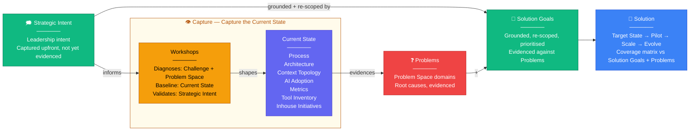

# Evidence Chain

_The engagement is a data pipeline: one primary source, one append-only log, everything else derived from those two. Flow is one-way by default — loops are a normal correction mechanism, not a failure of the template._

## Pipeline Principles

| Principle                                        | What it means                                                                                                                                                                                                                                                                                                                                                                  |
| ------------------------------------------------ | ------------------------------------------------------------------------------------------------------------------------------------------------------------------------------------------------------------------------------------------------------------------------------------------------------------------------------------------------------------------------------ |
| **Strategic Intent is primary, set once**        | Captured at kickoff — see [Initiation](../05%20Workflows/01%20Initiation.md) — then only ever validated or grounded, never re-derived from something downstream.                                                                                                                                                                                                               |
| **Workshops are an append-only log**             | Nothing already captured gets deleted. A later session confirming, reordering, or cutting an earlier finding is itself a new entry, not an edit to history.                                                                                                                                                                                                                    |
| **Everything else is derived**                   | Current State, SDLC Domains, Diagnose, Solution Goals, Solution, and Roadmap all generate from what's upstream — none of them get typed in independently of the workshops or Intent that justify them.                                                                                                                                                                         |
| **Solution Goals must cover Strategic Intent**   | The one place the two source threads — evidence and intent — merge. A diagnosed Problem is the hard gate: a goal with no Problem behind it doesn't survive [Gate Review](../05%20Workflows/02%20Gate%20Review.md)'s alignment step. Fit against Strategic Intent is then scored, not gate-kept — a goal with weak Intent fit gets flagged for re-evaluation, not cut outright. |
| **Flow is one-way by default; loops are normal** | Data moves left to right. Any node can send new evidence back upstream and re-open a phase that already closed — a correction, not a failure of the template. See [How the Engagement Runs](./03%20How%20the%20Engagement%20Runs.md) for how gates absorb that.                                                                                                                |

Every `## Changelog` table across `docs/AI SDLC/` (Strategic Intent, Solution Goals, Problems, SDLC Domains, Early Direction) is this pipeline's audit trail at page scale — each row cites the workshop or conversation that moved it, not just the date. → [Workflows](../05%20Workflows/01%20Initiation.md) for the concrete capture → process → review → publish sequence that writes those rows.
