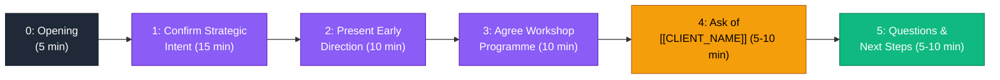

# [DRAFT] Gate 0 (Kick-off) Agenda — Date TBD

_[[CLIENT_NAME]] × DataArt ADLC discovery — Gate 0's [Initiation](/AI%20SDLC/01%20Engagement/05%20Workflows/01%20Initiation.md) session. A formal kickoff: confirm the raw intent captured at intake, present the Early Direction hypothesis, and agree the Investigate workshop programme._

**Audience:** The engagement sponsor and whoever owns delivery day-to-day — the same people who supplied the intake conversation this agenda's content is drawn from.

**Format:** Confirm Strategic Intent → present Early Direction → agree the workshop programme → next steps.

**Duration:** Roughly 45–60 minutes.

**Pre-read:** Share the draft [Strategic Intent](/AI%20SDLC/04%20Goals/02%20Strategic%20Intent.md) ahead of the session where possible — this session confirms it, it doesn't draft it live.

---

## Session Flow

---

## 0. Opening and Purpose of the Session (5 min)

- Why we're here: the formal start of the discovery engagement, now that intake has produced a first draft of intent.
- What we need from this meeting: confirmation of Strategic Intent, sign-off on the Early Direction hypothesis, and agreement on the workshop programme that follows.

## 1. Confirm: Strategic Intent (15 min)

- Restate the raw intent captured close to verbatim from the intake conversation (sales notes, RFP, kickoff transcript) — see [Strategic Intent](/AI%20SDLC/04%20Goals/02%20Strategic%20Intent.md).
- This is a sanity check, not a workshop — Investigate does the real validation later.
- **Check question for the audience:** does this still match what leadership actually wants out of the engagement? Anything to confirm, reorder, or cut?

## 2. Present: Early Direction (10 min)

- Share the likely pilot domain, known constraints, and stated aspirations the same intake conversation signalled — see [Solution Space — Early Direction](/AI%20SDLC/05%20Solution%20Space/index.md#early-direction).
- Name it explicitly as a hypothesis, not a confirmed finding — it gets refined once Problem Space evidence exists.
- **Check question for the audience:** does this look like a plausible starting point, or is there an obvious correction before Investigate begins?

## 3. Agree: Investigate Workshop Programme (10 min)

- Walk the shape of the workshop programme — see [Workshops Overview](/AI%20SDLC/02%20Capture/00%20Overview.md).
- Confirm who from `[[CLIENT_NAME]]` needs to be in the room for each workshop, and provisional scheduling.

## 4. What We Need From [[CLIENT_NAME]] (Explicit Ask) (5–10 min)

- Named contacts per SDLC Domain for the workshop programme.
- Calendar commitment for the first 1–3 weeks (Investigate's target duration).
- Any data-access or tooling prerequisites Investigate will need.

## 5. Questions and Next Steps (5–10 min)

- Open questions from the audience.
- Lock in agreements and owners for each item in block 4.
- Confirm the first workshop's date.

---

## Preparation Notes

- [Who's preparing materials, and by when]
- [Delivery format — deck / PDF / live walkthrough]
- **Deck:** [Path under `decks/<deck-name>/` once generated via `deck-design-corporate`, or "not requested for this session"]
