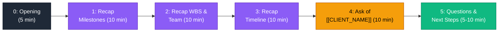

# [DRAFT] Gate 3 (Final Sign-off) Agenda — Date TBD

_[[CLIENT_NAME]] × DataArt ADLC discovery — Gate 3's Final Sign-off session (see [How the Engagement Runs](/AI%20SDLC/01%20Engagement/03%20Process/03%20How%20the%20Engagement%20Runs.md#the-four-gates)). Presents the phased delivery plan — Milestones, WBS, team composition, and Timeline — for final sign-off._

**Audience:** Whoever staffs and funds the delivery plan — the same sponsor who approved the Solution at Gate 2.

**Format:** Recap Milestones → recap WBS & team composition → recap Timeline → ask for final sign-off.

**Duration:** Roughly 45–60 minutes.

**Pre-read:** Share the Roadmap artifacts (Milestones, WBS, Timeline) ahead of the session — this is a sign-off session, not where the plan gets built live.

---

## Session Flow

---

## 0. Opening and Purpose of the Session (5 min)

- Why we're here: the delivery plan is sequenced — this is the engagement's final sign-off before execution starts.
- What we need from this meeting: confirmed staffing and funding against the plan below.

## 1. Recap: Milestones (10 min)

- Restate the sequenced [Milestones](/AI%20SDLC/06%20Roadmap/02%20Milestones.md) the delivery plan is measured against.
- **Check question for the audience:** do these dates still hold given anything that's changed since Gate 2?

## 2. Recap: WBS and Team Composition (10 min)

- Restate the [WBS](/AI%20SDLC/06%20Roadmap/03%20WBS.md) and the [team composition](/AI%20SDLC/06%20Roadmap/01%20Overview.md#team-composition) it assumes.
- **Check question for the audience:** is this staffing realistic against what `[[CLIENT_NAME]]` can actually commit?

## 3. Recap: Timeline (10 min)

- Restate the sequenced [Timeline](/AI%20SDLC/06%20Roadmap/04%20Timeline.md).
- **Check question for the audience:** any external dependency or deadline this doesn't yet account for?

## 4. What We Need From [[CLIENT_NAME]] (Explicit Ask) (10 min)

- Final sign-off on the delivery plan.
- Confirmed staffing commitment against the WBS/team composition above.
- Confirmed funding against the Timeline.

## 5. Questions and Next Steps (5–10 min)

- Open questions from the audience.
- Lock in agreements and owners for each item in block 4.
- Confirm the execution kickoff date.

---

## Preparation Notes

- [Who's preparing materials, and by when]
- [Delivery format — deck / PDF / live walkthrough]
- **Deck:** [Path under `decks/<deck-name>/` once generated via `deck-design-corporate`, or "not requested for this session"]
