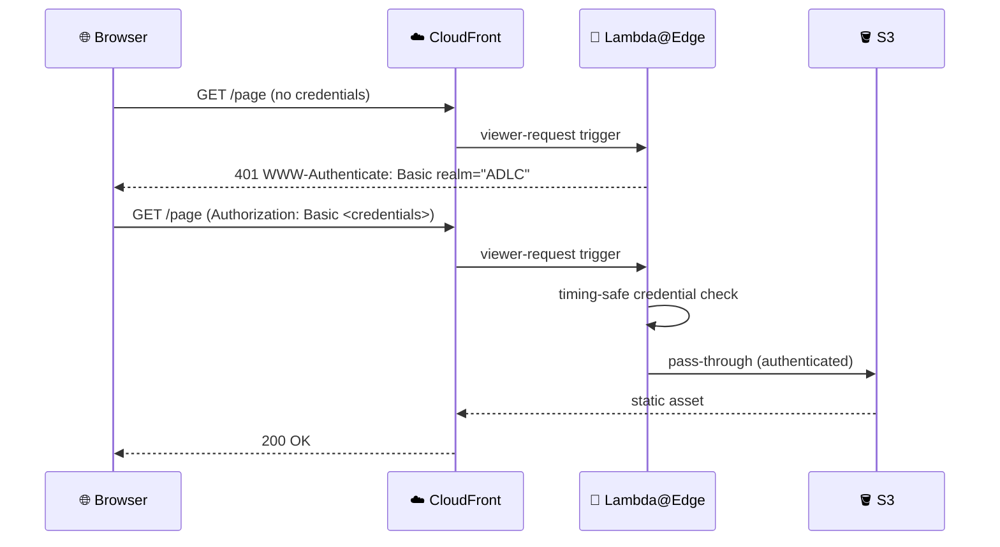
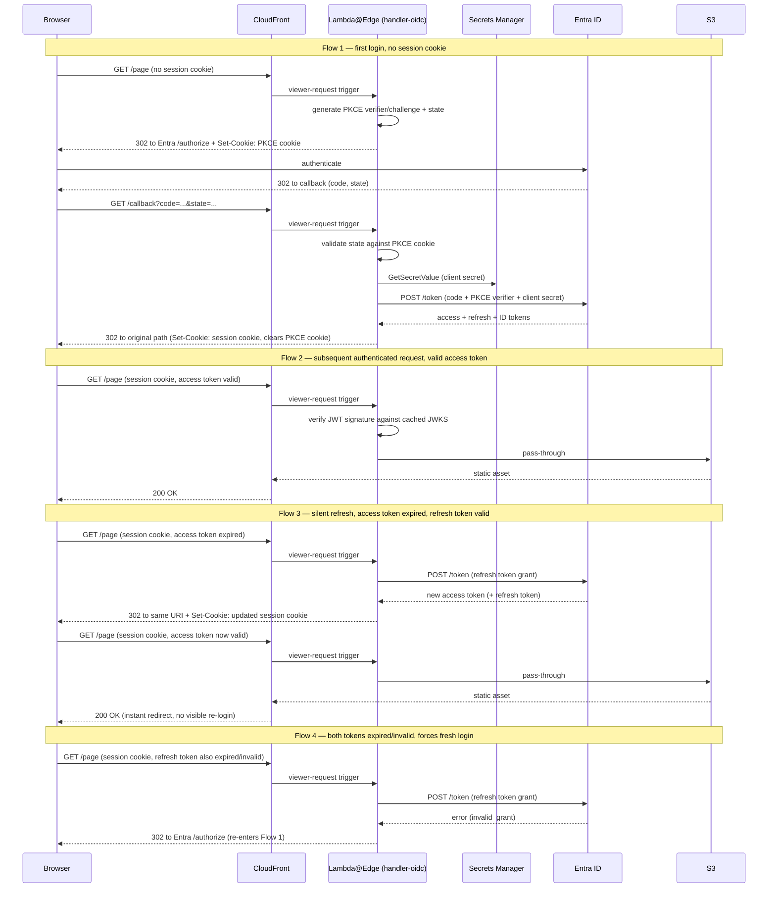

# Auth Container

Lambda@Edge handler supporting three deploy-time-selected auth modes — `none`, `basic`, `oidc` — selected via the `AUTH_MODE` build-time env var. Exactly one mode's code ships per build.

## Baseline diagrams

`basic` mode (unchanged from today's single-mode behavior):



`none` mode: unconditional pass-through to S3 on every request — no credential check, no cookie, no Secrets Manager call.

`oidc` mode — first login, steady-state, silent refresh, forced re-login:



## Responsibilities

- Select auth behavior at build time via `AUTH_MODE` (`none`/`basic`/`oidc`) — no runtime toggle
- `none` mode: intercept every viewer request and pass through unconditionally
- `basic` mode: parse the `Authorization` header, validate the password credential (timing-safe), return a `401 WWW-Authenticate` challenge for unauthenticated requests, pass through authenticated requests
- `oidc` mode: perform authorization-code + PKCE login against Entra ID, issue and verify a signed session cookie, silently refresh an expired access token using a valid refresh token, and fail closed on invalid signature or expiry
- `oidc` mode: log the authenticated principal alongside CloudFront's `x-edge-request-id` for attribution
- `oidc` mode: the post-login redirect target is validated as a same-origin relative path, rejecting absolute or protocol-relative values (NFR-8)

## Technology

| Component    | Choice                                                                                                                                                                                                                                                                                                              |
| ------------ | ------------------------------------------------------------------------------------------------------------------------------------------------------------------------------------------------------------------------------------------------------------------------------------------------------------------- |
| Runtime      | Node.js (Lambda@Edge)                                                                                                                                                                                                                                                                                               |
| Language     | TypeScript                                                                                                                                                                                                                                                                                                          |
| JWT/JWKS     | `jose` — signature verification and remote JWKS fetch/cache, used in `oidc` mode only                                                                                                                                                                                                                               |
| Deploy model | Lambda@Edge — CDK provisions a placeholder in `us-east-1`; exactly one of `handler-none.ts`/`handler-basic.ts`/`handler-oidc.ts` is bundled per build per `AUTH_MODE`, shipped via `lambda-auth:deploy` after CDK. Re-run after any DocsStack deploy. See `Engineering Guide/Infrastructure/02 Deploy Lifecycle.md` |

Reading the Discuss container's comments is not gated by anything beyond this Lambda — since giscus reads via its App's own token, not the viewer's, the configured auth gate (whichever `AUTH_MODE` is selected) is the only thing standing between an anonymous visitor and the comment content. Posting is separately gated by GitHub repository permission, independent of this Lambda (see NFR-6).

## Constraints

- Handler execution must complete within 5 seconds
- Response payload must be under 1 MB
- Secrets Manager `GetSecretValue` is the only permitted external call — no VPC access, no async file I/O beyond the SDK call
- Memory is capped at 128 MB (Lambda@Edge viewer-request ceiling) — set explicitly in CDK
- Execution logs are written to CloudWatch Logs in the CloudFront edge region handling the request, not in `us-east-1`; the CDK log group must carry an explicit removal policy
- `basic` mode: password hash loaded from Secrets Manager at cold start; comparisons must be timing-safe; the shared password must be a 20+ character randomly generated passphrase, enforced operationally (runbook), not by code
- `oidc` mode: session cookie is signed, `HttpOnly; Secure; SameSite=Lax`, budgeted to stay under ~4KB; the PKCE cookie is short-lived, scoped to the login redirect round-trip; an invalid JWT signature or a missing/malformed secret field fails closed — never passed through
- `oidc` mode: no session revocation mechanism exists — a compromised or offboarded session remains valid until natural token expiry; an accepted limit
- `AUTH_MODE=none` build prints a no-access-control warning to stdout but still succeeds

## Secrets Manager payload

```json
{
  "DOCS_BASIC_AUTH_HASH": "<basic mode only>",
  "OIDC_CLIENT_ID": "<oidc mode only>",
  "OIDC_CLIENT_SECRET": "<oidc mode only>",
  "OIDC_TENANT_ID": "<oidc mode only>",
  "OIDC_SESSION_SIGNING_KEY": "<oidc mode only>"
}
```

Each mode's handler reads only its own fields: `handler-none.ts` reads none; `handler-basic.ts` reads `DOCS_BASIC_AUTH_HASH`; `handler-oidc.ts` reads the four `OIDC_*` fields. `OIDC_SESSION_SIGNING_KEY` is kept separate from `OIDC_CLIENT_SECRET` so the two can be rotated independently.

## Key paths

| Path                                    | Purpose                                                           |
| --------------------------------------- | ----------------------------------------------------------------- |
| `apps/lambda-auth/src/handler-none.ts`  | `none`-mode entry point                                           |
| `apps/lambda-auth/src/handler-basic.ts` | `basic`-mode entry point                                          |
| `apps/lambda-auth/src/handler-oidc.ts`  | `oidc`-mode entry point                                           |
| `apps/lambda-auth/src/lib/`             | Shared helpers — `cookie.ts`, `jwks.ts`, `pkce.ts`, `redirect.ts` |
