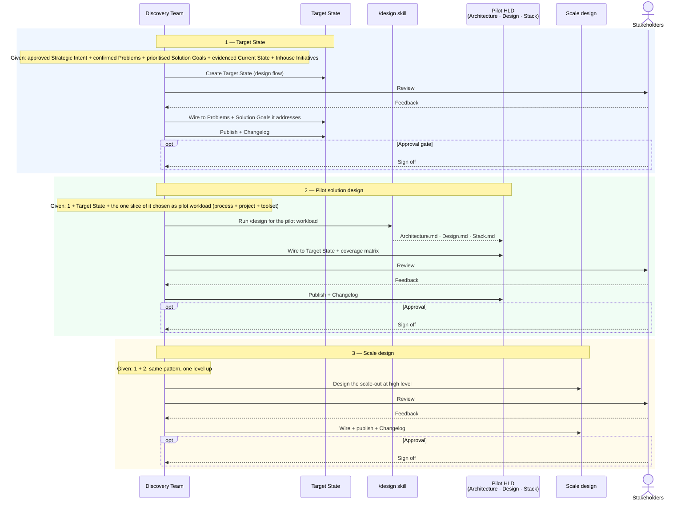

# Solution

_How an approved Gate Review turns into a Target State, a piloted solution design, and a high-level Scale design — the three flows Gate 2 closes on. Each follows the same given → design → review → wire → publish → approval(opt) shape._

**1 — Target State.** Given the approved [Strategic Intent](/AI%20SDLC/04%20Goals/02%20Strategic%20Intent.md), confirmed Problems, prioritised Solution Goals, evidenced Current State, and any [Inhouse Initiative](/AI%20SDLC/02%20Capture/02%20Inhouse%20Initiatives/Overview.md) already running, draft [Target State](/AI%20SDLC/05%20Solution%20Space/02%20Target%20State/00%20Overview.md) — the concrete end-state picture. Review, wire it to what it addresses, publish. The approval gate here is optional: some engagements need sign-off before pilot design starts, others fold it into step 2's review.

**2 — Pilot solution design.** Given Target State, carve out the one slice of it that becomes the pilot workload — which process slice, which project, which toolset proves the hypothesis first. Pilot isn't identified independently of Target State; it's the piece of it the team commits to proving. The actual topology, context/bootstrap, and process↔context↔code wiring is an architecture decision, not a Solution Space page. Run `/design` for that pilot; it produces the HLD-level spec (`Architecture.md`, `Design.md`, `Stack.md`) in [Target Architecture (HLD)](/Target%20Architecture%20%28HLD%29/). Wire the result back into [Pilot](/AI%20SDLC/05%20Solution%20Space/03%20Pilot/01%20Overview.md)'s coverage matrix, review, publish.

**3 — Scale design.** Same pattern as step 2, one level up: given the pilot's proof points, design how the pattern extends beyond it — at the high level, not down to implementation. Wire into [Scale](/AI%20SDLC/05%20Solution%20Space/04%20Scale.md).

Gate 2 closes once Target State, Pilot design, and (where run) Scale design are all published and reviewed — that's what unlocks the [Roadmap workflow](../05%20Roadmap/00%20Overview.md).
