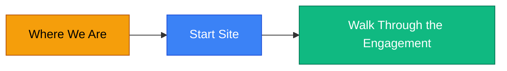
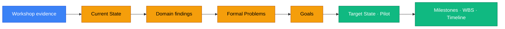

# Quick Walkthrough

_Three prompts for exploring the engagement with any harness-compatible AI assistant._



Use the prompts below in one conversation so the assistant can keep the site and browser context available.

## 1 — Where Are We?

**Prompt**

```text
Where are we in the engagement?
```

The answer should come from [Where We Are — Engagement](../04%20Where%20We%20Are/01%20Engagement.md) and the active phase tracker, not from document count or assumptions.

## 2 — Start the Site

**Prompt**

```text
Run the documentation site locally and open the preview.
```

The repository command is:

```bash
yarn nx run site:serve
```

Open the local URL it returns.

## 3 — Walk Through the Engagement

**Prompt**

```text
Walk me through the engagement in the visible browser, starting at Process Overview.
Navigate through Capture → Problems → Goals → Solution → Roadmap. At each step,
open an artifact, scroll the relevant area into view, and highlight it if supported
(otherwise point to it with the cursor). Explain how it feeds the next step and
show its sources, status, and gaps. Keep each area visible for at least 3 seconds
after highlighting it before scrolling or navigating onward.
Then show the gates and evidence chain at the same pace, and finish at
Where We Are with the next open decision.
```

Start at [Process Overview](../03%20Process/01%20Overview.md), then follow the five steps:

| Step                      | Open                                                                                                                                                          | Inspect                                                        |
| ------------------------- | ------------------------------------------------------------------------------------------------------------------------------------------------------------- | -------------------------------------------------------------- |
| Capture the Current State | [Workshops](/AI%20SDLC/02%20Capture/00%20Overview.md) → [Current State — Process](/AI%20SDLC/02%20Capture/01%20Current%20State/Process.md)                    | Source records and how work happens today.                     |
| Diagnose the Problems     | [Problem Space](/AI%20SDLC/03%20Problem%20Space/01%20Overview.md) → [Problems Registry](/AI%20SDLC/03%20Problem%20Space/02%20Diagnose/02%20Problems.md)       | Domain findings, root causes, citations, and confidence.       |
| Align the Goals           | [Strategic Intent](/AI%20SDLC/04%20Goals/02%20Strategic%20Intent.md) → [Solution Goals](/AI%20SDLC/04%20Goals/03%20Solution%20Goals.md)                       | How evidenced problems ground and re-scope intent.             |
| Engineer the Solution     | [Target State](/AI%20SDLC/05%20Solution%20Space/02%20Target%20State/00%20Overview.md) → [Pilot](/AI%20SDLC/05%20Solution%20Space/03%20Pilot/01%20Overview.md) | Goal coverage, proposed design, and pilot approval status.     |
| Sequence the Roadmap      | [Milestones](/AI%20SDLC/06%20Roadmap/02%20Milestones.md) → [WBS](/AI%20SDLC/06%20Roadmap/03%20WBS.md) → [Timeline](/AI%20SDLC/06%20Roadmap/04%20Timeline.md)  | Dependencies, owners, sequencing, and remaining planning gaps. |

Then open [How the Engagement Runs](../03%20Process/03%20How%20the%20Engagement%20Runs.md) and [Evidence Chain](../03%20Process/04%20Evidence%20Chain.md) to connect the artifacts to the gates and source traceability.

Read every warning, evidence tier, status, and open item. A populated-looking template is not necessarily confirmed engagement content.

Ask the assistant to derive the current chain from those pages each time. The shape should remain:



The assistant should report the evidence tier, status, and gaps it actually finds rather than treating this structural diagram as the engagement's current status.

Finish by returning to [Where We Are — Engagement](../04%20Where%20We%20Are/01%20Engagement.md). Name the next open decision and its owner if recorded. Missing Solution or Roadmap content is a gap to report, not a reason to invent an approved plan. The current discovery skill hands those phases off for manual work.
